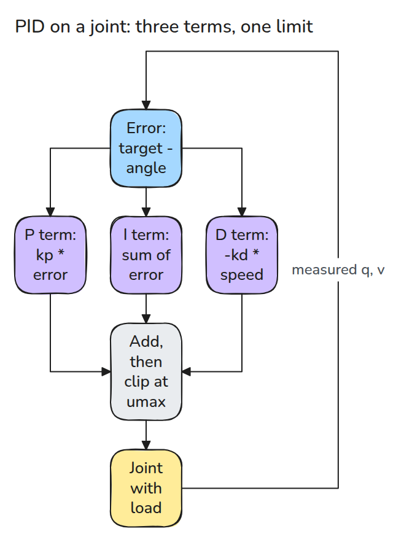
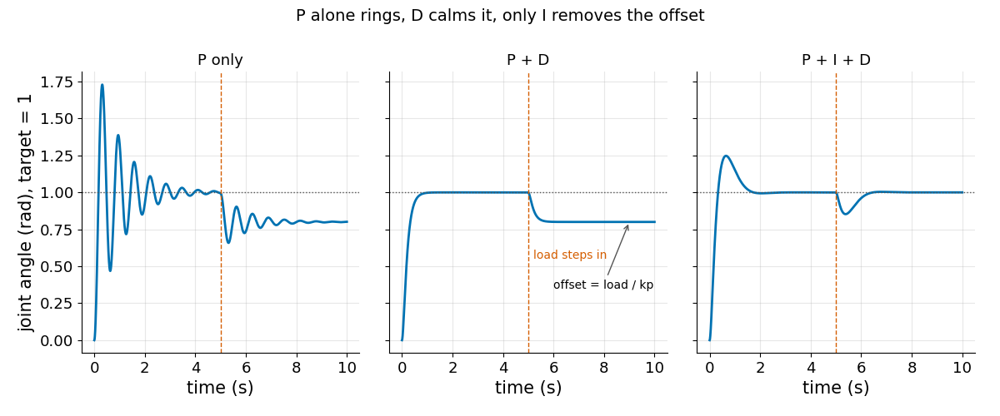
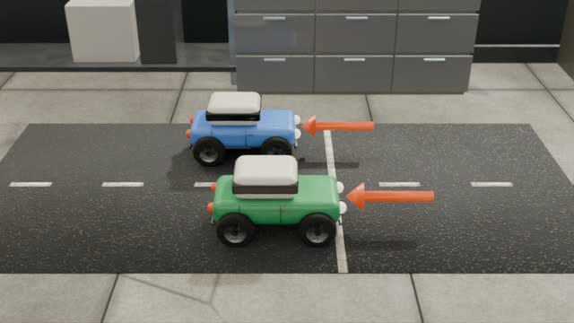
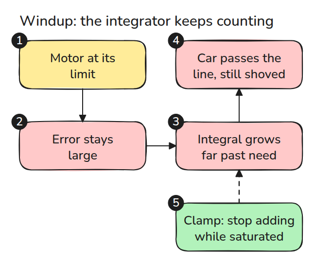
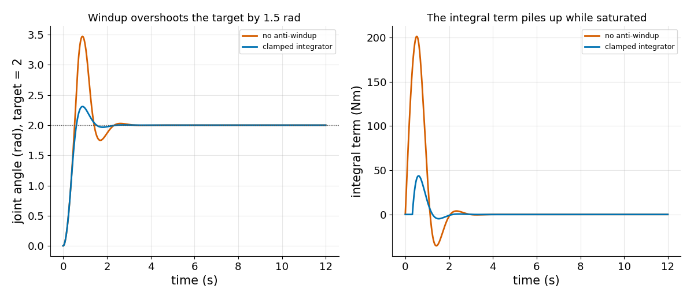
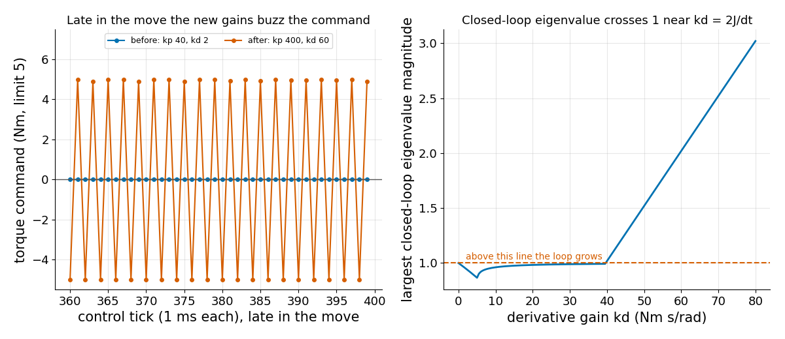

# PID and Tuning

> Learn how the three parts of the most common controller work, and what goes wrong when you turn them up.

**Type:** Build   **Prerequisites:** 03/01 The Sampling Limit, 03/03 Impedance Control   **Time:** ~15 minutes

## In Plain Words

A controller with three parts, P, I and D, steers a toy car to a stop line. P pushes harder the farther the car is from the line. D brakes harder the faster it moves. I adds push the longer the car stays short, beating a headwind. With the pedal on the floor, I keeps adding up the miss anyway, then shoves the car past the line. Anti-windup stops that.

## Key Terms

- **PID**: a way to steer something with three parts: P (the error), I (the error added up over time) and D (a brake on speed).
- **Gain**: how strongly a controller reacts, such as push per unit of error.
- **Steady offset**: the error left when something pushes on the joint all the time and only P and D are working.
- **Saturation**: the motor is at its torque limit and cannot push harder.
- **Windup**: the I part keeps growing during saturation, then causes overshoot.
- **Stable**: a loop that settles instead of buzzing or blowing up.

## The Problem

A robot joint shook, so someone turned up the push and brake strengths (the gains). Now it buzzes. The gains look like free knobs, but the joint, the motor and the control rate all limit them.

## The Concept

Most robot joints use PID control, so know what each part does and where it fails. P pushes in proportion to the error, D brakes in proportion to the speed, and I adds up the error over time.



*Three parts add up; the motor clips the sum.*



*A steady load: only I brings the joint back.*

[](../assets/clip-example.mp4)

*A steady push: blue (P and D) stays short, green (with I) returns.*

But I keeps adding even when the motor is at its limit, then overshoots to pay the debt back: windup.



*The fix stops adding at the limit.*



*Orange has no fix and overshoots.*



*Too-high gains flip the command each step.*

<details><summary>The math (optional)</summary>

A steady load leaves an offset `load / kp` under P+D. With `kp = 100` and a push of 20 the offset is `20 / 100 = 0.2`; the load steps in at 5 s. Windup overshoots by about 1.5 rad without the clamp. ROS 2 `control_toolbox` offers `none`, `back_calculation` and `conditional_integration` anti-windup, chosen per joint via `gains.<dof_names>.antiwindup_strategy`. The loop is stable only while the eigenvalues (how much each motion pattern is multiplied per tick) of its update matrix stay below 1 in size. The 2x2 matrix covers P and D; with I the stored I term is a third state (`spectral_radius(..., ki=ki)`), and `ki = 50000` gives 1.006 where P+D alone gives 0.946 (`J = 0.02`, `kp = 400`, `kd = 2`). Saturation is not covered. `kd` above about `2J/dt` breaks the P+D part (Craig 9.7).

</details>

## Build It

Four lines are the whole controller.

```python
raw = kp * e + I - kd * v
u = np.clip(raw, -umax, umax)
if u == raw or e * raw < 0:      # conditional integration
    I += ki * e * dt
v += dt / J * (u - b * v - load)
```

`simulate()` runs the loop and `spectral_radius()` gives the stability check.

```bash
cd robotics-engineering-from-scratch
python3 -m pytest phases/03-dynamics-and-control/04-pid-and-tuning -q
python3 phases/03-dynamics-and-control/04-pid-and-tuning/code/figure.py
```

## Use It

ROS 2's control toolbox has ready-made anti-windup. Compare it with the clamp here.

Sources: [control_toolbox docs](https://control.ros.org/master/doc/control_toolbox/doc/index.html), [PID controller user doc](https://control.ros.org/rolling/doc/ros2_controllers/pid_controller/doc/userdoc.html), checked 2026-11-09.

## Ship It

`outputs/skill-pid-tuning-check.md` reviews a gain change for offset, windup and the sampling limit.

## Exercises

1. Remove the clamp and watch the overshoot.
2. Raise `kd` until the command flips each step.
3. Lower `kd` until the buzzing stops.
