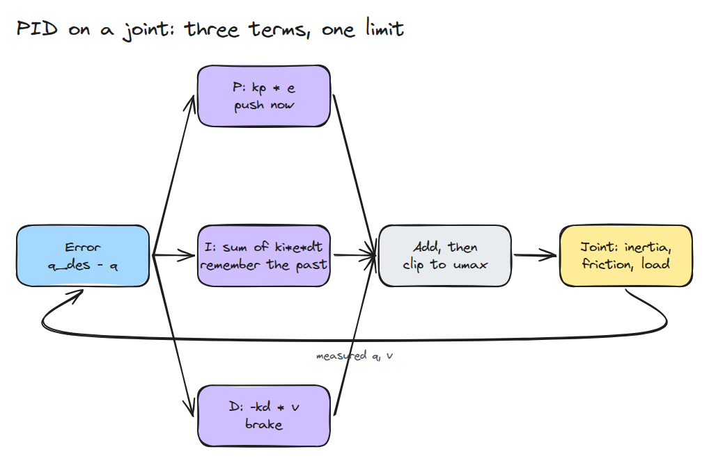
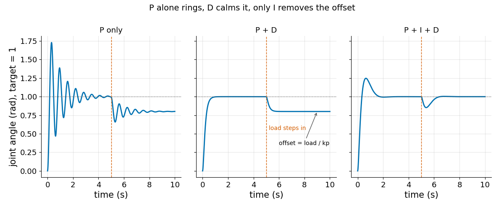
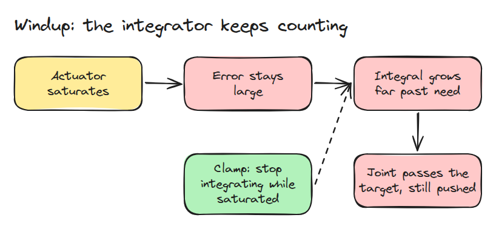
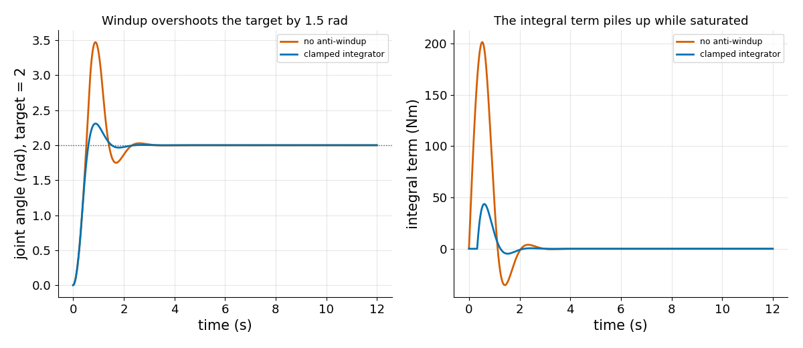
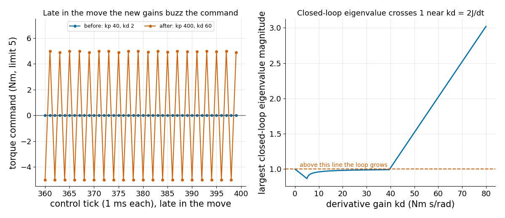

# PID and Tuning

> P pushes now, I remembers the past, D brakes. Each fixes one problem and causes another.

**Type:** Build   **Prerequisites:** 03/01 The Sampling Limit, 03/03 Impedance Control   **Time:** ~15 minutes

## The Problem

A joint oscillated, so someone raised `kp` and `kd` to stiffen it. Now it buzzes and the motor runs hot. PID gains look like three independent knobs, but each one has a limit set by the plant, the actuator and the control period.

## The Concept



*The joint has inertia `J`, friction `b` and a load. The controller sees only the measured angle and velocity.*



*A load steps in at 5 s. With P+D the joint settles `load / kp` below the target. Only the integral term brings it back.*

The integral term adds up error, so it keeps adding while the actuator is at its limit. That is windup.



*The fix used here is conditional integration: freeze the integral while saturated and the error pushes deeper.*



*Same gains and same torque limit. Without the clamp the joint overshoots the target by about 1.5 rad.*

Raising gains has a second limit. With one command held per tick, the loop is stable only while the eigenvalues of its 2x2 update matrix stay inside the unit circle. That is lesson 03/01 again: `kd` above about `2J/dt` makes the command flip every tick.



*Left: the torque command after the gain change. Right: the largest eigenvalue magnitude leaves 1 near `kd = 2J/dt`.*

## Build It

```python
raw = kp * e + I - kd * v
u = np.clip(raw, -umax, umax)
if u == raw or e * raw < 0:      # conditional integration
    I += ki * e * dt
v += dt / J * (u - b * v - load)
```

`simulate()` runs this loop. `closed_loop_matrix()` and `spectral_radius()` give the stability test. Tests check the offset `load / kp`, the effect of I and D, windup against the clamp, and that the eigenvalue predicts growth for both gain sets.

```bash
cd robotics-engineering-from-scratch
python3 -m pytest phases/03-dynamics-and-control/04-pid-and-tuning -q
python3 phases/03-dynamics-and-control/04-pid-and-tuning/code/figure.py
```

## Use It

ROS 2 `control_toolbox` offers `none`, `back_calculation` and `conditional_integration` anti-windup strategies; `pid_controller` picks one per joint via `gains.<dof_names>.antiwindup_strategy`. Compare its conditional integration on your plant with this lesson's clamp. Craig, Ch. 9 (section 9.7, disturbance rejection) covers the offset argument.

Sources: [control_toolbox docs](https://control.ros.org/master/doc/control_toolbox/doc/index.html) (the three strategies), [PID controller user doc](https://control.ros.org/rolling/doc/ros2_controllers/pid_controller/doc/userdoc.html) (the per-joint setting), checked 2026-11-09.

## Ship It

`outputs/skill-pid-tuning-check.md` reviews a gain change for offset, windup and the sampling limit.

## Exercises

1. Replace conditional integration with back-calculation and compare the overshoot.
2. Put the derivative on the error instead of the velocity and watch the setpoint step.
3. Find the largest `kp` that keeps the spectral radius below 1 at `kd = 20`.
