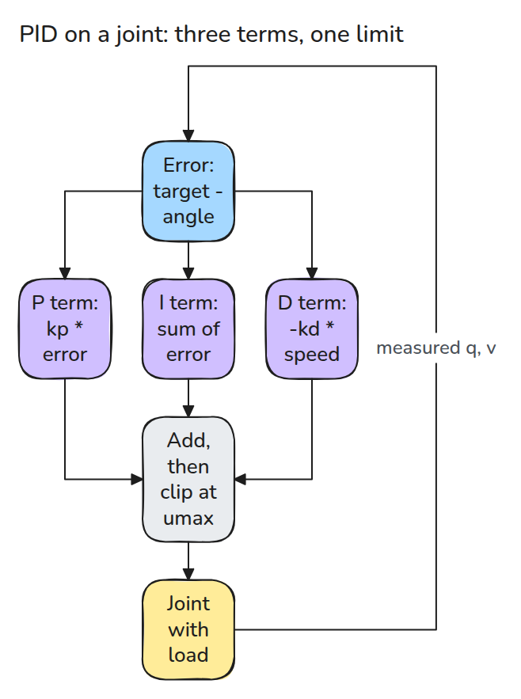
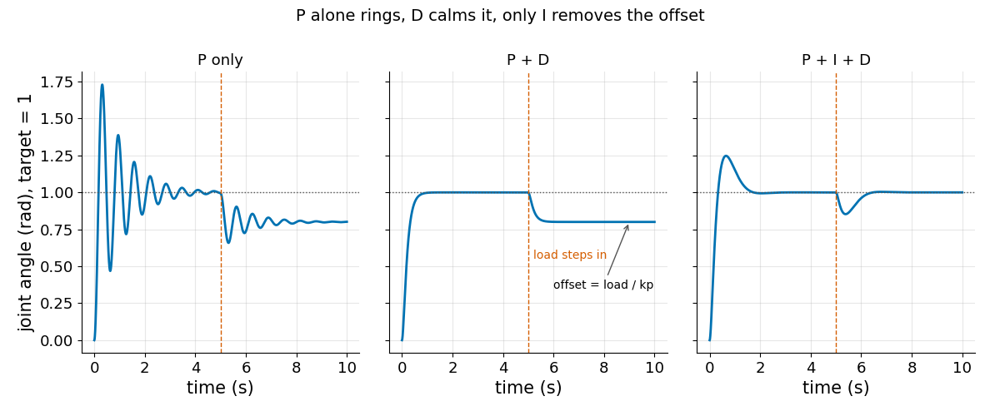
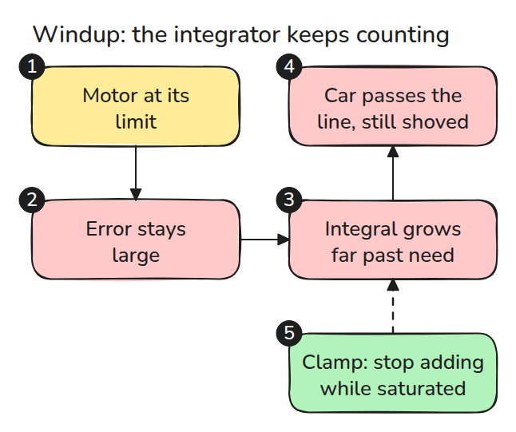
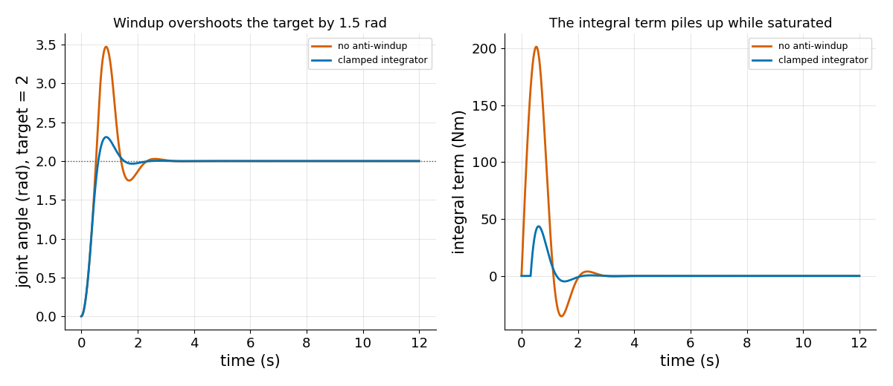
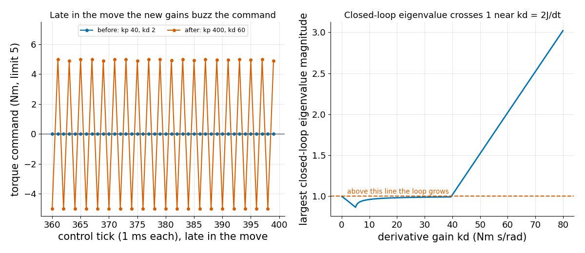

# PID와 튜닝 (PID and Tuning)

> P는 지금 밀고 I는 과거를 기억하고 D는 브레이크를 겁니다. 각각 한 문제를 풀고 다른 문제를 만듭니다.

**유형:** 만들기   **선수 지식:** 03/01 샘플링 한계, 03/03 임피던스 제어   **시간:** 약 15분

## 쉽게 말하면

장난감 자동차를 throttle(가속 페달)로 조종해 정지선에 세운다고 해 보세요. P는 차가 선에서 멀수록 더 세게 밟아요. D는 차가 빠를수록 더 세게 브레이크를 걸어요. I는 차가 선에 못 미친 채 있는 시간이 길수록 미는 힘을 더해서 계속 부는 맞바람도 이겨 내요.

throttle을 끝까지 밟고 있으면 I는 실제 힘을 더하지 못하는데도 계속 쌓아요. 그렇게 쌓인 힘이 차를 선 너머로 계속 밀어요. anti-windup은 throttle이 한계에 있는 동안 쌓는 것을 멈춰요.

## 문제

관절이 진동해서 누군가 `kp`(오차 한 단위당 미는 힘)와 `kd`(속도 한 단위당 거는 브레이크)를 올려 뻣뻣하게 만들었습니다. 이제 관절이 윙윙거리고 모터가 뜨거워집니다.

PID gain은 서로 독립인 손잡이처럼 보이지만 관절 자체와 모터의 토크 한계와 제어 주기가 각각 gain에 상한을 겁니다.

## 개념



*세 항이 더해지고 모터가 그 합을 `umax`에서 잘라 냅니다. 관절에는 관성 `J`와 마찰 `b`와 부하가 있고 컨트롤러는 측정된 각도와 속도만 봅니다.*



*5초에 일정한 부하가 걸린 뒤의 곡선을 보세요. P+D에서는 관절이 목표보다 `load / kp`만큼 아래에서 멈춥니다. 적분 항만 관절을 되돌립니다.*


*같은 경우를 장난감 자동차로 본 예입니다. 크기 20의 일정한 힘이 뒤로 밉니다(빨간 화살표). `kp = 100`일 때 파란 차(P+D)는 선에서 `20 / 100 = 0.2`만큼 밀린 채 서 있습니다. 초록 차(P+I+D)는 밀렸다가 선으로 돌아옵니다.*

적분 항(I)은 오차를 계속 더하고 모터가 한계에 있어도(saturated, 포화) 계속 더합니다. 쌓인 값은 오차의 부호가 바뀐 뒤에야 줄어들어서 차가 선을 지나쳐야 갚을 수 있습니다. 이것이 windup입니다.



*빨간 상자를 따라가 보세요. 여기서 쓰는 해법은 조건부 적분(clamp)으로, 모터가 포화되어 있고 오차가 더 깊이 밀 때는 더하기를 멈춥니다.*



*주황색 곡선이 clamp 없는 관절입니다. gain과 토크 한계가 같은데도 목표를 약 1.5 rad 넘어갑니다.*

gain을 올릴 때는 두 번째 한계가 있고 레슨 03/01과 같은 이야기입니다. loop는 2x2 갱신 행렬의 고유값(각 움직임 패턴이 tick마다 몇 배가 되는지)의 크기가 1보다 작을 때만 안정합니다.

`kd`가 약 `2J/dt`를 넘으면 이 조건이 깨져서 명령이 tick마다 부호를 뒤집습니다.



*왼쪽은 gain을 바꾼 뒤의 토크 명령입니다. 오른쪽은 가장 큰 고유값 크기가 `kd = 2J/dt` 근처에서 1을 넘는 모습입니다.*

## 만들기

```python
raw = kp * e + I - kd * v
u = np.clip(raw, -umax, umax)
if u == raw or e * raw < 0:      # conditional integration
    I += ki * e * dt
v += dt / J * (u - b * v - load)
```

`simulate()`가 이 loop를 돌립니다. `closed_loop_matrix()`와 `spectral_radius()`(가장 큰 고유값 크기)가 안정성 검사를 맡습니다.

테스트는 offset `load / kp`, I와 D의 효과, clamp를 건 windup 비교를 확인하고 두 gain 조합 모두에서 고유값이 발산 여부를 맞히는지 확인합니다.

```bash
cd robotics-engineering-from-scratch
python3 -m pytest phases/03-dynamics-and-control/04-pid-and-tuning -q
python3 phases/03-dynamics-and-control/04-pid-and-tuning/code/figure.py
```

## 실제 도구로 보기

ROS 2 `control_toolbox`는 `none`, `back_calculation`, `conditional_integration` anti-windup 전략을 줍니다.

관절마다 하나를 고르는 설정은 `pid_controller` 사용자 문서의 `gains.<dof_names>.antiwindup_strategy`입니다.

자기 plant(제어 대상)에서 그 conditional integration을 이 레슨의 clamp와 비교해 보세요. offset 논증은 Craig 9장(9.7절, disturbance rejection)에 있습니다.

출처 (2026년 11월 9일 확인)

- [control_toolbox 문서](https://control.ros.org/master/doc/control_toolbox/doc/index.html): 전략 세 가지
- [PID controller 사용자 문서](https://control.ros.org/rolling/doc/ros2_controllers/pid_controller/doc/userdoc.html): 관절별 설정

## 결과물

`outputs/skill-pid-tuning-check.md`는 gain 변경을 offset과 windup과 샘플링 한계 관점에서 점검합니다.

## 연습 문제

1. 조건부 적분을 back-calculation으로 바꾸고 overshoot를 비교하세요.
2. 미분을 속도 대신 오차에 걸고 setpoint step에서 어떻게 되는지 보세요.
3. `kd = 20`에서 spectral radius를 1 아래로 유지하는 가장 큰 `kp`를 찾으세요.
