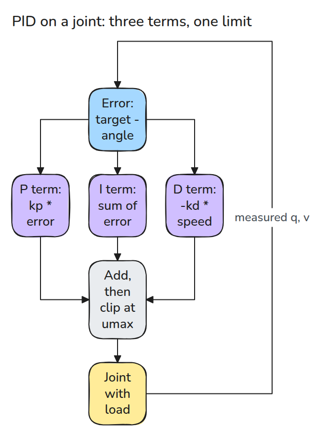
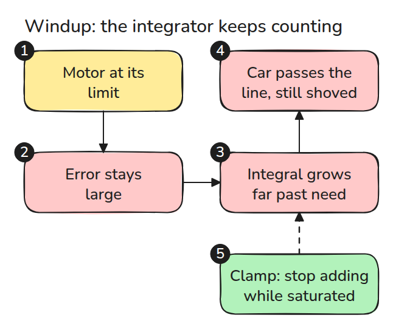
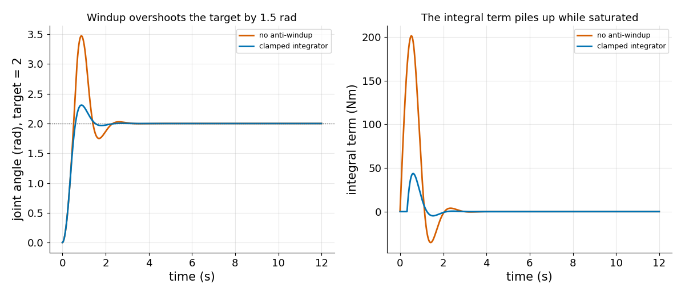
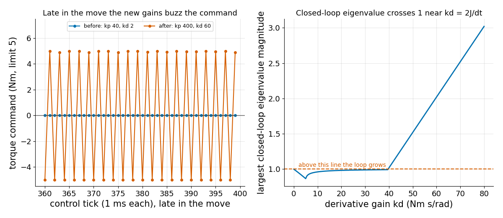

# PID와 튜닝 (PID and Tuning)

> 가장 흔한 컨트롤러의 세 부분이 어떻게 일하는지, 그리고 올리면 무엇이 잘못되는지 알게 됩니다.

**유형:** 만들기   **선수 지식:** 03/01 샘플링 한계, 03/03 임피던스 제어   **시간:** 약 15분

## 쉽게 말하면

P, I, D 세 부분을 가진 컨트롤러가 장난감 자동차를 정지선에 세운다고 해 보세요. P는 차가 선에서 멀수록 더 세게 밀어요. D는 빠를수록 더 세게 브레이크를 걸어요. I는 차가 선에 못 미친 채 있는 시간이 길수록 미는 힘을 더해서 계속 부는 맞바람도 이겨 내요.

페달을 끝까지 밟고 있어도 I는 못 미친 만큼을 계속 쌓고 나중에 차를 선 너머로 밀어요. anti-windup은 그것을 멈춰요.

## 핵심 용어

- **PID**: 세 부분으로 조종하는 방법입니다. P(오차)와 I(시간에 따라 쌓은 오차)와 D(속도에 거는 브레이크)입니다.
- **Gain**: 컨트롤러가 얼마나 세게 반응하는지입니다. 예를 들어 오차 한 단위당 미는 힘입니다.
- **Steady offset**: 무언가가 관절을 계속 밀고 P와 D만 일하고 있을 때 남는 오차입니다.
- **Saturation**: 모터가 토크 한계에 닿아서 더 세게 밀 수 없는 상태입니다.
- **Windup**: 포화된 동안 I 부분이 계속 쌓였다가 overshoot를 일으키는 현상입니다.
- **Stable**: 윙윙거리거나 폭주하지 않고 가라앉는 loop입니다.

## 문제

로봇 관절이 진동해서 누군가 미는 힘과 브레이크의 세기(gain)를 올렸습니다. 이제 관절이 윙윙거립니다. gain은 자유로운 손잡이처럼 보이지만 관절의 무게와 모터의 힘과 제어 주기가 각각 gain에 한계를 겁니다.

## 개념

로봇 관절 대부분은 PID 제어를 쓰므로 각 부분이 무엇을 하고 어디서 실패하는지 알아야 합니다. P는 오차에 비례해서 밀고 D는 속도에 비례해서 브레이크를 걸고 I는 오차를 시간에 따라 쌓습니다.



*세 항이 더해지고 모터가 그 합을 잘라 냅니다.*


*일정한 부하가 걸리면 I만 관절을 되돌립니다.*


*일정한 힘이 밉니다. 파랑(P와 D)은 못 미치고 초록(I 포함)은 돌아옵니다.*

그런데 I는 모터가 한계에 있어도 계속 쌓다가 그 빚을 갚느라 지나칩니다. 이것이 windup입니다.



*해법은 한계에서 쌓는 것을 멈추는 것입니다.*



*주황색은 해법이 없어서 지나칩니다.*

gain이 너무 높으면 loop가 단계별로 안정한 조건도 깨집니다.



*gain이 너무 높으면 명령이 단계마다 뒤집힙니다.*

<details><summary>The math (optional)</summary>

일정한 부하는 P+D에서 offset `load / kp`를 남깁니다. `kp = 100`이고 힘이 20이면 offset은 `20 / 100 = 0.2`이고 부하는 5초에 걸립니다. clamp가 없으면 windup으로 약 1.5 rad 넘어갑니다.
ROS 2 `control_toolbox`는 `none`, `back_calculation`, `conditional_integration` anti-windup을 주고 `gains.<dof_names>.antiwindup_strategy`로 관절마다 고릅니다.
loop는 2x2 갱신 행렬의 고유값(각 움직임 패턴이 tick마다 몇 배가 되는지) 크기가 모두 1보다 작을 때만 안정하고 `kd`가 약 `2J/dt`를 넘으면 깨집니다(Craig 9.7).

</details>

## 만들기

네 줄이 컨트롤러 전부입니다. 세 항을 더하고 모터 한계로 자르고 안전할 때만 기억에 더합니다.

```python
raw = kp * e + I - kd * v
u = np.clip(raw, -umax, umax)
if u == raw or e * raw < 0:      # conditional integration
    I += ki * e * dt
v += dt / J * (u - b * v - load)
```

`simulate()`가 loop를 돌리고 `spectral_radius()`가 안정성 검사를 맡습니다.

```bash
cd robotics-engineering-from-scratch
python3 -m pytest phases/03-dynamics-and-control/04-pid-and-tuning -q
python3 phases/03-dynamics-and-control/04-pid-and-tuning/code/figure.py
```

## 실제 도구로 보기

ROS 2의 control toolbox에는 만들어진 anti-windup이 있습니다. 이 레슨의 clamp와 비교해 보세요.

출처: [control_toolbox 문서](https://control.ros.org/master/doc/control_toolbox/doc/index.html), [PID controller 사용자 문서](https://control.ros.org/rolling/doc/ros2_controllers/pid_controller/doc/userdoc.html), 2026년 11월 9일 확인.

## 결과물

`outputs/skill-pid-tuning-check.md`는 gain 변경을 offset과 windup과 샘플링 한계 관점에서 점검합니다.

## 연습 문제

1. clamp를 빼고 overshoot를 보세요.
2. 명령이 단계마다 뒤집힐 때까지 `kd`를 올려 보세요.
3. 윙윙거림이 멈출 때까지 `kd`를 낮춰 보세요.
