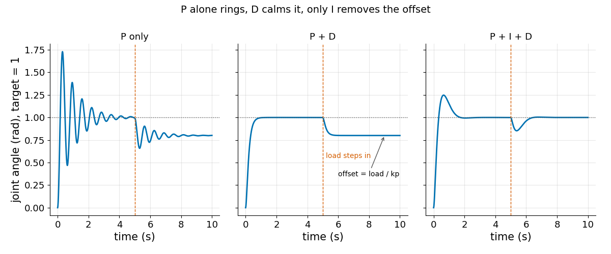

# PID와 튜닝 (PID and Tuning)

> 가장 흔한 컨트롤러의 세 부분이 어떻게 일하는지, 그리고 올리면 무엇이 잘못되는지 알게 됩니다.

**유형:** 만들기   **선수 지식:** 03/01 샘플링 한계, 03/03 임피던스 제어   **시간:** 약 15분

## 쉽게 말하면

장난감 자동차를 정지선에 세운다고 해 보세요. P는 차가 선에서 멀수록 더 세게 밟고 D는 빠를수록 더 세게 브레이크를 걸어요. I는 차가 선에 못 미친 채 있는 시간이 길수록 미는 힘을 더해서 계속 부는 맞바람도 이겨 내요.

throttle(가속 페달)을 끝까지 밟고 있으면 I는 실제 힘을 더하지 못하는데도 계속 쌓고 쌓인 힘이 차를 선 너머로 밀어요. anti-windup은 한계에 있는 동안 쌓는 것을 멈춰요.

## 핵심 용어

- **PID**: P 항(오차)과 I 항(시간에 따라 쌓은 오차)과 D 항(속도 브레이크)을 더하는 컨트롤러입니다.
- **Steady offset**: 일정한 부하가 P+D만 있는 제어를 계속 밀 때 남는 오차입니다.
- **Saturation**: 모터가 토크 한계에 닿아서 더 세게 밀 수 없는 상태입니다.
- **Windup**: 포화된 동안 적분이 계속 쌓였다가 overshoot를 일으키는 현상입니다.
- **Eigenvalue**: 한 움직임 패턴이 tick마다 몇 배가 되는지를 나타내는 숫자로 모두 크기가 1보다 작으면 loop가 안정합니다.
- **Plant**: 제어 대상으로 여기서는 관절과 모터입니다.

## 문제

로봇 관절이 진동해서 누군가 `kp`(오차 한 단위당 미는 힘)와 `kd`(속도 한 단위당 거는 브레이크)를 올렸습니다. 이제 관절이 윙윙거립니다.

각 gain은 독립인 손잡이처럼 보이지만 관절 자체와 모터의 토크 한계와 제어 주기가 각각 gain에 상한을 겁니다.

## 개념

로봇 관절 대부분은 PID 컨트롤러로 움직이므로 각 부분이 무엇을 하고 어디서 실패하는지 알아야 합니다.


*세 항이 더해지고 모터가 그 합을 `umax`에서 잘라 냅니다.*



*5초에 일정한 부하가 걸립니다. P+D는 목표보다 `load / kp`만큼 아래에서 멈추고 I만 관절을 되돌립니다.*


*크기 20의 일정한 힘이 뒤로 밉니다(빨간 화살표). `kp = 100`일 때 파란 차(P+D)는 선에서 `20 / 100 = 0.2`만큼 밀린 채 서 있고 초록 차(P+I+D)는 밀렸다가 선으로 돌아옵니다.*

windup은 I가 포화된 동안에도 오차를 계속 더하고 오차의 부호가 바뀐 뒤에야 줄어드는 현상이라서 차가 선을 지나쳐야 갚을 수 있습니다.


*조건부 적분(clamp)은 모터가 포화되어 있고 오차가 더 깊이 밀 때는 더하기를 멈춥니다.*


*주황색은 clamp가 없는 경우입니다. gain과 한계가 같은데도 약 1.5 rad 넘어갑니다.*

gain을 올릴 때는 두 번째 한계가 있습니다. loop는 2x2 갱신 행렬의 고유값 크기가 모두 1보다 작을 때만 안정하고 `kd`가 약 `2J/dt`를 넘으면 이 조건이 깨집니다.


*왼쪽은 gain을 바꾼 뒤의 torque 명령입니다. 오른쪽은 가장 큰 고유값이 `kd = 2J/dt` 근처에서 1을 넘는 모습입니다.*

## 만들기

```python
raw = kp * e + I - kd * v
u = np.clip(raw, -umax, umax)
if u == raw or e * raw < 0:      # conditional integration
    I += ki * e * dt
v += dt / J * (u - b * v - load)
```

`simulate()`가 이 loop를 돌립니다. `closed_loop_matrix()`와 `spectral_radius()`(가장 큰 고유값 크기)가 안정성 검사를 맡습니다.

테스트는 offset `load / kp`, I와 D의 효과, clamp를 건 windup 비교를 확인합니다.

```bash
cd robotics-engineering-from-scratch
python3 -m pytest phases/03-dynamics-and-control/04-pid-and-tuning -q
python3 phases/03-dynamics-and-control/04-pid-and-tuning/code/figure.py
```

## 실제 도구로 보기

ROS 2 `control_toolbox`는 `none`, `back_calculation`, `conditional_integration` anti-windup 전략을 줍니다.

`pid_controller`에서는 관절마다 `gains.<dof_names>.antiwindup_strategy`로 하나를 고릅니다.

그 conditional integration을 이 레슨의 clamp와 비교해 보세요. offset 논증은 Craig 9.7절에 있습니다.

출처 (2026년 11월 9일 확인)

- [control_toolbox 문서](https://control.ros.org/master/doc/control_toolbox/doc/index.html): 전략 세 가지
- [PID controller 사용자 문서](https://control.ros.org/rolling/doc/ros2_controllers/pid_controller/doc/userdoc.html): 관절별 설정

## 결과물

`outputs/skill-pid-tuning-check.md`는 gain 변경을 offset과 windup과 샘플링 한계 관점에서 점검합니다.

## 연습 문제

1. 조건부 적분을 back-calculation으로 바꾸고 overshoot를 비교하세요.
2. 미분을 오차에 걸고 setpoint step에서 어떻게 되는지 보세요.
3. `kd = 20`에서 spectral radius를 1 아래로 유지하는 가장 큰 `kp`를 찾으세요.
