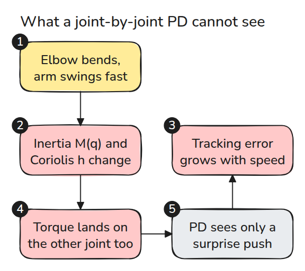
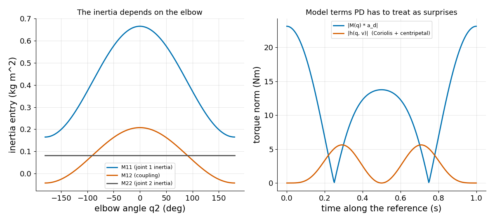

# Computed Torque

> Learn how to cancel an arm's own swing forces in advance, so a fast motion stays on track.

**Type:** Build   **Prerequisites:** 03/03 Impedance Control, 03/04 PID and Tuning   **Time:** ~15 minutes

## In Plain Words

A two-link arm sweeps across a table. With the elbow straight the same swing takes more shoulder torque, and a fast swing makes each link tug on the other.

Computed torque works out from the arm's equations the torque these effects demand and supplies it in advance. A small correction handles the leftover error.

## Key Terms

- **Computed torque**: using the arm's equations to cancel its dynamics, then controlling what is left.
- **Dynamics**: the equations linking torques to joint motion.
- **Inertia matrix (`M`)**: how heavy the arm feels to each joint; it changes with the elbow angle.
- **Coriolis torque**: the pull links exert on each other when they swing fast.
- **PD controller**: pushes by the error and brakes by the speed.
- **Reference**: the planned path the arm should follow.

## The Problem

A joint-by-joint PD controller makes a robot arm follow a slow motion well. Four times faster, the arm lags and wobbles, because inertia and coupling torques now dominate.

## The Concept

Fast motion makes an arm's links pull on each other; a good controller predicts that.



*PD sees the elbow's inertia change and the Coriolis torque as surprise pushes.*

For a horizontal 2-link arm `tau = M(q) qdd + h(q, qd)` (`qd`, `qdd`: speed and acceleration; `h`: Coriolis and centripetal torques; gravity left out). Computed torque picks `tau = M(q) a + h(q, qd)` with `a = qdd_d + kd ed + kp e` (planned acceleration plus PD on the errors `e`, `ed`). The model cancels the arm, so `qdd = a` and `e'' + kd e' + kp e = 0`.


*Inner layer: the model. Outer layer: PD on the error.*



*Left: joint-1 inertia changes about fourfold with the elbow. Right: the dynamic torques are large.*


*A 1 s swing, both tuned to `omega = 20`: computed torque has about 300 times less error.*

Example: real `m1` is 20% larger and `m2` 20% smaller than modelled. PD peaks at 0.19 rad of error; computed torque peaks at 0.038 rad.


*Blue (PD) lags by up to 0.19 rad; green (computed torque) stays close.*

## Build It

```python
M = mass(q, model)                      # 2x2, depends on the elbow angle
a = qdd_d + 2*w*(qd_d - qd) + w*w*(q_d - q)
tau = M @ a + coriolis(q, qd, model)    # Coriolis and centripetal terms
```

Tests check `M` against kinetic energy, `M qdd + h` against a numeric Lagrangian, and energy conservation in free motion.

```bash
cd robotics-engineering-from-scratch
python3 -m pytest phases/03-dynamics-and-control/05-computed-torque -q
python3 phases/03-dynamics-and-control/05-computed-torque/code/figure.py
```

## Use It

MuJoCo's `mj_inverse` returns `qfrc_inverse`, the torque for a given `qacc`; one test compares it with `inverse_dynamics` to 1e-9. Craig, Ch. 10, covers the control law.

Sources: [MuJoCo API reference](https://mujoco.readthedocs.io/en/stable/APIreference/APIfunctions.html), checked 2026-11-09.

## Ship It

`outputs/skill-computed-torque-check.md` reviews a model-based controller.

## Exercises

1. Add gravity (03/02) to `h` and add its potential to the energy test.
2. Scale one mass by 0.5 to 1.5 and plot the maximum error.
3. Run at 100 Hz instead of 1 kHz; where does the error floor move?
