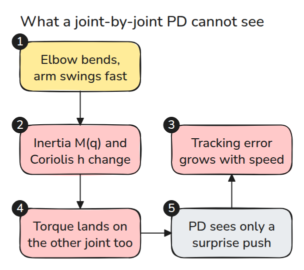
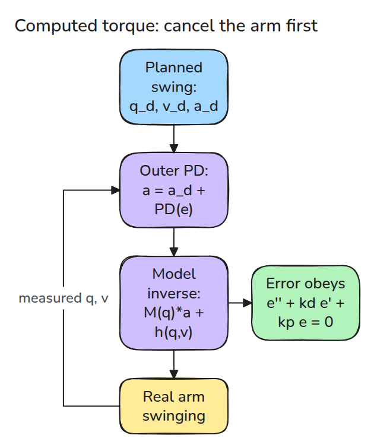
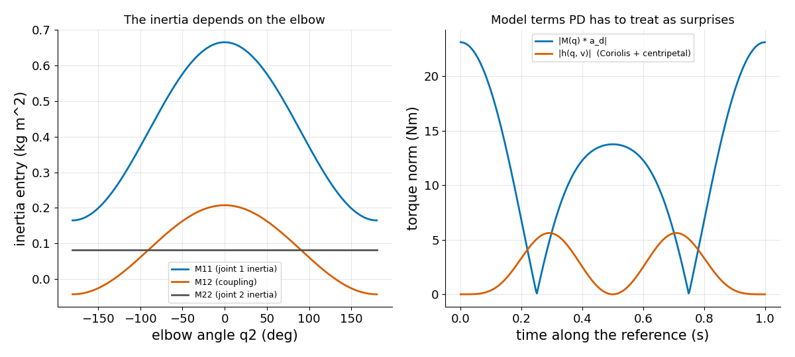
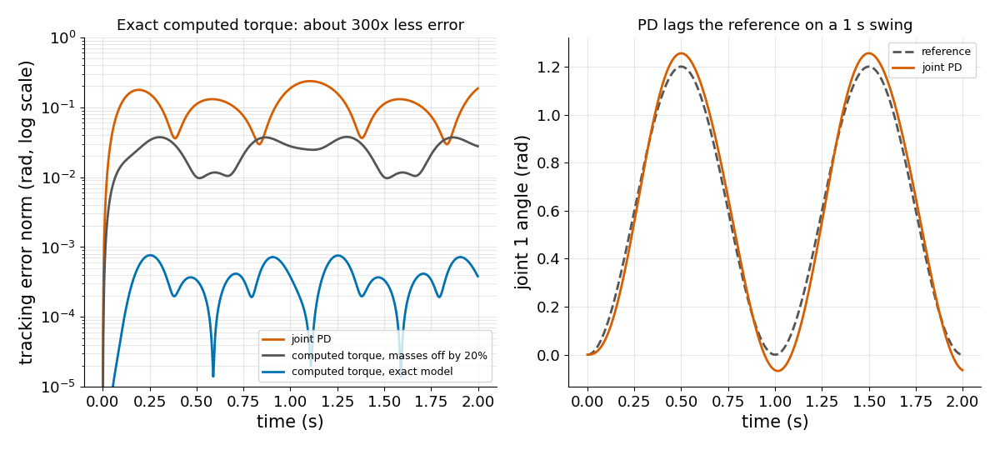

# Computed Torque

> If you know the arm's equations, use them to cancel the arm, then control what is left.

**Type:** Build   **Prerequisites:** 03/03 Impedance Control, 03/04 PID and Tuning   **Time:** ~15 minutes

## In Plain Words

Picture a two-link arm sweeping across a table. With the elbow straight, the hand is far from the shoulder, so the same swing takes more shoulder torque than with the elbow bent. A fast swing also makes each link tug on the other.

Computed torque works out from the arm's equations the torque these effects demand and supplies it in advance. A small correction handles the leftover error. If the model's masses are wrong, part of that torque is missing.

## The Problem

A joint-by-joint PD controller (push by error, brake by speed) tracks a slow motion well. Make the same motion four times faster and the arm lags and wobbles, because inertia and coupling torques, small at low speed, now dominate.

## The Concept



*The elbow angle changes the inertia, and fast swinging adds Coriolis torque (the links' spin tugging on each other). PD sees both as surprise pushes.*

For a horizontal 2-link arm the dynamics are `tau = M(q) qdd + h(q, qd)` (`q`: joint angles, `qd` and `qdd`: their speed and acceleration). `M` is the inertia matrix (how heavy the arm feels to each joint) and `h` holds the Coriolis and centripetal torques. Gravity (lesson 03/02) is left out. Computed torque picks `tau = M(q) a + h(q, qd)` with `a = qdd_d + kd ed + kp e`, where `qdd_d` is the planned acceleration and `e`, `ed` are the position and velocity errors. Since `tau = M qdd + h` too, the model cancels the arm: `qdd = a`, so the error obeys `e'' + kd e' + kp e = 0`, a spring and damper settling to zero.



*The inner layer is the model. The outer layer is a plain PD on the error.*



*Left: joint-1 inertia changes by a factor of about four with the elbow. Right: along the reference, the inertial and Coriolis torques are large.*



*A 1 s swing, both controllers tuned to `omega = 20`. With the exact model computed torque has about 300 times less error than PD.*

Example: the real `m1` is 20% larger and `m2` 20% smaller than the model says. PD peaks at 0.19 rad of error. Computed torque with the wrong model peaks at 0.038 rad, about five times less.


*Watch the tips against the translucent reference arms (the planned path): blue (PD) lags by up to 0.19 rad, green (computed torque) stays close despite the wrong masses. One-third speed.*

## Build It

```python
M = mass(q, model)                      # 2x2, depends on the elbow angle
a = qdd_d + 2*w*(qd_d - qd) + w*w*(q_d - q)
tau = M @ a + coriolis(q, qd, model)    # Coriolis and centripetal terms
```

Tests check `M` against the kinetic energy computed from Cartesian velocities, `M qdd + h` against a numeric Lagrangian, and that free motion conserves kinetic energy, which tests the Coriolis sign.

```bash
cd robotics-engineering-from-scratch
python3 -m pytest phases/03-dynamics-and-control/05-computed-torque -q
python3 phases/03-dynamics-and-control/05-computed-torque/code/figure.py
```

## Use It

MuJoCo's `mj_inverse` returns `qfrc_inverse`, the torque for a given `qacc`. One test builds the same arm in MuJoCo and compares it with `inverse_dynamics` to 1e-9. Craig, Ch. 10, covers the nonlinear control law.

Sources: [MuJoCo API reference](https://mujoco.readthedocs.io/en/stable/APIreference/APIfunctions.html), checked 2026-11-09.

## Ship It

`outputs/skill-computed-torque-check.md` reviews a model-based controller for model error and sampling.

## Exercises

1. Add gravity from lesson 03/02 to `h` and keep the energy test valid by adding the potential.
2. Scale one mass by 0.5 to 1.5 and plot the maximum error.
3. Run computed torque at 100 Hz instead of 1 kHz and see where the error floor moves.
