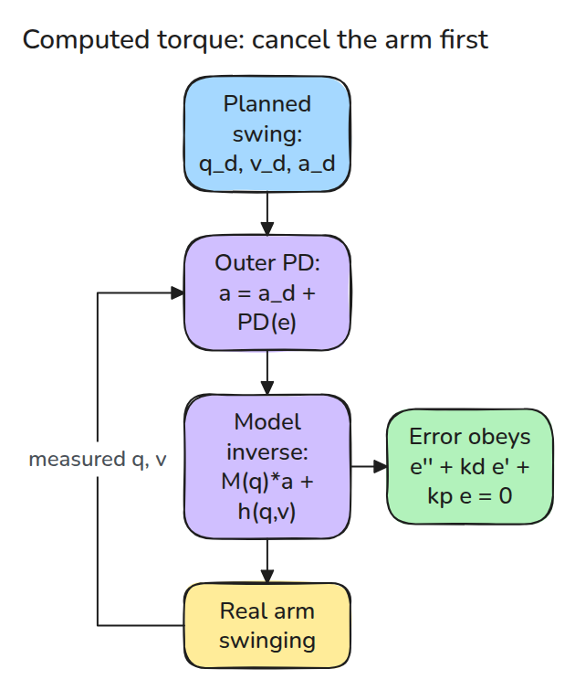
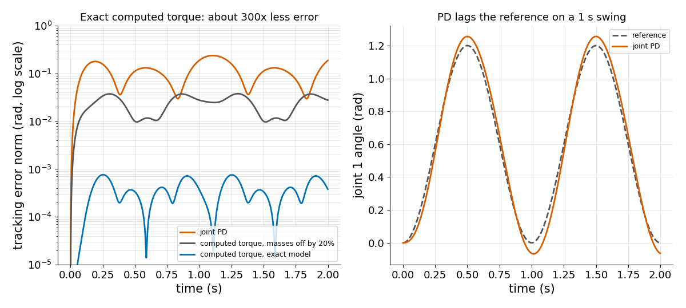

# Computed Torque

> Learn how to cancel an arm's own swing forces in advance, so a fast motion stays on track.

**Type:** Build   **Prerequisites:** 03/03 Impedance Control, 03/04 PID and Tuning   **Time:** ~15 minutes

## In Plain Words

A two-link arm sweeps across a table. With the elbow straight the same swing takes more shoulder torque, and a fast swing makes each link tug on the other.

Computed torque works out from the arm's equations the torque these effects demand and supplies it in advance. A small correction handles the leftover error.

## Key Terms

- **Computed torque**: using the arm's equations to cancel its dynamics, then controlling what is left.
- **Dynamics**: the equations linking torques to joint motion.
- **Inertia matrix (`M`)**: how heavy the arm feels to each joint; it changes with the elbow angle.
- **Coriolis torque**: the pull links exert on each other when they swing fast.
- **PD controller**: pushes by the error and brakes by the speed.
- **Reference**: the planned path the arm should follow.

## The Problem

A simple controller makes a robot arm follow a slow motion well. Make the same motion four times faster, and the arm lags and wobbles.

## The Concept

Fast motion makes an arm's links pull on each other, and a good controller predicts that. The arm's weight and swing forces can be worked out from its equations, so the controller supplies them in advance and only fixes what is left.


*A simple controller sees these forces as surprises.*



*Inner layer: the model. Outer layer: a simple fix.*


*The arm feels heavier with the elbow straight.*



*A one-second swing: far less error.*


*Even with wrong masses it still helps.*

<details><summary>The math (optional)</summary>

For a horizontal 2-link arm `tau = M(q) qdd + h(q, qd)`. Computed torque uses `tau = M(q) a + h(q, qd)` with `a = qdd_d + kd ed + kp e`, so `e'' + kd e' + kp e = 0`. Both controllers are tuned to `omega = 20`; with the exact model computed torque has about 300 times less error. With real `m1` 20% larger and `m2` 20% smaller than modelled, PD peaks at 0.19 rad of error, computed torque at 0.038 rad. Joint-1 inertia changes about fourfold with the elbow.

</details>

## Build It

Three lines: get the arm's weight table for the current elbow angle, form the wanted acceleration, and add the swing terms.

```python
M = mass(q, model)                      # 2x2, depends on the elbow angle
a = qdd_d + 2*w*(qd_d - qd) + w*w*(q_d - q)
tau = M @ a + coriolis(q, qd, model)    # Coriolis and centripetal terms
```

Tests check the weight table against kinetic energy, the equations against a numeric method, and that a free-swinging arm keeps its energy.

```bash
cd robotics-engineering-from-scratch
python3 -m pytest phases/03-dynamics-and-control/05-computed-torque -q
python3 phases/03-dynamics-and-control/05-computed-torque/code/figure.py
```

## Use It

MuJoCo's `mj_inverse` returns the torque for a given acceleration; one test compares it with `inverse_dynamics` to 1e-9. Craig, Ch. 10, covers the control law.

Sources: [MuJoCo API reference](https://mujoco.readthedocs.io/en/stable/APIreference/APIfunctions.html), checked 2026-11-09.

## Ship It

`outputs/skill-computed-torque-check.md` reviews a model-based controller.

## Exercises

1. Make the model's masses 20% wrong and compare the error.
2. Run the controller at 100 Hz instead of 1 kHz.
3. Try one mass at half and at one and a half times.
