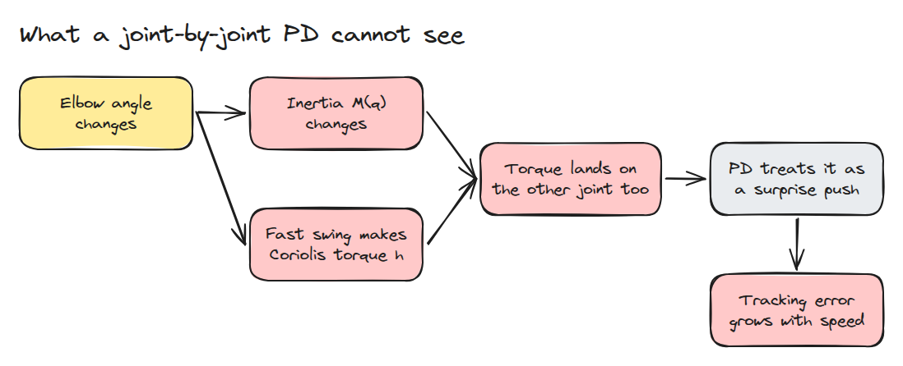
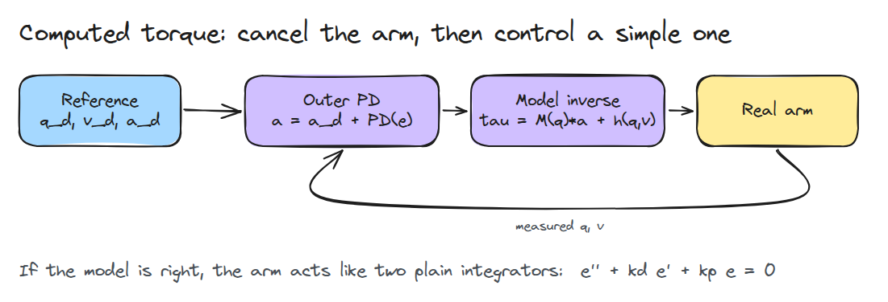
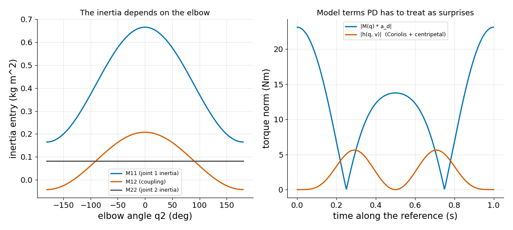
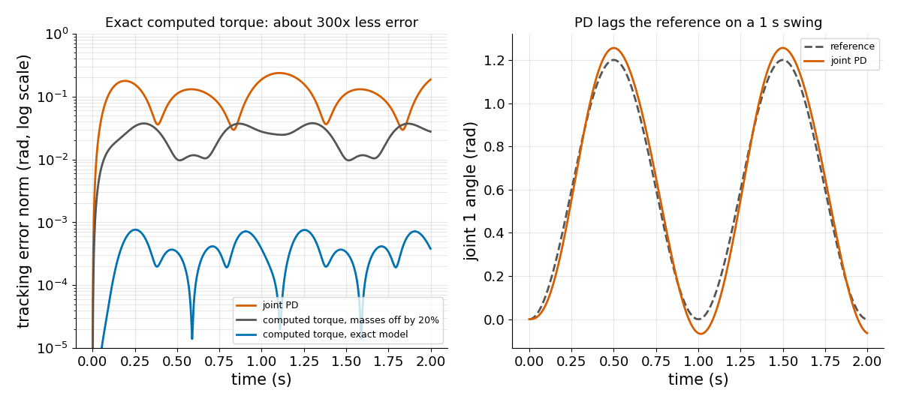

# Computed Torque

> 팔의 운동 방정식을 안다면 그 식으로 팔을 상쇄하고 남은 것만 제어합니다.

**유형:** 만들기   **선수 지식:** 03/03 임피던스 제어, 03/04 PID와 튜닝   **시간:** 약 15분

## 문제

관절별 PD 컨트롤러는 느린 움직임을 잘 따라갑니다. 같은 움직임을 네 배 빠르게 하면 팔이 뒤처지고 흔들립니다. 느릴 때는 작았던 관성 토크와 결합 토크가 이제 지배하기 때문입니다. gain을 올리면 레슨 03/04의 한계에 부딪힙니다.

## 개념



*팔꿈치 각도가 관성을 바꾸고 빠른 swing은 Coriolis 토크를 더합니다. PD는 둘 다 갑작스러운 외란으로 봅니다.*

수평면의 2링크 팔 동역학은 `tau = M(q) qdd + h(q, qd)`입니다. `M`은 관성 행렬이고 `h`는 Coriolis 토크와 원심 토크입니다. 중력은 레슨 03/02에서 다루었으므로 여기서는 뺍니다.

computed torque는 `tau = M(q) a + h(q, qd)`를 고르고 `a = qdd_d + kd ed + kp e`로 둡니다.

모델이 팔을 상쇄하므로 오차는 `e'' + kd e' + kp e = 0`을 따릅니다.



*안쪽 층은 모델이고 바깥쪽 층은 오차에 건 단순한 PD입니다.*



*왼쪽은 관절 1의 관성이 팔꿈치에 따라 약 네 배 달라지는 모습입니다. 오른쪽은 reference를 따라 움직일 때 관성 토크와 Coriolis 토크가 크다는 것을 보여 줍니다.*



*`omega = 20`으로 1초 swing을 돌렸습니다. 정확한 모델의 computed torque는 PD보다 오차가 약 300배 작고 질량이 20% 틀려도 약 5배 작습니다.*

## 만들기

```python
M = mass(q, model)                      # 2x2, depends on the elbow angle
a = qdd_d + 2*w*(qd_d - qd) + w*w*(q_d - q)
tau = M @ a + coriolis(q, qd, model)    # Coriolis and centripetal terms
```

`main.py`에 `M`과 `h`의 전체 항이 있습니다. 테스트는 `M`을 Cartesian 속도로 계산한 운동에너지와 비교하고 `M qdd + h`를 수치 Lagrangian과 비교하며 자유 운동에서 운동에너지가 보존되는지 확인합니다.

마지막 확인이 Coriolis 부호를 검사합니다. 그런 다음 같은 궤적에서 PD와 computed torque를 돌립니다.

```bash
cd robotics-engineering-from-scratch
python3 -m pytest phases/03-dynamics-and-control/05-computed-torque -q
python3 phases/03-dynamics-and-control/05-computed-torque/code/figure.py
```

## 실제 도구로 보기

MuJoCo의 `mj_inverse`는 주어진 `qacc`에 필요한 토크 `qfrc_inverse`를 돌려줍니다. 테스트 하나가 같은 팔을 MuJoCo로 만들어 `inverse_dynamics`와 1e-9 안에서 비교합니다. 비선형 제어 법칙은 Craig 10장에 있습니다.

출처: [MuJoCo API reference](https://mujoco.readthedocs.io/en/stable/APIreference/APIfunctions.html), 2026년 11월 9일에 확인했습니다.

## 결과물

`outputs/skill-computed-torque-check.md`는 모델 기반 컨트롤러를 모델 오차와 샘플링 관점에서 점검합니다.

## 연습 문제

1. 레슨 03/02의 중력을 `h`에 더하고 위치 에너지를 포함해 에너지 테스트가 계속 성립하게 하세요.
2. 질량 하나를 0.5배에서 1.5배까지 바꾸며 최대 오차를 그리세요.
3. computed torque를 1 kHz 대신 100 Hz로 돌리고 오차 하한이 어디로 움직이는지 보세요.
