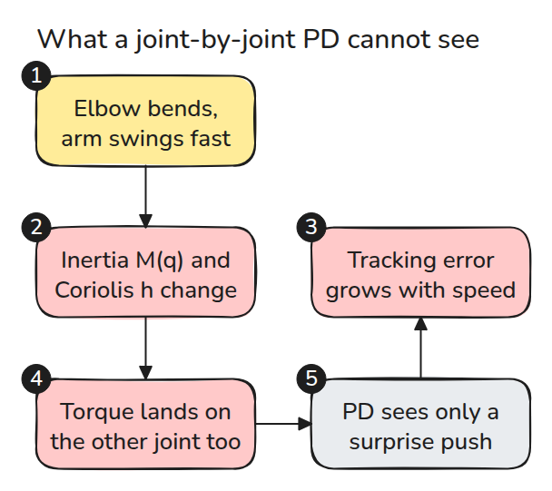
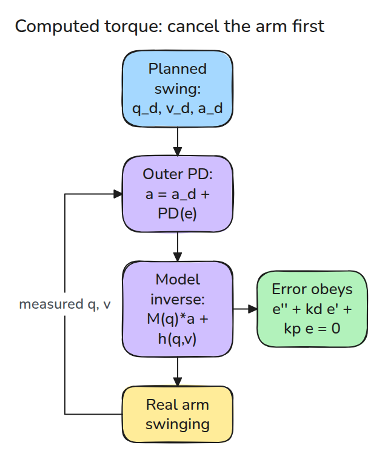
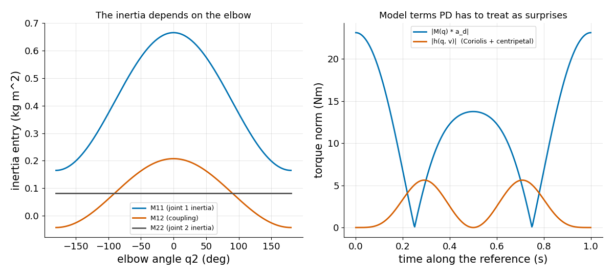
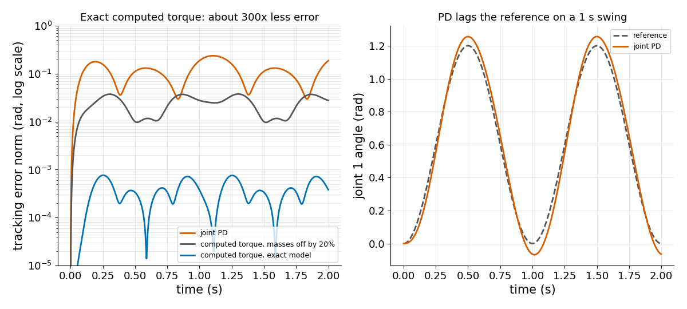

# Computed Torque

> 팔 자신이 만드는 휘두름의 힘을 미리 상쇄해서 빠른 움직임도 경로를 지키게 하는 법을 알게 됩니다.

**유형:** 만들기   **선수 지식:** 03/03 임피던스 제어, 03/04 PID와 튜닝   **시간:** 약 15분

## 쉽게 말하면

테이블 위를 쓸고 지나가는 링크가 둘인 팔을 떠올려 보세요. 팔꿈치를 펴면 같은 swing에 어깨 torque가 더 많이 들고 빠르게 휘두르면 링크가 서로를 잡아당겨요.

computed torque는 팔의 방정식으로 이런 영향이 요구하는 torque를 계산해서 미리 넣어 줘요. 남는 오차는 작은 보정이 맡아요.

## 핵심 용어

- **Torque**: 비트는 힘으로 예를 들어 모터가 관절을 미는 힘입니다.
- **Dynamics**: torque와 관절 운동을 이어 주는 방정식입니다.
- **Computed torque**: 팔의 방정식으로 동역학을 상쇄하고 남은 것만 제어하는 방법입니다.
- **Inertia matrix (`M`)**: 팔이 각 관절에 얼마나 무겁게 느껴지는지를 나타내며 팔꿈치 각도에 따라 바뀝니다.
- **Coriolis torque**: 링크가 빠르게 휘두를 때 서로에게 가하는 당기는 힘입니다.
- **PD controller**: 팔이 계획에서 벗어난 만큼 밀고 속도에 비례해서 브레이크를 거는 컨트롤러입니다.

## 문제

단순한 컨트롤러(팔을 움직이는 프로그램)는 로봇 팔이 느린 움직임을 잘 따라가게 합니다. 같은 움직임을 네 배 빠르게 하면 팔이 뒤처지고 흔들립니다.

## 개념

빠르게 움직이면 팔의 link들이 서로를 잡아당기고 좋은 컨트롤러는 그것을 예측합니다. 팔의 관성과 휘두르는 힘은 방정식으로 계산할 수 있으므로 컨트롤러가 미리 넣어 주고 남은 것만 고칩니다.



*단순한 컨트롤러는 이런 힘을 갑작스러운 일로 봅니다.*



*안쪽 층은 팔 모델이 예측하는 것을 상쇄하고 바깥쪽 층은 남은 작은 오차를 고칩니다.*



*팔꿈치를 펴면 팔이 더 무겁게 느껴집니다.*



*1초 swing에서 계획한 경로에서 벗어난 정도가 computed torque에서 훨씬 작습니다.*


*모델의 질량이 틀려도 경로에서 벗어난 정도가 단순한 컨트롤러보다 작습니다.*

<details><summary>The math (optional)</summary>

수평면의 2링크 팔은 `tau = M(q) qdd + h(q, qd)`입니다. computed torque는 `tau = M(q) a + h(q, qd)`를 고르고 `a = qdd_d + kd ed + kp e`로 두므로 `e'' + kd e' + kp e = 0`이 됩니다.
두 컨트롤러를 모두 `omega = 20`으로 맞췄고 모델이 정확하면 computed torque는 오차가 약 300배 작습니다. 실제 `m1`이 모델보다 20% 크고 `m2`가 20% 작으면 PD는 오차가 최대 0.19 rad이고 computed torque는 0.038 rad입니다.
관절 1의 관성은 팔꿈치에 따라 약 네 배 달라집니다. 테스트 하나가 `mj_inverse`를 `inverse_dynamics`와 1e-9 안에서 비교합니다.

</details>

## 만들기

세 줄입니다. 지금 팔꿈치 각도에서 팔의 관성 행렬 `M`을 얻고 계획을 따르려면 얼마나 빨리 속도를 올려야 하는지(원하는 가속도) 정하고 휘두르는 항을 더합니다.

```python
M = mass(q, model)                      # 2x2, depends on the elbow angle
a = qdd_d + 2*w*(qd_d - qd) + w*w*(q_d - q)
tau = M @ a + coriolis(q, qd, model)    # Coriolis and centripetal terms
```

테스트는 `M`을 팔의 운동 에너지와 비교하고 방정식을 조금 움직여 보고 지켜보는 추정값과 비교하며 자유롭게 흔들리는 팔이 에너지를 유지하는지 확인합니다.

```bash
cd robotics-engineering-from-scratch
python3 -m pytest phases/03-dynamics-and-control/05-computed-torque -q
python3 phases/03-dynamics-and-control/05-computed-torque/code/figure.py
```

## 실제 도구로 보기

MuJoCo의 `mj_inverse`는 주어진 가속도에 필요한 torque를 돌려줍니다. 제어 법칙은 Craig 10장에 있습니다.

출처: [MuJoCo API reference](https://mujoco.readthedocs.io/en/stable/APIreference/APIfunctions.html), 2026년 11월 9일에 확인했습니다.

## 결과물

`outputs/skill-computed-torque-check.md`는 모델 기반 컨트롤러를 모델 오차와 샘플링 관점에서 점검합니다.

## 연습 문제

1. 모델의 질량을 20% 틀리게 하고 오차를 비교하세요.
2. 컨트롤러를 1초에 1000번 대신 100번 돌려 보세요.
3. 모델의 질량 하나를 실제 값의 절반으로, 그다음 1.5배로 놓고 비교하세요.
