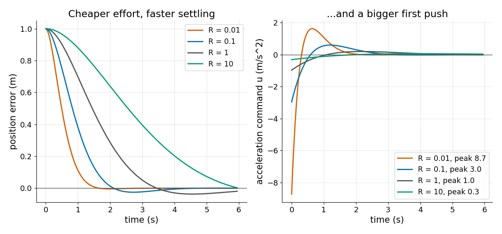

# LQR: Gains from Cost, Not from Guessing

> Learn how to get controller gains by saying how much you mind error and effort, instead of guessing.

**Type:** Build   **Prerequisites:** 03/04 PID and Tuning   **Time:** ~15 minutes

## In Plain Words

Imagine pushing a toy car to a stop line. A hard push gets it there quickly but costs effort. A gentle push saves effort but takes longer.

LQR weighs error against effort using a model of the car. Q says how much error hurts, R how much effort hurts; a larger R softens the response.

## Key Terms

- **LQR**: a method that computes a feedback gain from a model and a cost for error and effort.
- **State**: the values that predict future motion, such as position and speed.
- **Cost weights (`Q`, `R`)**: how much error (`Q`) and effort (`R`) hurt.
- **Riccati recursion**: a repeated calculation that turns the model and weights into the gain `K`.
- **Feedback gain (`K`)**: the numbers that turn the state into a push, `u = -Kx`.
- **Double integrator**: a car steered by acceleration; position changes by speed, speed by push.

## The Problem

You tune a robot's `kp` and `kd` by feel. The result is slow or violent, and you cannot say why. Two states need two gains to guess; six states need six.

## The Concept

Real robots have many interacting joints, so guessing gains one by one fails.


*Model and two cost weights in, every entry of K out.*

The cost is the sum of `x'Qx + u'Ru` over time (`u` is the push) for the model `x+ = A x + B u`. Start with `P = Q` and repeat `K = (R + B'PB)^-1 B'PA`, then `P = Q + A'P(A - BK)`. When `P` (the cost still to come) stops changing, `u = -Kx` is the cheapest feedback.


*Big pushes cost more as R grows.*



*1 m away. R = 0.01 settles fastest with an 8.7 m/s^2 first push; R = 10 pushes 0.3, slowly.*

Example: `R = 1`, `Q = diag(1, 0.1)`, `dt = 0.05`, car 1 m away. After 1 loop `K = [0.005, 0.010]`, moving 0.09 m in 6 s. After 10 loops `K = [0.15, 0.11]`, swinging across the line at about 4.5 s. Steady `P`: `K = [0.96, 1.42]`, within 0.05 m at 3 s.


*`K` from 1 loop, 10 loops and a steady `P`: creeps, swings across, settles (green).*

## Build It

```python
K = np.linalg.solve(R + B.T @ P @ B, B.T @ P @ A)
P = Q + A.T @ P @ (A - B @ K)      # repeat until P is steady
```

`dare()` loops these two lines; `rollout()` runs `u = -Kx` and adds up the cost. Tests check stable closed-loop eigenvalues, that `K` and `P` satisfy their equations, and that a larger `R` lowers the peak input.

```bash
cd robotics-engineering-from-scratch
python3 -m pytest phases/03-dynamics-and-control/06-lqr -q
python3 phases/03-dynamics-and-control/06-lqr/code/figure.py
```

## Use It

SciPy's `scipy.linalg.solve_discrete_are` solves it directly; cross-check `P`. Hard actuator limits need explicit constraints.

## Ship It

`outputs/skill-lqr-gain-review.md` reviews a Q and R choice by closed-loop poles and peak input.

## Exercises

1. Penalise velocity ten times more in `Q`.
2. Cancel a constant disturbance with feedforward.
3. Find the `R` that keeps the peak input under 2 m/s^2 for a 1 m step.
