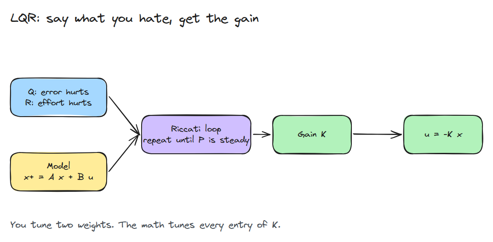
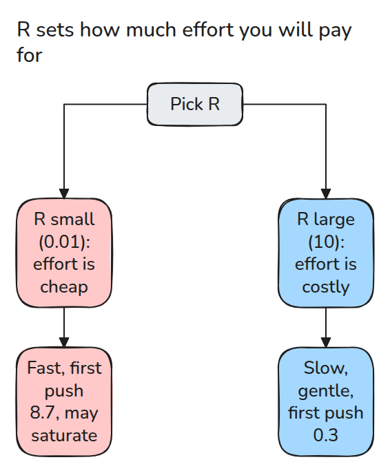

# LQR: Gains from Cost, Not from Guessing

> Learn how to get a robot's push and brake strengths (gains) by saying how much you mind error and effort, instead of guessing.

**Type:** Build   **Prerequisites:** 03/04 PID and Tuning   **Time:** ~15 minutes

## In Plain Words

Imagine pushing a toy car to a stop line. A hard push gets it there quickly but costs effort. A gentle push saves effort but takes longer.

LQR weighs error against effort using a model of the car (equations for how it moves). Q says how much error hurts, R how much effort hurts; a larger R softens the response.

## Key Terms

- **State**: the values that predict future motion, such as position and speed.
- **Cost weights**: numbers saying how much error hurts and how much effort hurts.
- **Feedback gain**: the numbers that turn the state into a push (the push is minus the gain times the state).
- **LQR**: a method that computes a feedback gain from a model and the cost weights.
- **Riccati recursion**: a repeated calculation that turns the model and the weights into the feedback gain.
- **Double integrator**: a car steered by acceleration; position changes by speed, speed by push.

## The Problem

You tune a robot's push and brake gains by feel. The result is slow or violent, and you cannot say why. With more joints there are many more gains to guess.

## The Concept

Real robots have many interacting joints, so guessing gains one by one fails. LQR lets you say two things instead: how much you dislike error, and how much you dislike effort. A short repeated calculation returns the best gains.



*A model and two weights in, the gains out.*



*A bigger effort weight makes big pushes cost more.*


*A cheap push settles fastest; an expensive push crawls.*

The calculation must repeat until its answer stops changing. Stop early and the gains are too weak.

[](../assets/clip-example.mp4)

*1 repeat: the car creeps. 10: it crosses the line. Finished (green): it settles.*

<details><summary>The math (optional)</summary>

The cost is the sum of `x'Qx + u'Ru` over time for the model `x+ = A x + B u`. Start with `P = Q` and repeat `K = (R + B'PB)^-1 B'PA`, then `P = Q + A'P(A - BK)`; `u = -Kx`. A double integrator 1 m away: R = 0.01 settles fastest with an 8.7 m/s^2 first push, R = 10 pushes 0.3. With `R = 1`, `Q = diag(1, 0.1)`, `dt = 0.05`: 1 repeat gives `K = [0.005, 0.010]` (moves 0.09 m in 6 s), 10 repeats `K = [0.15, 0.11]` (crosses the line at about 4.5 s), a steady `P` gives `K = [0.96, 1.42]` (within 0.05 m at 3 s).

</details>

## Build It

Two lines repeat: compute the gains, then update the running total of future cost.

```python
K = np.linalg.solve(R + B.T @ P @ B, B.T @ P @ A)
P = Q + A.T @ P @ (A - B @ K)      # repeat until P is steady
```

`dare()` loops them; `rollout()` runs the car and adds up the cost. Tests check the car settles, the gains satisfy their equations, and a bigger effort weight lowers the peak push.

```bash
cd robotics-engineering-from-scratch
python3 -m pytest phases/03-dynamics-and-control/06-lqr -q
python3 phases/03-dynamics-and-control/06-lqr/code/figure.py
```

## Use It

SciPy's `scipy.linalg.solve_discrete_are` solves it directly; cross-check with it. Hard actuator limits need explicit constraints.

## Ship It

`outputs/skill-lqr-gain-review.md` reviews a Q and R choice by how the car settles and how hard the biggest push is.

## Exercises

1. Change the effort weight and watch the peak push.
2. Raise the weight in `Q` that applies to velocity tenfold.
3. Stop the loop after one repeat and watch the car creep.
