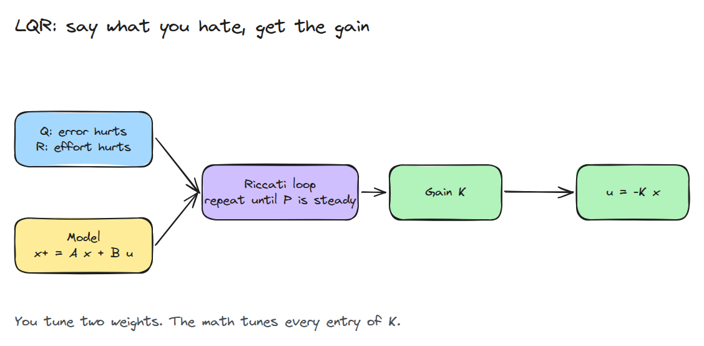
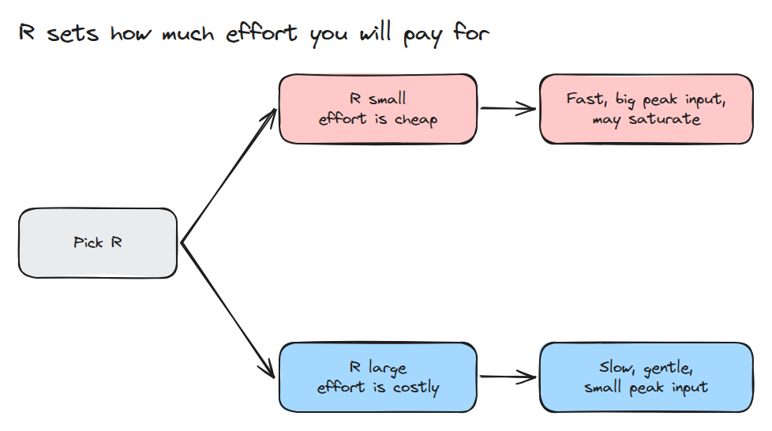
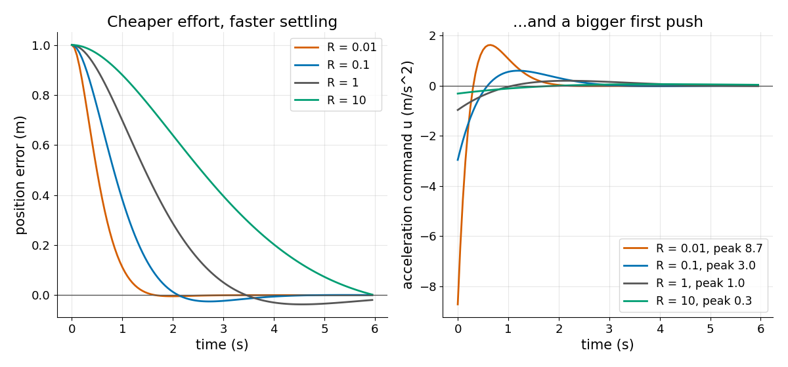

# LQR: Gains from Cost, Not from Guessing

> Say how much you hate error against effort, and the Riccati recursion hands back the gain.

**Type:** Build   **Prerequisites:** 03/04 PID and Tuning   **Time:** ~15 minutes

## In Plain Words

In a game, you must stop a drifting spaceship at a marker. Strong thrust corrects its position quickly but
uses more fuel; gentle thrust saves fuel and takes longer. Its current speed matters too, because thrust now
changes where it goes later.

LQR uses a motion model to balance state error against control effort over time. Q weights the errors and R
weights effort. Raising R makes large commands more costly, usually softening the response; it does not impose
a hard thrust limit.

## The Problem

You have a state-space model and you tune `kp` and `kd` by feel. The result is either slow or violent, and you cannot say why those numbers and not others. For one input, two states need two gains to guess. Six states need six.

## The Concept



*You supply the model and two cost weights. The Riccati loop returns every entry of K.*

The cost is the sum over time of `x'Qx + u'Ru`. `Q` prices error and `R` prices effort. Start with `P = Q` and repeat `K = (R + B'PB)^-1 B'PA`, then `P = Q + A'P(A - BK)`. When `P` stops changing, `u = -Kx` is the cheapest feedback for that cost, and the cost from state `x0` is `x0'P x0`.



*Raising R does not break anything. It tells the optimiser that big pushes cost more.*



*A double integrator starting 1 m away. R = 0.01 settles fastest and pushes 8.7 m/s^2 at the first tick. R = 10 pushes 0.3 and takes much longer.*

## Build It

```python
K = np.linalg.solve(R + B.T @ P @ B, B.T @ P @ A)
P = Q + A.T @ P @ (A - B @ K)      # repeat until P is steady
```

`dare()` loops these two lines. `rollout()` runs `u = -Kx`, optionally clipped, and adds up the cost. Tests check that the closed-loop eigenvalues are inside the unit circle, that `K` and `P` satisfy their own equations, that simulated cost equals `x0'P x0`, that a hand-picked PD costs more, and that a larger `R` lowers the peak input.

```bash
cd robotics-engineering-from-scratch
python3 -m pytest phases/03-dynamics-and-control/06-lqr -q
python3 phases/03-dynamics-and-control/06-lqr/code/figure.py
```

## Use It

SciPy's `scipy.linalg.solve_discrete_are` solves the same equation directly, so use it to cross-check `P`. Real systems rarely use the optimum blindly. Raising `R` can reduce effort for the tested starts; check the full rollout. Hard actuator limits need explicit constraints or separately validated saturation handling.

## Ship It

`outputs/skill-lqr-gain-review.md` reviews a Q and R choice by its closed-loop poles and peak input.

## Exercises

1. Make `Q` penalise velocity ten times more and describe how the response changes.
2. Estimate a constant input disturbance and cancel it with feedforward; keep LQR on the controllable position and velocity errors.
3. Find the `R` that keeps the peak input under 2 m/s^2 for a 1 m step.
