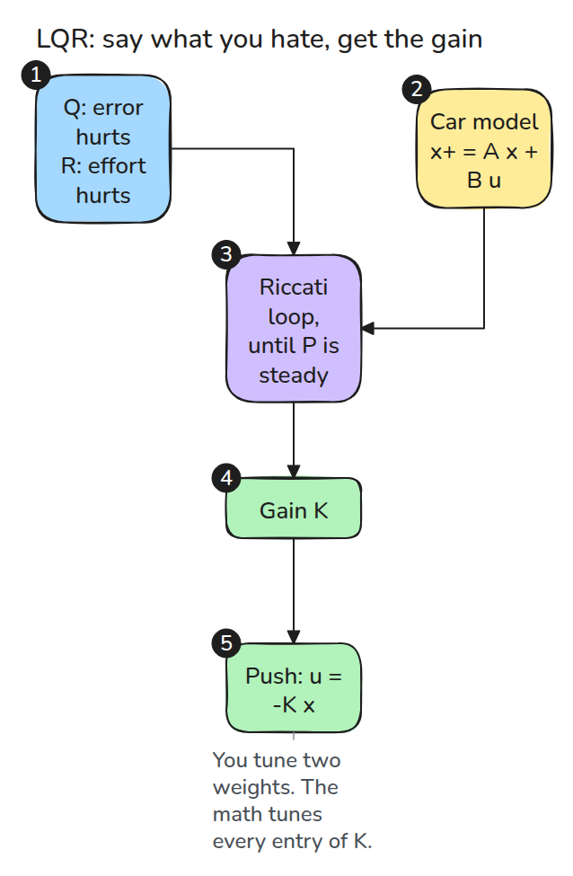
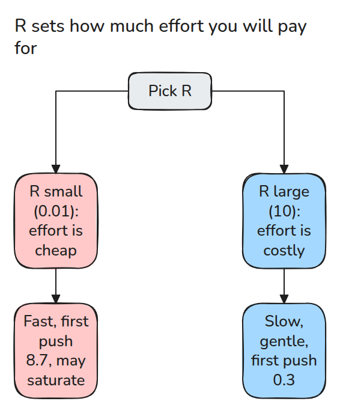
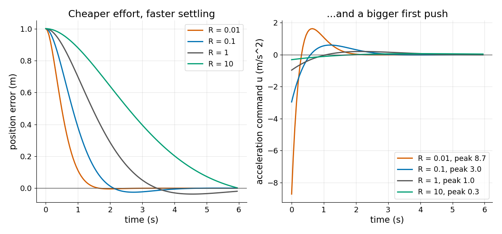

# LQR: 감이 아니라 비용으로 구하는 gain

> 오차와 노력 중 무엇을 얼마나 싫어하는지 말하면 Riccati 재귀가 gain을 돌려줍니다.

**유형:** 만들기   **선수 지식:** 03/04 PID와 튜닝   **시간:** 약 15분

## 쉽게 말하면

장난감 자동차를 정지선까지 민다고 해 보세요. 세게 밀면 빨리 가지만 힘이 많이 들어요. 살살 밀면 힘은 아끼지만 오래 걸려요.

LQR은 자동차의 모델로 오차와 노력을 함께 따져요. Q는 오차에 벌점을 얼마나 줄지 정하고 R은 노력에 벌점을 얼마나 줄지 정해요. R을 키우면 큰 힘이 비싸져서 반응이 완만해져요. 미는 힘의 최대값을 강제로 정하는 것은 아니에요.

## 문제

state-space 모델(state는 움직임을 예측하는 데 필요한 값으로 위치와 속도 같은 것입니다)이 있는데 `kp`와 `kd`를 감으로 맞추고 있습니다. 결과는 느리거나 거칠고 왜 그 값이어야 하는지 설명하지 못합니다.

입력이 하나일 때 state가 둘이면 gain 둘을 짐작해야 합니다. state가 여섯이면 gain도 여섯입니다.

## 개념



*모델과 비용 가중치 두 개를 주면 Riccati 반복(아래의 반복 계산)이 K의 모든 성분을 돌려줍니다.*

비용은 시간에 걸친 `x'Qx + u'Ru`의 합입니다. `x`는 state이고 `u`는 미는 힘이고 자동차 모델은 `x+ = A x + B u`입니다. `Q`는 오차에 값을 매기고 `R`은 노력에 값을 매깁니다.

`P = Q`에서 시작해 `K = (R + B'PB)^-1 B'PA`와 `P = Q + A'P(A - BK)`를 반복합니다. `P`(각 state에서 앞으로 들 비용)가 변하지 않으면 `u = -Kx`가 그 비용에서 가장 싼 피드백입니다. 그때 state `x0`에서의 비용은 `x0'P x0`입니다.



*R을 올려도 아무것도 망가지지 않습니다. 큰 힘이 더 비싸질 뿐입니다.*



*이중 적분기(가속도로 모는 자동차)가 1 m 떨어진 곳에서 출발합니다. R = 0.01은 가장 빨리 정착하고 첫 tick에 8.7 m/s^2를 밀어 넣습니다. R = 10은 0.3만 밀고 훨씬 오래 걸립니다.*

예: 반복을 일찍 멈추면 gain이 약합니다. `R = 1`, `Q = diag(1, 0.1)`, `dt = 0.05`이고 자동차가 선에서 1 m 떨어져 있습니다. 1번 반복하면 `K = [0.005, 0.010]`(위치 gain, 속도 gain)이라서 6초 동안 0.09 m만 움직입니다.

10번 반복하면 `K = [0.15, 0.11]`이고 약 4.5초에 선을 넘어 흔들립니다. `P`가 일정해지면 `K = [0.96, 1.42]`이고 3초에 차가 선에서 0.05 m 안쪽까지 옵니다.


*같은 자동차, `R = 1`이고 `K`는 1번 반복, 10번 반복, `P`가 일정해진 뒤의 값입니다. 첫 번째 차가 거의 기지 못하고 두 번째 차가 선을 넘어 흔들리고 초록 차가 자리를 잡는 것을 보세요.*

## 만들기

```python
K = np.linalg.solve(R + B.T @ P @ B, B.T @ P @ A)
P = Q + A.T @ P @ (A - B @ K)      # repeat until P is steady
```

`dare()`가 이 두 줄을 반복하고 `dare(max_iter=n)`은 `n`번 반복한 뒤 멈춥니다. `rollout()`은 `u = -Kx`를 돌리며 비용을 더합니다. 테스트는 폐루프 고유값이 단위원 안에 있는지, `K`와 `P`가 자기 방정식을 만족하는지, 시뮬레이션 비용이 `x0'P x0`와 같은지, `R`이 클수록 피크 입력이 작은지를 확인합니다.

```bash
cd robotics-engineering-from-scratch
python3 -m pytest phases/03-dynamics-and-control/06-lqr -q
python3 phases/03-dynamics-and-control/06-lqr/code/figure.py
```

## 실제 도구로 보기

SciPy의 `scipy.linalg.solve_discrete_are`가 같은 방정식을 바로 풉니다. `P`를 교차 확인하는 데 쓰세요.

`R`을 올리면 시험한 출발점에서 입력을 줄일 수 있습니다. 전체 rollout을 확인하세요. actuator 한계를 보장하려면 명시적 제약이나 별도로 검증한 saturation 처리가 필요합니다.

## 결과물

`outputs/skill-lqr-gain-review.md`는 Q와 R의 선택을 폐루프 극점과 피크 입력으로 검토합니다.

## 연습 문제

1. `Q`에서 속도 벌점을 열 배로 올리고 응답이 어떻게 달라지는지 설명하세요.
2. 일정한 입력 외란을 추정해 feedforward로 상쇄하세요. LQR은 제어 가능한 위치 오차와 속도 오차에만 설계하세요.
3. 1 m 스텝에서 피크 입력을 2 m/s^2 아래로 유지하는 `R`을 찾으세요.
