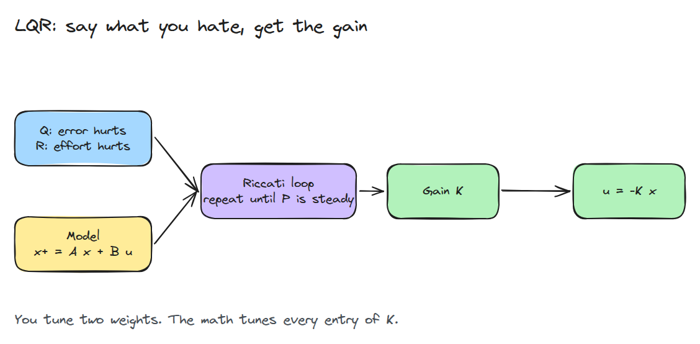
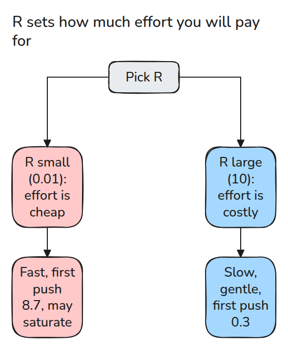
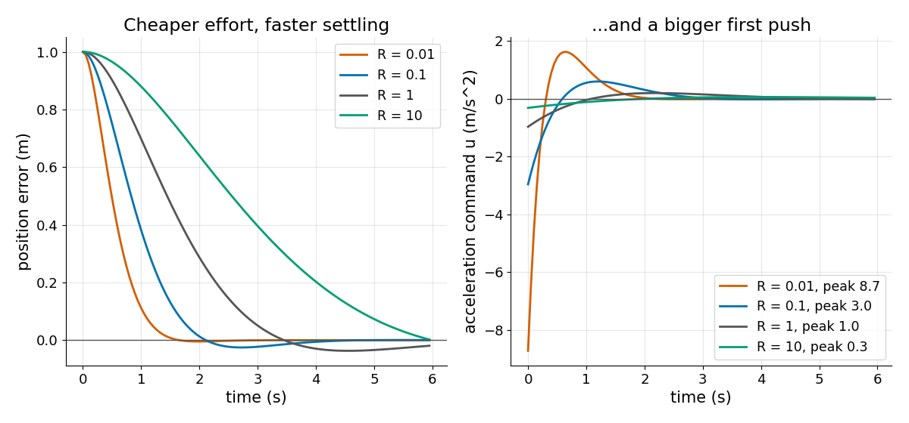
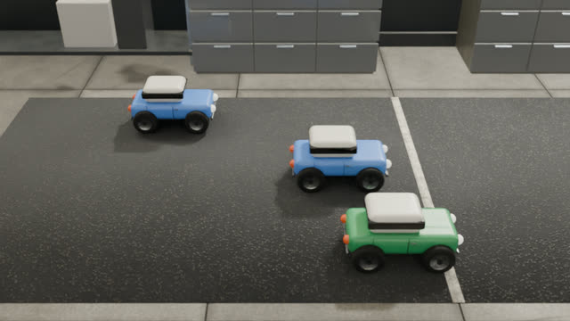

# LQR: 감이 아니라 비용으로 구하는 gain

> 추측하는 대신 오차와 노력을 각각 얼마나 싫어하는지 정해 주어서 로봇의 미는 힘과 브레이크 세기(gain)를 구하는 법을 배웁니다.

**유형:** 만들기   **선수 지식:** 03/04 PID와 튜닝   **시간:** 약 15분

## 쉽게 말하면

장난감 자동차를 정지선까지 민다고 해 보세요. 세게 밀면 빨리 가지만 힘이 많이 들어요. 살살 밀면 힘은 아끼지만 오래 걸려요.

LQR은 자동차의 모델(움직임을 설명하는 몇 개의 식)로 오차와 노력을 함께 따져요. Q는 오차에 벌점을 얼마나 줄지 정하고 R은 노력에 벌점을 얼마나 줄지 정해요. R을 키우면 큰 힘이 비싸져서 반응이 완만해져요.

## 핵심 용어

- **State**: 위치와 속도처럼 앞으로의 움직임을 예측하는 데 필요한 값입니다.
- **Cost weights**: 오차와 노력에 벌점을 얼마나 줄지 정하는 숫자들입니다.
- **Feedback gain**: state를 미는 힘으로 바꾸는 숫자들입니다(미는 힘은 gain과 state를 곱한 값의 음수입니다).
- **LQR**: 모델과 cost weights로부터 feedback gain을 계산하는 방법입니다.
- **Riccati recursion**: 모델과 가중치를 feedback gain으로 바꾸는 반복 계산입니다.
- **Double integrator**: 가속도로 모는 자동차입니다. 위치는 속도로, 속도는 미는 힘으로 변합니다.

## 문제

로봇의 미는 힘과 브레이크의 gain을 감으로 맞춥니다. 결과가 느리거나 거칠어서 왜 그런지도 설명할 수 없습니다. 관절이 많아지면 짐작해야 할 gain도 훨씬 많아집니다.

## 개념

실제 로봇은 서로 영향을 주는 관절이 많아서 gain을 하나씩 짐작하는 방식은 통하지 않습니다. 그 대신 LQR에서는 두 가지를 말해 줍니다. 오차를 얼마나 싫어하는지와 노력을 얼마나 싫어하는지입니다. 짧은 반복 계산이 가장 좋은 gain을 돌려줍니다.



*모델과 가중치 두 개를 넣으면 gain이 나옵니다.*



*노력 가중치가 클수록 큰 힘이 더 비쌉니다.*



*싼 힘은 가장 빨리 자리 잡고 비싼 힘은 기어갑니다.*

계산은 답이 변하지 않을 때까지 반복해야 합니다. 일찍 멈추면 gain이 약합니다.

[](../assets/clip-example.mp4)

*1번 반복하면 자동차가 기어갑니다. 10번 반복하면 선을 넘습니다. 끝까지 반복한 계산(초록)에서는 자리를 잡습니다.*

<details><summary>The math (optional)</summary>

모델 `x+ = A x + B u`에서 비용은 모든 시점의 `x'Qx + u'Ru`를 더한 값입니다. `P = Q`에서 시작해 `K = (R + B'PB)^-1 B'PA`를 계산하고 이어서 `P = Q + A'P(A - BK)`로 갱신하기를 반복합니다. 입력은 `u = -Kx`입니다.
1 m 떨어진 double integrator에서 R = 0.01은 가장 빨리 자리를 잡고 첫 push가 8.7 m/s^2입니다. R = 10은 첫 push가 0.3에 그칩니다.
`R = 1`, `Q = diag(1, 0.1)`, `dt = 0.05`일 때 1번 반복하면 `K = [0.005, 0.010]`(6초 동안 0.09 m),
10번 반복하면 `K = [0.15, 0.11]`(약 4.5초에 선을 넘음), `P`가 일정해지면 `K = [0.96, 1.42]`(3초에 선에서 0.05 m 이내)입니다.

</details>

## 만들기

두 줄을 반복합니다. 먼저 gain을 계산하고 이어서 앞으로 들 비용의 누적 합을 갱신합니다.

```python
K = np.linalg.solve(R + B.T @ P @ B, B.T @ P @ A)
P = Q + A.T @ P @ (A - B @ K)      # repeat until P is steady
```

`dare()`가 이를 반복하고 `rollout()`은 자동차를 돌려 비용을 더합니다. 테스트는 자동차가 자리를 잡는지, gain이 자기 방정식을 만족하는지, 노력 가중치가 클수록 최대 힘이 작은지 확인합니다.

```bash
cd robotics-engineering-from-scratch
python3 -m pytest phases/03-dynamics-and-control/06-lqr -q
python3 phases/03-dynamics-and-control/06-lqr/code/figure.py
```

## 실제 도구로 보기

SciPy의 `scipy.linalg.solve_discrete_are`가 바로 풀어 주니 교차 확인에 쓰세요. actuator의 한계를 엄격히 지키려면 명시적 제약이 필요합니다.

## 결과물

`outputs/skill-lqr-gain-review.md`는 Q와 R의 선택을 자동차가 얼마나 잘 자리를 잡는지와 가장 큰 힘이 얼마나 센지로 검토합니다.

## 연습 문제

1. 노력 가중치를 바꾸고 최대 힘을 보세요.
2. `Q`에서 속도에 걸리는 가중치를 열 배로 올려 보세요.
3. 한 번 반복한 뒤 멈추고 자동차가 기어가는 것을 보세요.
