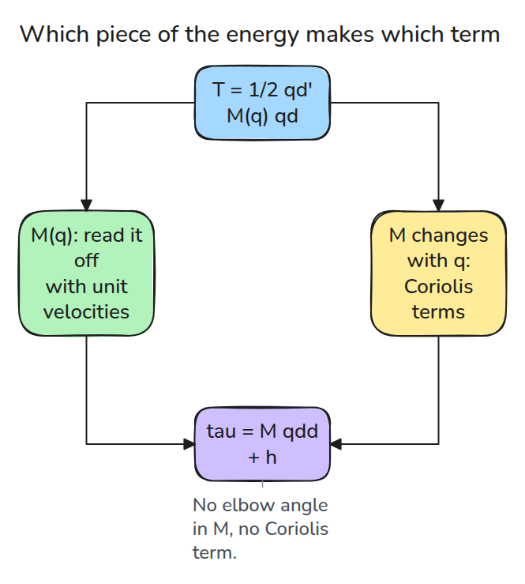

# Where M(q) Comes From: Deriving Arm Dynamics

> Learn where an arm's inertia numbers come from, so you can rebuild them when the robot changes.

**Type:** Build   **Prerequisites:** 02/03 Jacobians, 03/05 Computed Torque   **Time:** ~15 minutes

## In Plain Words

A two-link bench arm swings freely with no motor pushing. The forearm's speed depends on both joints at once, so its kinetic energy cannot be split joint by joint.

Differentiating the summed kinetic energy gives the inertia matrix and the coupling torques. A separate force-and-moment calculation must agree, and with no motor or friction the kinetic energy stays constant.

## Key Terms

- **Kinetic energy (`T`)**: the energy of motion; for an arm `T = 1/2 qd' M qd`, where `qd'` is the speed list written sideways.
- **Inertia matrix (`M`)**: how heavy the arm feels to each joint, and how the joints couple.
- **Coriolis and centripetal torques (`h`)**: speed-dependent torques that exist because `M` changes with the pose.
- **Lagrange equation**: a rule that turns kinetic energy into joint torques by differentiating.
- **Newton-Euler**: a second method that adds up each link's forces and moments instead of using energy.
- **Positive definite**: every motion has positive kinetic energy.

## The Problem

You bolt a heavier tool on the arm, and the formulas `M(q)` and `h(q, qd)` of lesson 03/05 no longer match. Mistype one sign and the controller cancels the wrong arm.

## The Concept

A controller is only as good as its arm model, so you must be able to rebuild it.


*Two independent derivations; a disagreement means a bug.*

The kinetic energy of a horizontal arm is `T = 1/2 qd' M(q) qd`. Expanded, `T = 1/2 (M11 qd1^2 + 2 M12 qd1 qd2 + M22 qd2^2)`: `M12` needs both joints moving. The Lagrange equation `tau = d/dt(dT/dqd) - dT/dq` gives `tau = M qdd + h`.

Take the lesson's arm (1 and 1.5 kg) at `q = (0.3, 1.0)` and 1 rad/s. Joint 1 alone gives `T = 0.437`, so `M11 = 2T = 0.873`; joint 2 alone gives `T = 0.0925`, so `M22 = 0.185`; both give `T = 0.836`, and the extra `0.307` is `M12`.


*The stack is each joint's energy alone, the amber bar both together; the gap is `M12`.*



*`M` changes with the elbow angle.*

In free motion `h` cancels the energy change `1/2 qd' Mdot qd` from changing inertia. The other road, Newton-Euler, adds up forces link by link.


*Left: inertia against elbow angle. Right: a flipped sign makes energy wander by tenths of a joule.*

## Build It

```python
off = T(e0 + e1) - T(e0) - T(e1)          # unit velocities
M = [[2*T(e0), off], [off, 2*T(e1)]]
tau = M @ qdd + dMdt @ qd - dTdq          # dMdt, dTdq by central differences
```

`kinetic()` builds `T`; `lagrange_tau()` and `newton_euler()` are the two roads. Tests check `M` is symmetric positive definite, the roads agree at 20 random states, and `energy_drift()` fails on a flipped sign.

```bash
cd robotics-engineering-from-scratch
python3 -m pytest phases/03-dynamics-and-control/07-deriving-arm-dynamics -q
python3 phases/03-dynamics-and-control/07-deriving-arm-dynamics/code/figure.py
```

## Use It

MuJoCo computes the same `M` with `mj_fullM`; compare with `mass()`. Craig, Ch. 6.

Sources: [MuJoCo API reference](https://mujoco.readthedocs.io/en/stable/APIreference/APIfunctions.html), checked 2026-11-10.

## Ship It

`outputs/skill-arm-dynamics-derivation-check.md` checks a dynamics model.

## Exercises

1. Add the potential energy `V` of 03/02 to `lagrange_tau`.
2. Double link 2's mass; which entry of `M` moves most?
3. Add a tip point mass to link 2.
