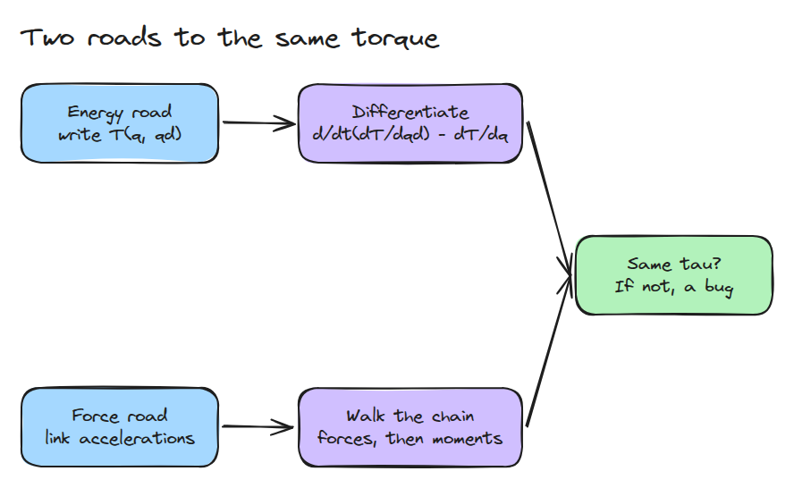
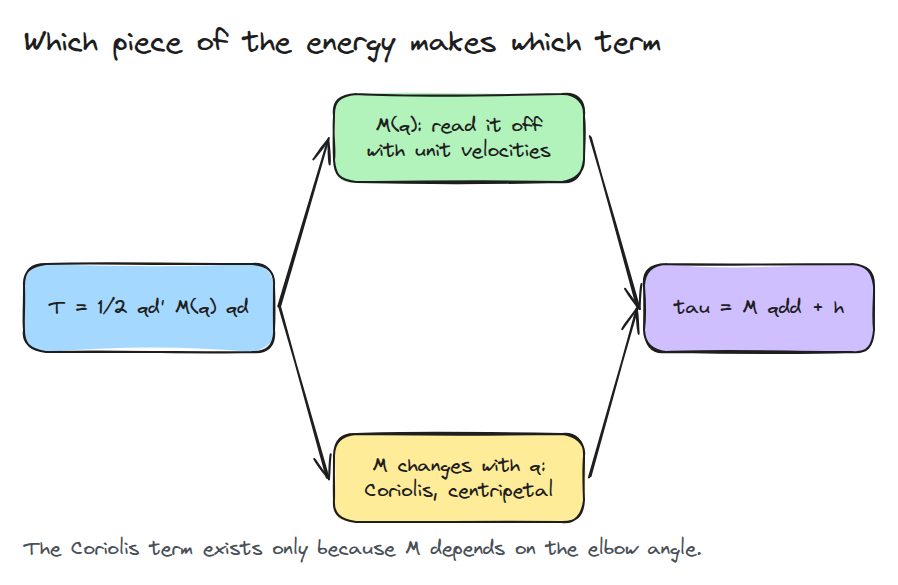
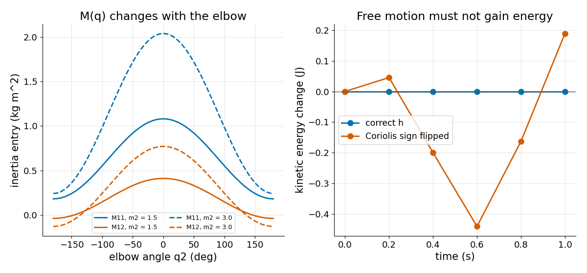

# Where M(q) Comes From: Deriving Arm Dynamics

> Write the arm's kinetic energy once, and differentiation hands you the inertia matrix and every Coriolis term.

**Type:** Build   **Prerequisites:** 02/03 Jacobians, 03/05 Computed Torque   **Time:** ~15 minutes

## In Plain Words

Sweep your forearm across a desk while moving your shoulder and elbow. The forearm's speed depends on both
joints. Its kinetic energy includes the combined effect of those motions, so the joints' contributions cannot
be treated independently.

Arm dynamics starts by adding each link's kinetic energy. Differentiation reveals the inertia matrix and the
motion-dependent coupling torques. An independent calculation adds link forces and moments instead. Both
should predict the same motor torques, and an unforced, frictionless horizontal arm should conserve kinetic
energy.

## The Problem

Lesson 03/05 gave you `M(q)` and `h(q, qd)` and asked you to trust them. Change a link, add a joint, or mistype one sign, and the controller cancels the wrong arm. You cannot adapt a formula you cannot rebuild.

## The Concept



*Two independent derivations. If they disagree at any state, one of them has a bug.*

The kinetic energy of a horizontal arm is `T = 1/2 qd' M(q) qd`. It is exactly quadratic in `qd`, so unit velocities read `M` straight off `T`. The Lagrange equation `tau = d/dt(dT/dqd) - dT/dq` then gives `tau = M qdd + h`.



*Coriolis and centripetal torques appear only because `M` changes with the elbow angle.*

The power `qd' h` need not vanish. It equals `1/2 qd' Mdot qd`, so in free motion it cancels the kinetic-energy change from the varying inertia.

The other road is Newton-Euler. Walk outward and compute each link's acceleration, then walk inward and add up forces and moments. It never touches energy.



*Left: inertia entries against elbow angle for two masses of link 2. Right: free motion with the correct `h` keeps kinetic energy constant. A flipped Coriolis sign makes it wander by tenths of a joule.*

## Build It

```python
off = T(e0 + e1) - T(e0) - T(e1)          # unit velocities
M = [[2*T(e0), off], [off, 2*T(e1)]]
tau = M @ qdd + dMdt @ qd - dTdq          # dMdt, dTdq by central differences
```

`kinetic()` builds `T` from the link geometry. `lagrange_tau()` and `newton_euler()` are the two roads. Tests check that `M` is symmetric positive definite, equals lesson 03/05's closed form, and that both roads agree with each other and with 03/05 at 20 random states. `energy_drift()` runs free motion with RK4, and a flipped sign must fail it.

```bash
cd robotics-engineering-from-scratch
python3 -m pytest phases/03-dynamics-and-control/07-deriving-arm-dynamics -q
python3 phases/03-dynamics-and-control/07-deriving-arm-dynamics/code/figure.py
```

## Use It

MuJoCo computes the same `M` with `mj_fullM` and stores the bias force in `data.qfrc_bias`. Build the arm there and compare entries with `mass()` to a tight tolerance. Craig, Ch. 6, derives these equations for manipulators.

Sources: [MuJoCo API reference](https://mujoco.readthedocs.io/en/stable/APIreference/APIfunctions.html), checked 2026-11-10.

## Ship It

`outputs/skill-arm-dynamics-derivation-check.md` checks a hand-derived or generated dynamics model with the two-road and energy tests.

## Exercises

1. Add the potential energy `V` of lesson 03/02 and extend `lagrange_tau`.
2. Make link 2 twice as heavy and predict which entry of `M` moves most.
3. Give link 2 a point mass at its tip and rebuild `kinetic()`.
