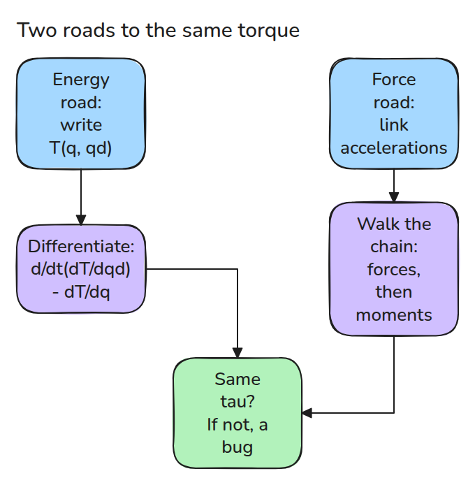
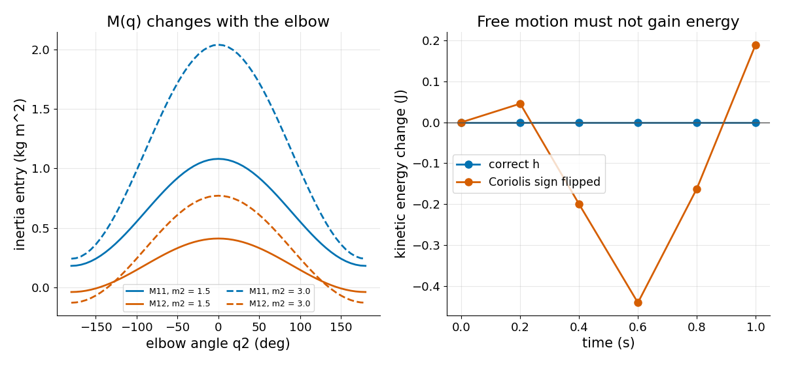

# Where M(q) Comes From: Deriving Arm Dynamics

> Learn where an arm's inertia numbers come from, so you can rebuild them when the robot changes.

**Type:** Build   **Prerequisites:** 02/03 Jacobians, 03/05 Computed Torque   **Time:** ~15 minutes

## In Plain Words

A two-link bench arm swings freely with no motor pushing. The forearm's speed depends on both joints at once, so its kinetic energy cannot be split joint by joint.

Differentiating the summed kinetic energy gives the inertia matrix and the coupling torques. A separate force-and-moment calculation must agree, and with no motor or friction the kinetic energy stays constant.

## Key Terms

- **Kinetic energy (`T`)**: the energy of motion; for an arm `T = 1/2 qd' M qd`, where `qd'` is the speed list written sideways.
- **Inertia matrix (`M`)**: how heavy the arm feels to each joint, and how the joints couple.
- **Coriolis and centripetal torques (`h`)**: speed-dependent torques that exist because `M` changes with the pose.
- **Lagrange equation**: a rule that turns kinetic energy into joint torques by differentiating.
- **Newton-Euler**: a second method that adds up each link's forces and moments instead of using energy.
- **Positive definite**: every motion has positive kinetic energy.

## The Problem

You bolt a heavier tool onto the arm, and the formulas your controller uses for the arm's weight and swing forces no longer match. One mistyped sign and the controller cancels the wrong arm.

## The Concept

A controller is only as good as its arm model, so you must be able to rebuild it. Two independent ways give the same answer. One writes down the arm's energy of motion and differentiates it. The other adds up forces link by link.



*Two roads to one torque. If they disagree, one has a bug.*


*Each joint's energy alone, and both together. The gap is the tug.*


*The tugging exists because the weight changes with the elbow.*

A free-swinging arm with no friction must keep its energy, a sharp test for a wrong sign.



*Right: a flipped sign makes the energy wander.*

<details><summary>The math (optional)</summary>

`T = 1/2 qd' M(q) qd` expands to `1/2 (M11 qd1^2 + 2 M12 qd1 qd2 + M22 qd2^2)`; the Lagrange equation `tau = d/dt(dT/dqd) - dT/dq` gives `tau = M qdd + h`. For the lesson's arm (1 and 1.5 kg) at `q = (0.3, 1.0)` and 1 rad/s: joint 1 alone gives `T = 0.437`, `M11 = 0.873`; joint 2 alone `T = 0.0925`, `M22 = 0.185`; both `T = 0.836`, so `M12 = 0.307`. The wrong-sign energy wanders by tenths of a joule.

</details>

## Build It

Three lines measure the weight table from the energy with unit speeds, then form the torque.

```python
off = T(e0 + e1) - T(e0) - T(e1)          # unit velocities
M = [[2*T(e0), off], [off, 2*T(e1)]]
tau = M @ qdd + dMdt @ qd - dTdq          # dMdt, dTdq by central differences
```

`kinetic()` builds the energy; `lagrange_tau()` and `newton_euler()` are the two roads. Tests check the roads agree at 20 random states and a flipped sign fails the energy test.

```bash
cd robotics-engineering-from-scratch
python3 -m pytest phases/03-dynamics-and-control/07-deriving-arm-dynamics -q
python3 phases/03-dynamics-and-control/07-deriving-arm-dynamics/code/figure.py
```

## Use It

MuJoCo computes the same table with `mj_fullM`; compare with `mass()`. Craig, Ch. 6.

Sources: [MuJoCo API reference](https://mujoco.readthedocs.io/en/stable/APIreference/APIfunctions.html), checked 2026-11-10.

## Ship It

`outputs/skill-arm-dynamics-derivation-check.md` checks a dynamics model.

## Exercises

1. Make link 2 twice as heavy and see which table entry moves most.
2. Flip one sign and watch the energy test fail.
3. Add a small weight at the tip of link 2.
