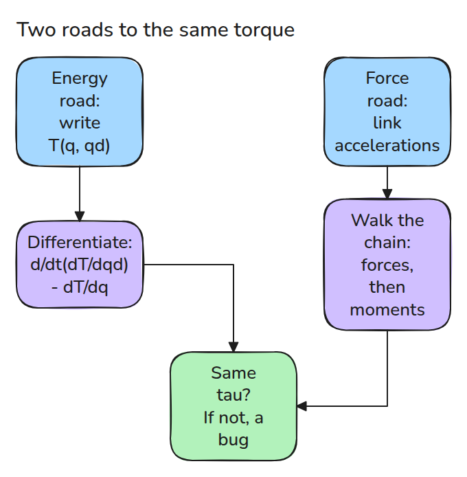
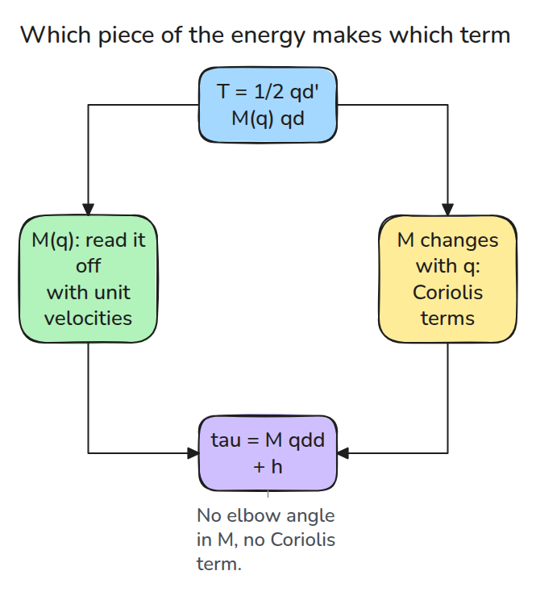
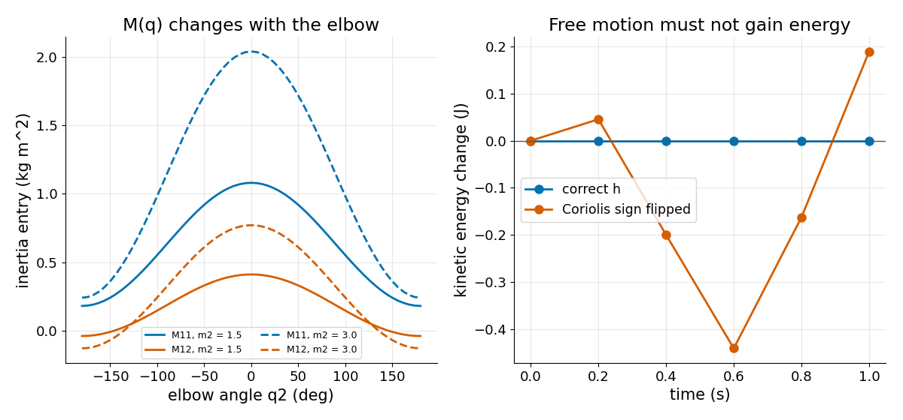

# M(q)는 어디서 오는가: 팔 동역학 유도

> 팔의 운동에너지를 한 번 쓰면 미분만으로 관성 행렬과 모든 Coriolis 항이 나옵니다.

**유형:** 만들기   **선수 지식:** 02/03 야코비안, 03/05 Computed Torque   **시간:** 약 15분

## 쉽게 말하면

링크가 둘인 책상 위 로봇 팔이 모터가 밀지 않는 채로 자유롭게 흔들린다고 해 보세요. 아래팔의 속도에는 두 관절의 움직임이 함께 들어가요. 그래서 움직임의 에너지인 운동에너지를 관절별로 따로 나눌 수 없어요.

링크마다 운동에너지를 더하고 미분하면 관성 행렬과 관절끼리 주고받는 coupling torque가 나와요. 링크의 힘과 모멘트를 더하는 별도 계산도 같은 모터 토크를 줘야 해요. 모터도 마찰도 없으면 팔의 운동에너지는 일정해야 해요.

## 문제

레슨 03/05는 `M(q)`(관성 행렬)와 `h(q, qd)`(속도에 따른 토크)를 주고 믿으라고 했습니다. 링크를 바꾸거나 관절을 하나 더하거나 부호 하나만 잘못 적으면 컨트롤러는 엉뚱한 팔을 상쇄합니다. 다시 만들 수 없는 공식은 새 팔에 맞게 고칠 수 없습니다.

## 개념



*서로 독립인 유도 두 개입니다. 어떤 상태에서든 둘이 다르면 한쪽에 버그가 있습니다.*

수평면 팔의 운동에너지는 `T = 1/2 qd' M(q) qd`입니다(`qd'`는 `qd`를 옆으로 눕힌 것입니다). 풀어 쓰면 `T = 1/2 (M11 qd1^2 + 2 M12 qd1 qd2 + M22 qd2^2)`이라서 관절 하나만 단위 속도로 돌리면 `M11`이나 `M22`가 보이고 교차항 `M12`는 둘이 함께 움직여야 나타납니다. Lagrange 방정식 `tau = d/dt(dT/dqd) - dT/dq`는 `tau = M qdd + h`를 줍니다.

예: 레슨의 팔(질량 1 kg과 1.5 kg)이 `q = (0.3, 1.0)`에 있습니다. 관절 1만 1 rad/s로 돌리면 `T = 0.437`이므로 `M11 = 2T = 0.873`입니다. 관절 2만 돌리면 `T = 0.0925`이므로 `M22 = 0.185`입니다. 둘을 함께 돌리면 `T = 0.836`입니다. 남는 `0.836 - 0.437 - 0.0925 = 0.307`이 `M12`이고 관절 사이의 coupling입니다.


*두 관절이 1 rad/s로 함께 돕니다. 쌓은 막대는 각 관절이 혼자 돌 때의 에너지이고 호박색 막대는 함께 돌 때의 에너지입니다. 둘 사이의 틈을 보세요. 그것이 `M12`이고 팔꿈치 각도에 따라 변합니다.*



*Coriolis 토크와 centripetal 토크는 `M`이 팔꿈치 각도에 따라 변하기 때문에만 생깁니다.*

일률 `qd' h`는 0일 필요가 없습니다. `1/2 qd' Mdot qd`, 즉 관성이 변하면서 운동에너지를 바꾸는 속도와 같아서 자유 운동에서는 `h`가 그것을 상쇄합니다.

다른 길은 Newton-Euler입니다. 바깥으로 나가며 각 링크의 가속도를 구하고 안쪽으로 돌아오며 힘과 모멘트를 더합니다. 에너지는 전혀 쓰지 않습니다.



*왼쪽은 링크 2의 질량 두 가지에 대한 팔꿈치 각도별 관성 성분입니다. 오른쪽은 올바른 `h`로 자유 운동을 하면 운동에너지가 일정하고 Coriolis 부호를 뒤집으면 십분의 몇 J(줄)씩 흔들리는 모습입니다.*

## 만들기

```python
off = T(e0 + e1) - T(e0) - T(e1)          # unit velocities
M = [[2*T(e0), off], [off, 2*T(e1)]]
tau = M @ qdd + dMdt @ qd - dTdq          # dMdt, dTdq by central differences
```

`kinetic()`이 링크 기하에서 `T`를 만듭니다. `lagrange_tau()`와 `newton_euler()`가 두 길입니다. 테스트는 `M`이 대칭 양정치이고 레슨 03/05의 닫힌 식과 같은지, 두 길이 서로 그리고 03/05와 무작위 상태 20개에서 일치하는지, 그리고 `energy_drift()`(RK4로 돌리는 자유 운동)가 부호를 뒤집으면 실패하는지 확인합니다.

```bash
cd robotics-engineering-from-scratch
python3 -m pytest phases/03-dynamics-and-control/07-deriving-arm-dynamics -q
python3 phases/03-dynamics-and-control/07-deriving-arm-dynamics/code/figure.py
```

## 실제 도구로 보기

MuJoCo는 같은 `M`을 `mj_fullM`으로 계산하고 bias force를 `data.qfrc_bias`에 저장합니다. 같은 팔을 만들어 `mass()`와 성분을 엄격한 허용 오차로 비교하세요. Craig 6장이 매니퓰레이터의 이 방정식을 유도합니다.

출처: [MuJoCo API reference](https://mujoco.readthedocs.io/en/stable/APIreference/APIfunctions.html), 2026년 11월 10일에 확인했습니다.

## 결과물

`outputs/skill-arm-dynamics-derivation-check.md`는 손으로 유도했거나 생성한 동역학 모델을 두 길 테스트와 에너지 테스트로 점검합니다.

## 연습 문제

1. 레슨 03/02의 위치에너지 `V`를 더해 `lagrange_tau`를 확장하세요.
2. 링크 2를 두 배 무겁게 하고 `M`의 어느 성분이 가장 크게 변할지 예측하세요.
3. 링크 2의 끝에 점질량을 달고 `kinetic()`을 다시 만드세요.
