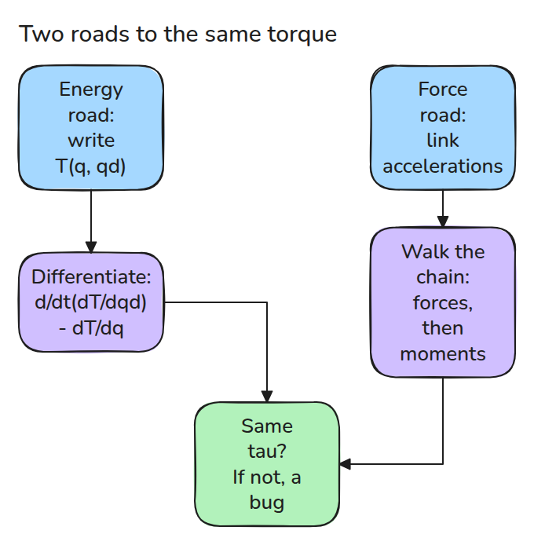
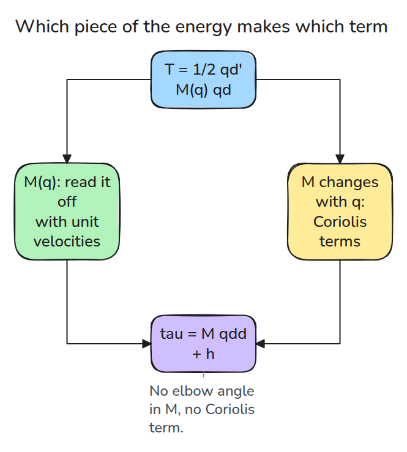
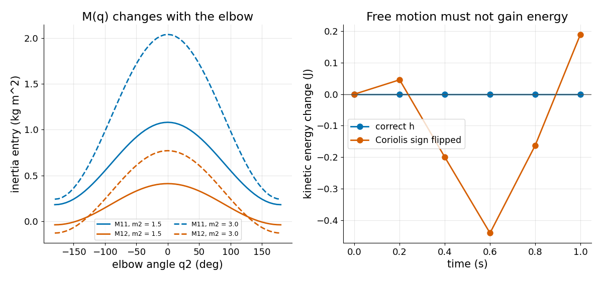

# M(q)는 어디서 오는가: 팔 동역학 유도

> 팔의 관성 숫자가 어디서 나오는지 이해하면 로봇이 바뀌었을 때도 그 숫자를 다시 만들 수 있습니다.

**유형:** 만들기   **선수 지식:** 02/03 야코비안, 03/05 Computed Torque   **시간:** 약 15분

## 쉽게 말하면

모터가 밀지 않는 상태에서 링크가 둘인 작은 로봇 팔이 자유롭게 흔들린다고 해 보세요. 흔들리는 아래팔이 윗팔을 함께 잡아당겨서 두 관절을 하나씩 따로 다룰 수 없어요.

미적분 한 단계(접힌 부분 참고)로 팔의 움직임 에너지에서 관성 행렬과 그 잡아당김을 얻어요. 힘을 더해 가는 두 번째 방법도 같은 답을 줘야 해요.

## 핵심 용어

- **Joint angles (`q`)**: 각 관절이 얼마나 돌았는지입니다.
- **Torque**: 비트는 힘입니다. 예를 들어 모터가 관절을 미는 힘입니다.
- **Kinetic energy**: 어떤 것이 움직이기 때문에 갖는 에너지입니다.
- **Inertia matrix (`M`)**: 팔이 각 관절에 얼마나 무겁게 느껴지는지, 그리고 관절끼리 어떻게 서로 잡아당기는지를 나타내는 숫자 네 개의 표입니다.
- **Fast-motion torques (`h`)**: 팔이 빠르게 움직일 때 나타나는 비트는 힘입니다. 자세에 따라 팔이 무겁게 느껴지는 정도가 달라지기 때문에 생깁니다.
- **Lagrange equation**: 팔의 움직임 에너지를 관절 torque로 바꾸는 규칙입니다(수학은 접힌 부분에 있습니다).

## 문제

팔에 더 무거운 도구를 달면 팔의 관성과 swing 힘을 계산하는 공식이 더 이상 맞지 않습니다. 부호 하나만 잘못 적어도 팔을 움직이는 프로그램은 엉뚱한 팔 모델로 일합니다.

## 개념

컨트롤러(팔을 움직이는 프로그램)는 팔의 모델만큼만 좋으므로 그 모델을 다시 만들 수 있어야 합니다. 서로 독립인 두 방법이 같은 답을 줍니다. 하나는 팔의 움직임 에너지에서 출발합니다(미적분은 접힌 부분에 있습니다). 다른 하나는 링크마다 힘을 더합니다.



*하나의 torque로 가는 두 길입니다. 둘이 다르면 한쪽에 버그가 있습니다.*


*관절 하나만 돌 때의 막대와 둘이 함께 돌 때의 막대를 비교하세요. 차이가 잡아당김입니다.*



*잡아당김은 관성이 팔꿈치에 따라 변하기 때문에 생깁니다.*

자유롭게 흔들리는 팔은 에너지를 그대로 유지하므로 `h`의 부호를 뒤집으면 에너지가 점점 어긋납니다.



*오른쪽: 부호를 뒤집으면 에너지가 흔들립니다.*

<details><summary>The math (optional)</summary>

운동에너지는 `T = 1/2 qd' M(q) qd`이고 `qd'`는 속도 목록 `qd`를 옆으로 눕힌 것입니다.
이를 풀어 쓰면 `1/2 (M11 qd1^2 + 2 M12 qd1 qd2 + M22 qd2^2)`입니다. Lagrange 방정식 `tau = d/dt(dT/dqd) - dT/dq`에서 `tau = M qdd + h`가 나옵니다.
이 레슨의 팔(1 kg과 1.5 kg)이 `q = (0.3, 1.0)`에서 1 rad/s로 돌 때를 봅니다. 관절 1만 돌리면 `T = 0.437`이므로 `M11 = 0.873`입니다. 관절 2만 돌리면 `T = 0.0925`이므로 `M22 = 0.185`입니다. 둘을 함께 돌리면 `T = 0.836`이라서 `M12 = 0.307`입니다.
`h`의 부호가 틀리면 에너지가 십분의 몇 J씩 흔들립니다.
빠른 움직임의 torque `h`는 Coriolis torque와 centripetal torque라고 부릅니다.
`M`은 성분을 하나씩 만듭니다. 관절 하나만 속도 1로 돌리고 나머지를 0으로 두면 `M11`이나 `M22`가 나오고 둘을 함께 돌리면 `M12`가 나옵니다.

</details>

## 만들기

짧은 세 줄로 팔의 에너지에서 `M`을 만들고 torque를 구합니다.

```python
off = T(e0 + e1) - T(e0) - T(e1)          # unit velocities
M = [[2*T(e0), off], [off, 2*T(e1)]]
tau = M @ qdd + dMdt @ qd - dTdq          # dMdt, dTdq by central differences
```

`kinetic()`은 에너지를 만들고 `lagrange_tau()`와 `newton_euler()`는 각각 두 길입니다. 테스트는 행렬이 대칭 양정치인지, 두 길이 무작위 상태 20개에서 일치하는지, 부호를 뒤집으면 에너지 테스트가 실패하는지 확인합니다.

```bash
cd robotics-engineering-from-scratch
python3 -m pytest phases/03-dynamics-and-control/07-deriving-arm-dynamics -q
python3 phases/03-dynamics-and-control/07-deriving-arm-dynamics/code/figure.py
```

## 실제 도구로 보기

MuJoCo는 같은 행렬을 `mj_fullM`으로 계산할 수 있으니 `mass()`와 비교해 보세요. 자세한 내용은 Craig 6장에 있습니다.

출처: [MuJoCo API reference](https://mujoco.readthedocs.io/en/stable/APIreference/APIfunctions.html), 2026년 11월 10일에 확인했습니다.

## 결과물

`outputs/skill-arm-dynamics-derivation-check.md`는 동역학 모델을 점검합니다.

## 연습 문제

1. 링크 2를 두 배 무겁게 하고 `M`의 네 숫자 중 어느 것이 가장 크게 변하는지 보세요.
2. `h`의 부호를 뒤집고 에너지 테스트가 실패하는 것을 보세요.
3. 링크 2의 끝에 작은 무게를 다세요.
