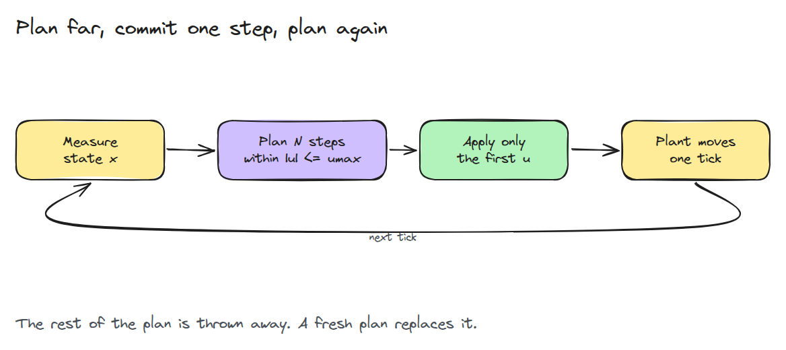
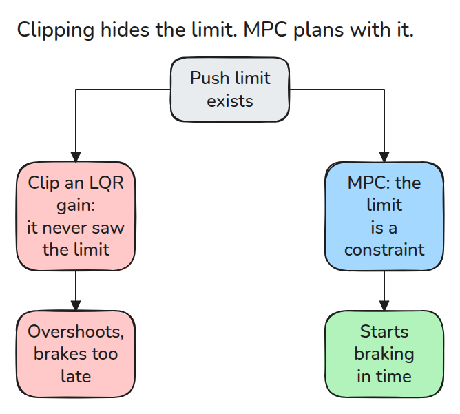
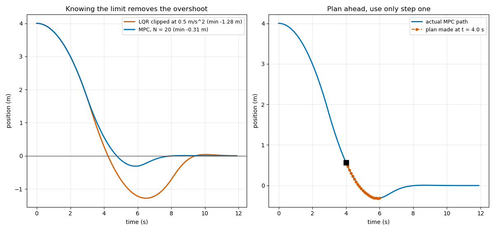

# Model Predictive Control

> Learn how a controller can plan ahead while respecting a motor's limits.

**Type:** Build   **Prerequisites:** 03/06 LQR   **Time:** ~15 minutes

## In Plain Words

Imagine steering a toy car to a stop line with a weak brake. If you brake only at the line, you shoot past it, so you must start early.

Model predictive control plans the next few pushes with that brake limit built in. It applies only the first push, measures the car again, then plans again.

## Key Terms

- **Model predictive control (MPC)**: plan a short future under the limits, apply the first command, then plan again.
- **Horizon (`N`)**: how many steps ahead each plan looks.
- **Terminal cost**: a price on where the plan ends, so a short plan still sees what comes after.
- **Quadratic**: a cost shaped like a bowl, easy to minimise.
- **Box constraint**: every command must stay between `-umax` and `umax`.
- **Plant**: the thing being controlled.

## The Problem

A robot's motor can only push so hard. A controller asks for more, the command is clipped, and since it never knew the limit it brakes too late and overshoots.

## The Concept

Real motors have limits, so plan with them instead of asking for the impossible and clipping.



*Every tick the plan is rebuilt from the measured state. Only its first step reaches the plant.*

Stack the next `N` states as `X = Phi x0 + Gam U` (`x0` the measured state, `U` the next `N` pushes, `Phi` and `Gam` from lesson 06's model). The cost `sum x'Qx + u'Ru` plus a terminal cost becomes a quadratic in `U`, and the limit `|u| <= umax` a box on `U`. Solve it by gradient steps (small downhill moves) clipped back into the box, with Nesterov momentum.



*The limit lives after the controller, or inside it.*



*Start 4 m away, `umax = 0.5`. The clipped gain overshoots by 1.28 m; MPC with `N = 20` (2 s ahead at `dt = 0.1`) by 0.31 m.*

Same start, only the plan length changes: `N = 2` (0.2 s ahead) overshoots by 1.27 m, `N = 10` by 0.78 m, `N = 20` by 0.31 m.


*Plans of 2, 10 and 20 steps; amber bars show the slide past the line.*

## Build It

```python
U_new = np.clip(Y - step * (H @ Y + f), -umax, umax)   # projected gradient
Y = U_new + (t - 1) / t_new * (U_new - U)               # momentum
```

`prediction()` builds `Phi` and `Gam`, `plan()` solves the box-constrained problem, `simulate()` re-plans every tick. Tests check the prediction reproduces a rollout, inputs obey the bound, and MPC matches LQR with a loose bound.

```bash
cd robotics-engineering-from-scratch
python3 -m pytest phases/03-dynamics-and-control/08-model-predictive-control -q
python3 phases/03-dynamics-and-control/08-model-predictive-control/code/figure.py
```

## Use It

Production MPC uses a QP solver such as OSQP; solve one tick and compare the first input with `plan()`.

Sources: [OSQP documentation](https://osqp.org/docs/), checked 2026-11-10.

## Ship It

`outputs/skill-mpc-setup-check.md` reviews horizon, weights, terminal cost and solve time.

## Exercises

1. Add a velocity bound; what does the box become?
2. Find the smallest `N` whose cost is within 1% of `N = 30`.
3. Stop the solver after 20 iterations and measure the cost rise.
