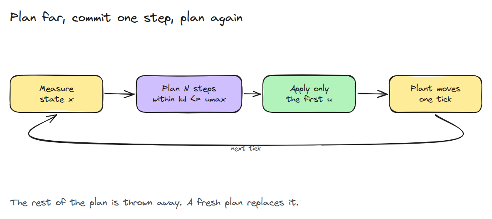
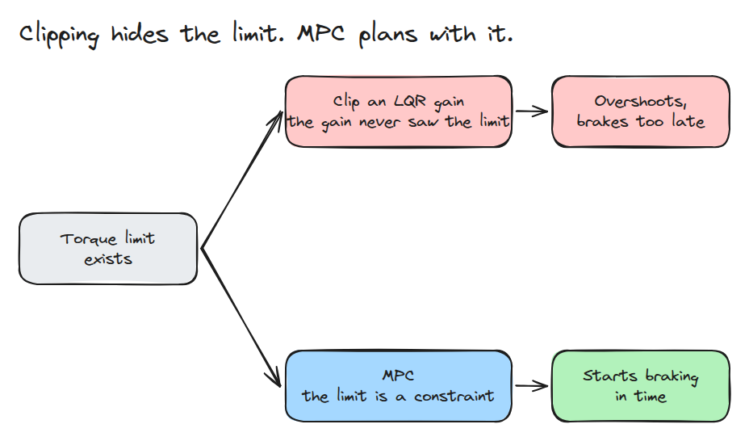
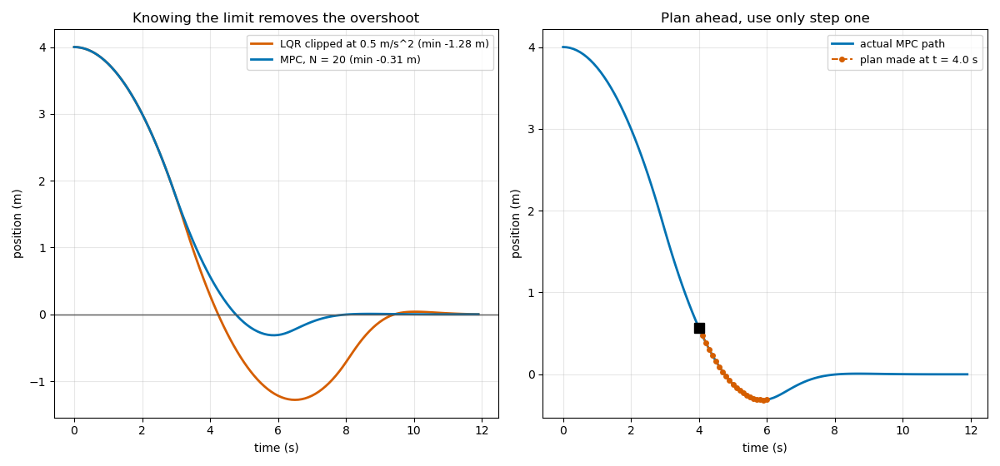

# Model Predictive Control

> Plan a short future with the limits written in, apply only the first command, then plan again.

**Type:** Build   **Prerequisites:** 03/06 LQR   **Time:** ~15 minutes

## In Plain Words

On a bike, waiting until a stop line to brake sends you past it. The brakes have limited strength, so you must
consider your speed and the distance needed to slow down before you reach the line.

Model predictive control plans a short sequence with the input limit included. It applies the first command,
measures the new state, then plans again. Accounting for limited braking while planning can reduce overshoot
compared with clipping a command that asked for too much.

## The Problem

A controller asks for more torque than the motor has, and the command is simply clipped. The controller never knew about the limit, so it brakes too late and overshoots. The error then keeps pushing the other way, and the arm swings back across the target.

## The Concept



*Every tick the plan is rebuilt from the measured state. Only its first step ever reaches the plant.*

Stack the next `N` states as `X = Phi x0 + Gam U`. The cost `sum x'Qx + u'Ru` plus a terminal cost becomes a quadratic in the inputs `U`. The limit `|u| <= umax` is a box on `U`. Take gradient steps and clip back into the box after each one, with Nesterov momentum to converge faster. Using LQR's `P` as the terminal cost lets a short plan still see the tail.



*The difference is where the limit lives: after the controller, or inside it.*



*A double integrator starts 4 m away with `umax = 0.5`. The clipped gain overshoots by 1.28 m. MPC with `N = 20` overshoots by 0.31 m. Right: the plan at 4 s looks 2 s ahead and only its first step is used.*

## Build It

```python
U_new = np.clip(Y - step * (H @ Y + f), -umax, umax)   # projected gradient
Y = U_new + (t - 1) / t_new * (U_new - U)               # momentum
```

`prediction()` builds `Phi` and `Gam`. `plan()` solves the box-constrained problem. `simulate()` re-plans every tick. Tests check that the prediction reproduces a rollout, that every applied input obeys the bound, that with a loose bound MPC matches LQR, and that a longer horizon does not raise the cost on this run.

```bash
cd robotics-engineering-from-scratch
python3 -m pytest phases/03-dynamics-and-control/08-model-predictive-control -q
python3 phases/03-dynamics-and-control/08-model-predictive-control/code/figure.py
```

## Use It

Production MPC uses a dedicated QP solver such as OSQP, with a warm start from the last plan. Solve one tick with it and compare the first input with `plan()`. The horizon is a cost-versus-compute knob.

Sources: [OSQP documentation](https://osqp.org/docs/), checked 2026-11-10.

## Ship It

`outputs/skill-mpc-setup-check.md` reviews horizon, weights, terminal cost and solve time.

## Exercises

1. Add a bound on velocity as a second constraint and describe what the box becomes.
2. Find the smallest `N` whose cost is within 1% of `N = 30`.
3. Stop the solver after 20 iterations and measure how much the cost rises.
