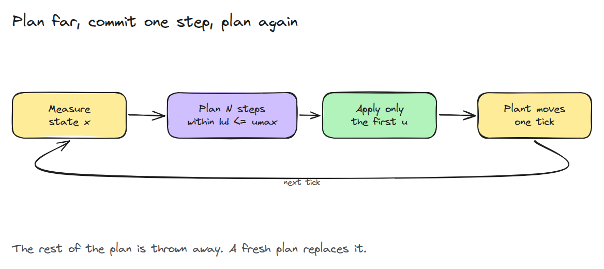
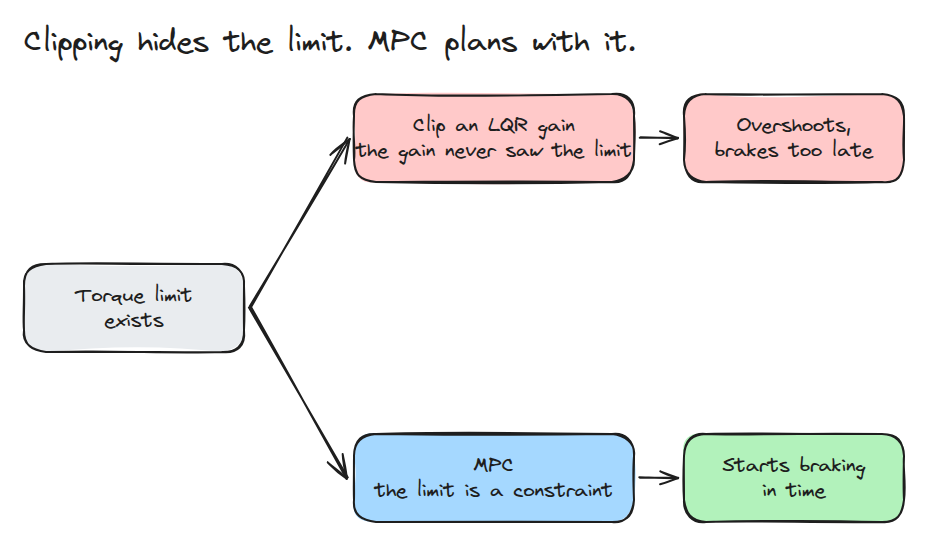
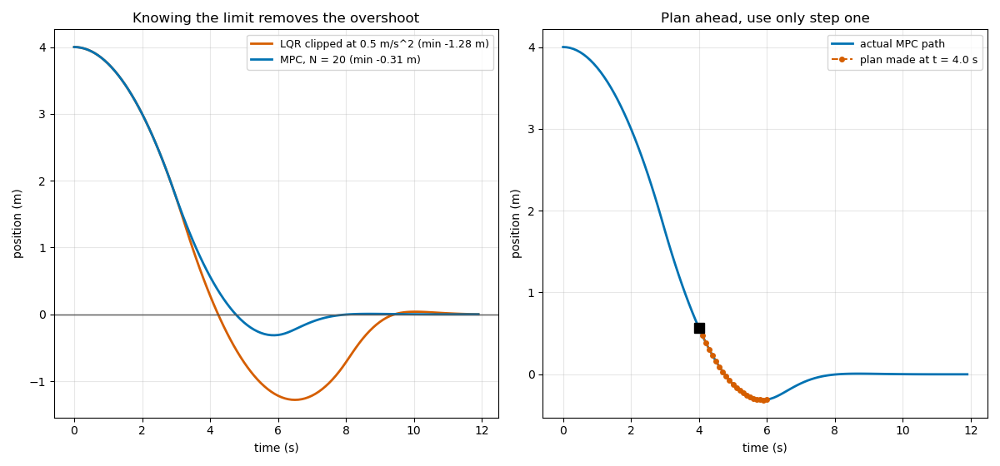

# Model Predictive Control

> 한계를 식에 넣고 짧은 미래를 계획하고 첫 명령만 쓰고 다시 계획합니다.

**유형:** 만들기   **선수 지식:** 03/06 LQR   **시간:** 약 15분

## 쉽게 말하면

자전거를 타다가 정지선에 와서야 브레이크를 잡으면 선을 지나쳐요. 제동력에는 한계가 있어서 현재 속도와 속도를 줄이는 데 필요한 거리를 미리 봐야 해요.

model predictive control은 입력 한계를 포함해 짧은 미래의 명령들을 계획해요. 첫 명령만 쓰고 새 상태를 측정한 뒤 다시 계획해요. 한계를 넘는 명령을 나중에 잘라 내기보다
계획할 때부터 제동 한계를 반영하면 지나치는 정도를 줄일 수 있어요.

## 문제

컨트롤러가 모터가 낼 수 있는 토크보다 큰 값을 요구하고 그 명령은 그냥 잘려 나갑니다. 컨트롤러는 한계를 몰랐으므로 너무 늦게 제동해서 overshoot가 납니다. 그러면 오차가 반대로 밀어서 팔이 목표를 다시 가로질러 흔들립니다.

## 개념



*매 tick마다 측정한 상태에서 계획을 새로 만듭니다. 계획의 첫 단계만 plant에 전달됩니다.*

다음 `N`개 상태를 `X = Phi x0 + Gam U`로 쌓습니다. 비용 `sum x'Qx + u'Ru`에 종단 비용을 더하면 입력 `U`에 대한 이차식이 됩니다. 한계 `|u| <= umax`는 `U`에 대한 상자입니다. 경사 한 걸음을 가고 상자 안으로 되돌리기를 반복하며 Nesterov 모멘텀으로 수렴을 빠르게 합니다. 종단 비용으로 LQR의 `P`를 쓰면 짧은 계획도 꼬리까지 봅니다.



*차이는 한계가 컨트롤러 뒤에 있느냐 안에 있느냐입니다.*



*이중 적분기가 4 m 떨어진 곳에서 `umax = 0.5`로 출발합니다. 잘린 게인은 1.28 m 넘치고 `N = 20`인 MPC는 0.31 m 넘칩니다. 오른쪽은 4 s의 계획이 2 s를 내다보고 첫 단계만 쓰는 모습입니다.*

## 만들기

```python
U_new = np.clip(Y - step * (H @ Y + f), -umax, umax)   # projected gradient
Y = U_new + (t - 1) / t_new * (U_new - U)               # momentum
```

`prediction()`이 `Phi`와 `Gam`을 만들고 `plan()`이 상자 제약 문제를 풉니다. `simulate()`는 매 tick 다시 계획합니다. 테스트는 예측이 rollout을 재현하는지, 적용된 입력이 모두 한계를 지키는지, 한계가 넉넉하면 MPC가 LQR과 같은지, 이 실행에서 horizon이 길수록 비용이 오르지 않는지 확인합니다.

```bash
cd robotics-engineering-from-scratch
python3 -m pytest phases/03-dynamics-and-control/08-model-predictive-control -q
python3 phases/03-dynamics-and-control/08-model-predictive-control/code/figure.py
```

## 실제 도구로 보기

실제 MPC는 OSQP 같은 전용 QP solver를 쓰고 직전 계획으로 warm start 합니다. 한 tick을 그것으로 풀어 첫 입력을 `plan()`과 비교하세요. horizon은 비용과 계산량 사이의 손잡이입니다.

출처: [OSQP documentation](https://osqp.org/docs/), 2026년 11월 10일에 확인했습니다.

## 결과물

`outputs/skill-mpc-setup-check.md`는 horizon, 가중치, 종단 비용, 풀이 시간을 검토합니다.

## 연습 문제

1. 속도 한계를 두 번째 제약으로 더하고 상자가 무엇이 되는지 설명하세요.
2. 비용이 `N = 30`의 1% 안에 드는 가장 작은 `N`을 찾으세요.
3. solver를 20번만 반복하게 하고 비용이 얼마나 오르는지 재세요.
