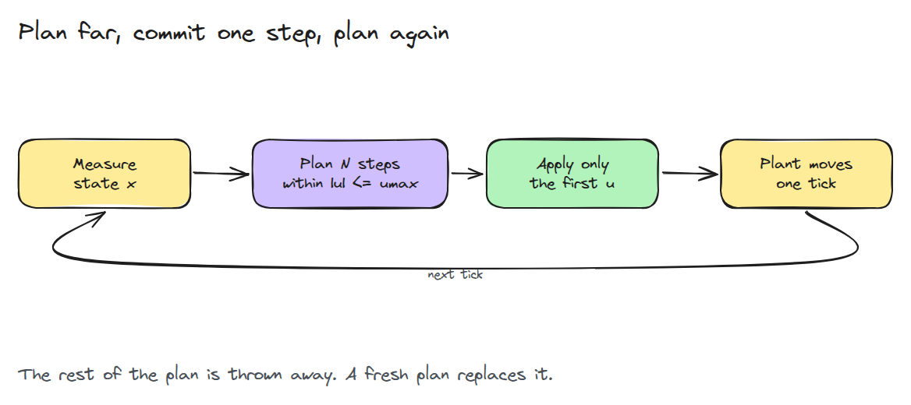
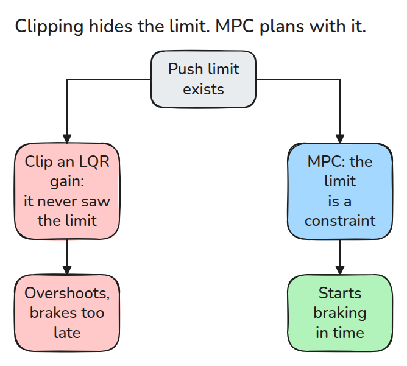
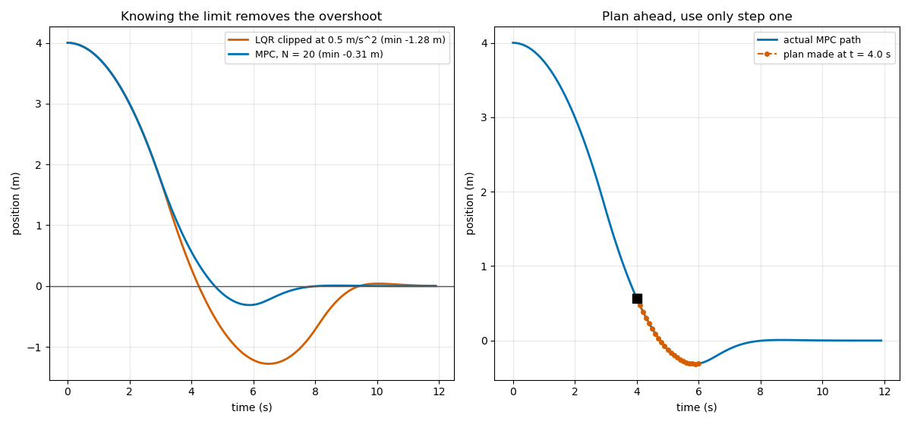

# Model Predictive Control

> 컨트롤러가 모터의 한계를 지키면서 앞을 내다보고 계획하는 법을 알게 됩니다.

**유형:** 만들기   **선수 지식:** 03/06 LQR   **시간:** 약 15분

## 쉽게 말하면

장난감 자동차를 정지선에 세운다고 해 보세요. 브레이크가 약해요. 선에 와서야 브레이크를 잡으면 선을 지나치니까 일찍 잡아야 해요.

model predictive control은 그 브레이크 한계를 넣고 앞으로 몇 번 밀지를 계획해요. 첫 번째 힘만 쓰고 자동차를 다시 측정한 뒤 다시 계획해요.

## 핵심 용어

- **Model predictive control (MPC)**: 한계를 지키며 짧은 미래를 계획하고 첫 명령만 쓴 뒤 다시 계획하는 방법입니다.
- **Horizon (`N`)**: 계획 하나가 몇 step 앞을 내다보는지입니다.
- **Cost**: 계획이 얼마나 나쁜지 매기는 점수입니다.
- **Terminal cost**: 계획이 끝나는 자리에 매기는 값이라서 짧은 계획도 그 뒤의 일을 봅니다.
- **Quadratic**: 그릇 모양의 비용으로 최솟값을 찾기 쉽습니다.
- **Box constraint**: 모든 미는 힘이 허용된 가장 큰 힘의 ± 범위 안에 있어야 한다는 제약입니다.

## 문제

로봇의 모터는 낼 수 있는 힘에 한계가 있습니다. 컨트롤러(팔을 움직이는 프로그램)가 그보다 큰 값을 요구하면 명령은 잘려 나가고 컨트롤러는 한계를 몰랐으므로 너무 늦게 제동해서 overshoot가 납니다.

## 개념

실제 모터에는 한계가 있으므로 불가능한 값을 요구했다가 자르는 대신 한계를 넣고 계획합니다. model predictive control은 한계를 넣고 앞으로 몇 번 밀지를 계획하고 첫 번째만 쓰고 다시 측정하고 다시 계획합니다.



*매 단계 측정한 값으로 계획을 새로 만듭니다.*



*한계를 두는 곳은 두 가지입니다. 컨트롤러 뒤에서 잘라 내거나 계획 안에 넣습니다(MPC).*



*브레이크가 약할 때 잘린 컨트롤러가 훨씬 많이 지나칩니다.*

더 멀리 내다볼수록 도움이 됩니다.


*계획이 2, 10, 20 step인 경우입니다. 호박색 막대는 선을 지나 미끄러진 거리입니다.*

<details><summary>The math (optional)</summary>

다음 `N`개 상태를 `X = Phi x0 + Gam U`로 쌓습니다. 비용에 종단 비용을 더하면 `U`에 대한 그릇 모양이 되고 `|u| <= umax`는 상자입니다.
내려가는 걸음을 상자 안으로 잘라 가며 풉니다(Nesterov momentum). 4 m 떨어진 곳에서 `umax = 0.5`로 출발하면 잘린 gain은 1.28 m 넘치고 `N = 20`(`dt = 0.1`이므로 2초 앞)인 계획은 0.31 m 넘칩니다.
`N = 2`(0.2초 앞)는 1.27 m, `N = 10`은 0.78 m 넘칩니다.

</details>

## 만들기

짧은 두 줄이 계획 문제를 풉니다(자세한 것은 접힌 부분).

```python
U_new = np.clip(Y - step * (H @ Y + f), -umax, umax)   # projected gradient
Y = U_new + (t - 1) / t_new * (U_new - U)               # momentum
```

`prediction()`은 미는 힘의 목록에 대해 자동차가 어디에 가는지 계산하고 `plan()`은 한계 안에 머무는 비용이 가장 낮은 목록을 찾으며 `simulate()`는 매 단계 다시 계획합니다.

테스트는 예측이 실제 실행과 맞는지, 한계를 지키는지, 한계가 넉넉하면 LQR과 같은지 확인합니다.

```bash
cd robotics-engineering-from-scratch
python3 -m pytest phases/03-dynamics-and-control/08-model-predictive-control -q
python3 phases/03-dynamics-and-control/08-model-predictive-control/code/figure.py
```

## 실제 도구로 보기

실제 시스템은 OSQP 같은 만들어진 solver 라이브러리를 씁니다. 한 단계를 그것으로 풀어 첫 힘을 `plan()`과 비교하세요.

출처: [OSQP documentation](https://osqp.org/docs/), 2026년 11월 10일에 확인했습니다.

## 결과물

`outputs/skill-mpc-setup-check.md`는 horizon, 가중치, terminal cost, 풀이 시간을 검토합니다.

## 연습 문제

1. 계획 길이를 바꾸고 overshoot를 보세요.
2. 속도 한계를 더하세요. 이제 계획이 어떤 숫자들을 한계 안에 두어야 하나요?
3. `plan()`을 20번만 반복하게 하고(`iters=20`) 비용이 얼마나 오르는지 보세요.
