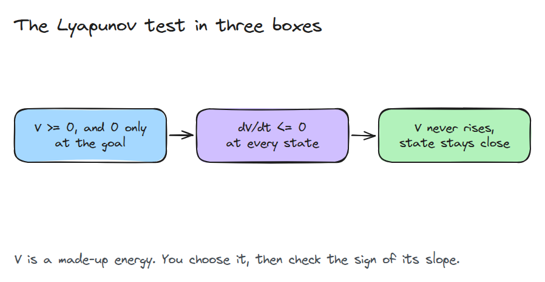
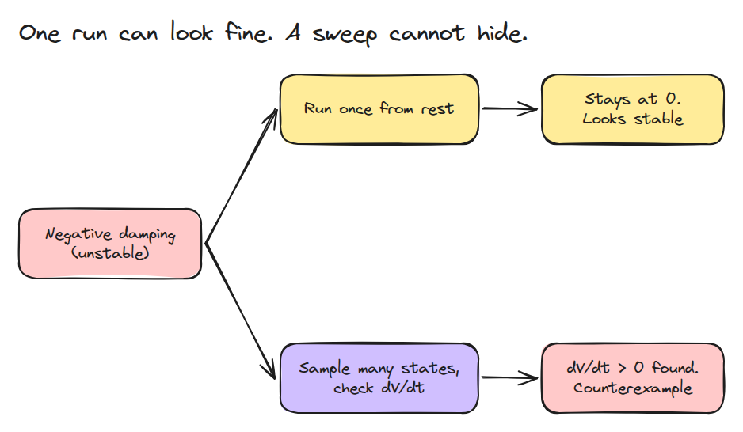
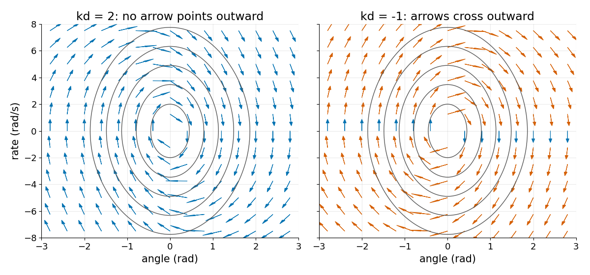
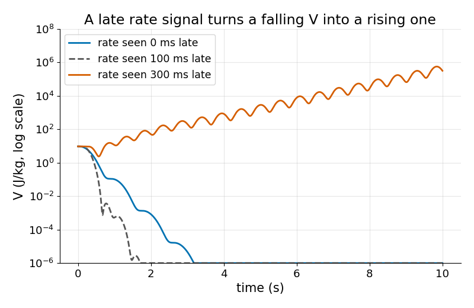

# Lyapunov Stability by Checking

> A stable system has an energy-like number that never rises, and you can test that on a computer.

**Type:** Build   **Prerequisites:** 03/04 PID and Tuning, 03/06 LQR   **Time:** ~15 minutes

## In Plain Words

A marble rolling in a bowl exchanges speed for height. Friction removes energy, so it cannot keep
climbing to higher energy levels without another push. An energy-like quantity can test motion more
broadly than watching one roll.

A Lyapunov function is an energy-like quantity for a controlled joint. Check whether it decreases along
the motion. Negative damping can make it rise, although a simulation started at the target with zero
velocity stays still. Sampling many states can expose that failure, but cannot prove every state is safe.

## The Problem

The only stability test you know is "I simulated it and it settled." A run from rest sits still even when the system is unstable, and a run from one start misses the corner of state space where it blows up. You need a test that covers every state, not one path.

## The Concept



*Choose V, then check the sign of its slope. You never solve the motion.*

For a pendulum under PD control, take `V = 1/2 w^2 + (g/l)(1 - cos q) + 1/2 kp q^2`: kinetic energy, gravity potential and the spring's potential. Differentiating along the motion gives `dV/dt = -(c + kd) w^2`. Everything but damping cancels. So `dV/dt <= 0` everywhere exactly when `c + kd >= 0`.



*With negative damping, a run from rest never moves and looks stable. A sweep of states finds a positive slope at once.*



*Grey curves are level sets of V. Blue arrows do not point outward. Orange arrows do. With `kd = -1` almost every arrow is orange.*



*Same gains, `kd = 5`, but the controller sees the rate late. At 300 ms V climbs instead of falling.*

## Build It

```python
grad = np.array([(V(x + h*e, p) - V(x - h*e, p)) / (2*h) for e in np.eye(2)])
vdot = grad @ f(x, p)          # dV/dt along the motion
```

`check()` samples states and returns the largest `vdot` with where it happened. Tests check that `V` is positive, that `vdot` equals `-(c + kd) w^2`, that stable gains pass, that negative damping is caught, and that a delayed rate raises V. A sampled check finds counterexamples. It does not prove there are none.

```bash
cd robotics-engineering-from-scratch
python3 -m pytest phases/03-dynamics-and-control/09-lyapunov-stability -q
python3 phases/03-dynamics-and-control/09-lyapunov-stability/code/figure.py
```

## Use It

To search for a counterexample, minimize `-vdot` over the operating bounds with a solver such as SciPy's `minimize`. Report the corresponding maximum `vdot` and compare it with the sampled one. For a proof, an SOS or SMT tool must confirm the sign.

## Ship It

`outputs/skill-lyapunov-check.md` turns a stability claim into a candidate V and a sweep.

## Exercises

1. Set `kp = 0` and explain what happens to the sign of V away from the origin.
2. Find the delay at which `kd = 5` first fails to settle.
3. Add a friction term `c |w| w` and recompute `vdot` by hand.
