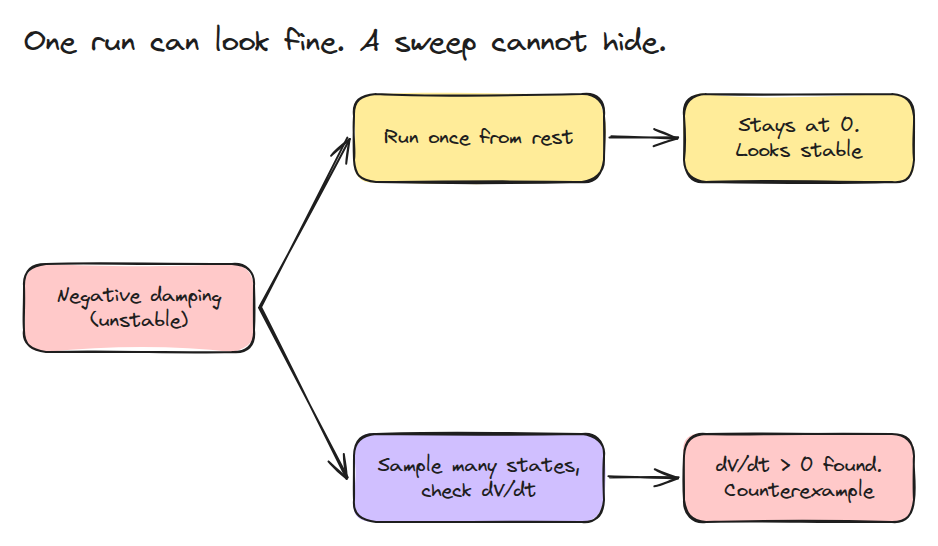
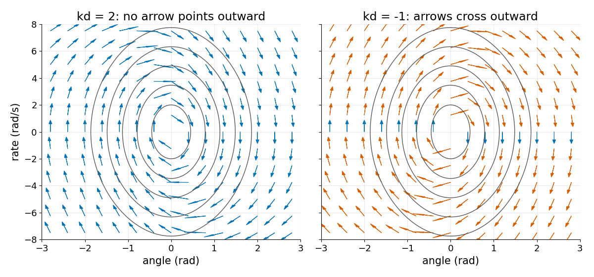
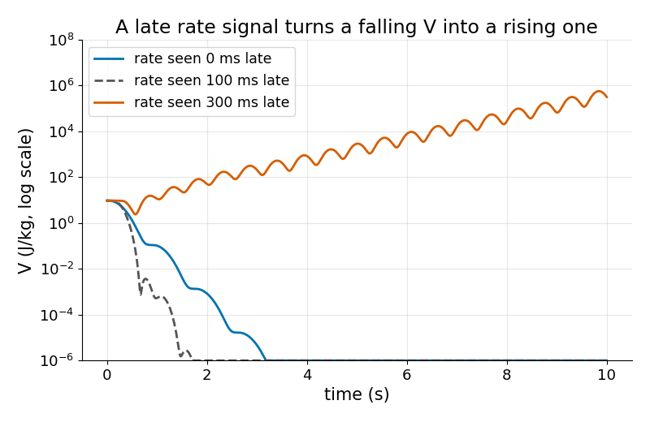

# Lyapunov Stability by Checking

> Learn how to check that a controller is stable from every starting state with one energy-like number.

**Type:** Build   **Prerequisites:** 03/04 PID and Tuning, 03/06 LQR   **Time:** ~15 minutes

## In Plain Words

Push an arm hanging from its joint a little to one side. It swings, each swing smaller as the brake takes energy out. Add up its energy of motion and its energy of height, and the total only goes down.

A Lyapunov function is such an energy-like number. A brake that reacts late can push with the swing, adding energy.

## Key Terms

- **State**: the arm's angle and speed at one moment.
- **Lyapunov function (`V`)**: an energy-like number that never rises while a stable system (one that settles) moves.
- **Slope (`vdot`)**: how fast the energy-like number changes as the system moves.
- **Level set**: all states with the same energy-like number, drawn as a curve.
- **Counterexample**: one state where the slope is positive, which breaks the stability claim.
- **PD control**: a spring on the angle plus a brake on the rate (how fast the angle is changing).

## The Problem

You tuned a robot's controller and tested it with one simulation that settled. But a run that starts at rest never moves, even if the system is unstable, and one start can miss the corner where it blows up.

## The Concept

A robot near people must be stable from any starting state. The trick is an energy-like number that should only go down; you check its slope and never solve the motion.


*Pick the number, then check its slope at many states.*


*Left: at rest. Middle (blue): the brake pushes with the motion and the swing grows. Right (green): it settles.*



*A sweep of many starting states finds a bad slope at once.*



*Each arrow shows where one state heads (angle across, rate up). Orange arrows point outward: the energy grows.*



*The controller sees the rate late: the energy climbs.*

<details><summary>The math (optional)</summary>

For a PD pendulum take `V = 1/2 w^2 + (g/l)(1 - cos q) + 1/2 kp q^2`. Then `dV/dt = -(c + kd) w^2` (friction `c`), so `dV/dt <= 0` everywhere exactly when `c + kd >= 0`. With `kd = -1` and `c = 0.1`, `dV/dt = 0.9 w^2`: at `w = 2` rad/s V grows by 3.6 per second. The clip nudges 0.1 rad; green has `kd = 2`. In the late-signal plot `kd = 5` and the delay is 300 ms.

</details>

## Build It

`check()` tries many states and reports the largest slope and where it is.

```python
grad = np.array([(V(x + h*e, p) - V(x - h*e, p)) / (2*h) for e in np.eye(2)])
vdot = grad @ f(x, p)          # dV/dt along the motion
```

Tests check the slope matches the formula, stable settings pass, and a negative brake or delayed rate is caught. A clean sweep is evidence, not proof; one bad slope is a counterexample.

```bash
cd robotics-engineering-from-scratch
python3 -m pytest phases/03-dynamics-and-control/09-lyapunov-stability -q
python3 phases/03-dynamics-and-control/09-lyapunov-stability/code/figure.py
```

## Use It

Hunt for a counterexample by minimizing the slope with SciPy's `minimize`. A proof needs a specialised maths tool.

## Ship It

`outputs/skill-lyapunov-check.md` turns a stability claim into a candidate V and sweep.

## Exercises

1. Set the brake negative and see the check fail.
2. Delay the rate signal and find where it first fails.
3. Set the spring to zero.
