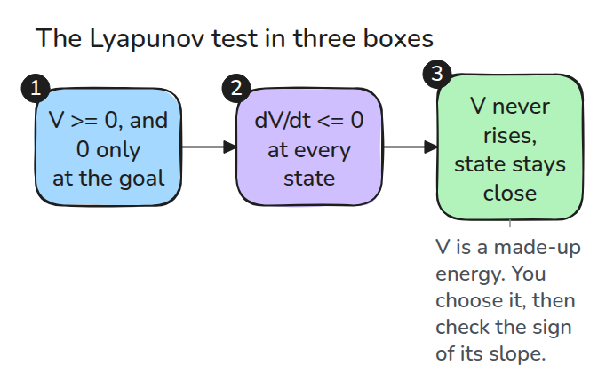

# Lyapunov Stability by Checking

> Learn how to check that a controller is stable from every starting state with one energy-like number.

**Type:** Build   **Prerequisites:** 03/04 PID and Tuning, 03/06 LQR   **Time:** ~15 minutes

## In Plain Words

Push an arm hanging from its joint a little to one side. It swings, each swing smaller as the brake takes energy out. The sum of its motion, height and spring energy only goes down.

A Lyapunov function is such an energy-like number. A late-reading brake pushes with the swing and adds energy instead.

## Key Terms

- **Lyapunov function (`V`)**: an energy-like number that never rises along the motion of a stable system.
- **`vdot` (`dV/dt`)**: how fast `V` changes as the system moves.
- **Equilibrium**: a state where nothing moves, such as the arm at rest.
- **Level set**: all states with the same value of `V`, drawn as a curve.
- **Counterexample**: one state where `vdot` is positive, which breaks the stability claim.
- **PD control**: a spring on the angle plus a brake on the rate.

## The Problem

You tuned a robot's controller and your only test is "I simulated it and it settled." A run from rest sits still even if the system is unstable, and one start misses the corner where it blows up.

## The Concept

A robot near people must be stable from any starting state.



*Choose V, then check the sign of its slope.*

For a PD-controlled pendulum take `V = 1/2 w^2 + (g/l)(1 - cos q) + 1/2 kp q^2`, its kinetic, gravity and spring energy. Then `dV/dt = -(c + kd) w^2` (joint friction `c`), so `dV/dt <= 0` everywhere exactly when `c + kd >= 0`.

Example: `kd = -1` and `c = 0.1` give `dV/dt = 0.9 w^2`: at `w = 2` rad/s V grows by 3.6 per second, yet a run from rest never moves.


*Blue: `kd = -1`. Left stays at rest; middle, nudged 0.1 rad, swings wider. Green (`kd = 2`) settles.*


*Rest looks stable; a sweep finds a positive slope at once.*


*Arrows show where the state moves; grey curves are level sets of V. Orange arrows: V grows.*


*`kd = 5`, but the controller sees the rate late: at 300 ms V climbs.*

## Build It

```python
grad = np.array([(V(x + h*e, p) - V(x - h*e, p)) / (2*h) for e in np.eye(2)])
vdot = grad @ f(x, p)          # dV/dt along the motion
```

`check()` samples states and returns the largest `vdot` and where. Tests check `V` is positive, `vdot` equals `-(c + kd) w^2`, stable gains pass, negative damping is caught, and a delayed rate raises V. Sampling proves nothing.

```bash
cd robotics-engineering-from-scratch
python3 -m pytest phases/03-dynamics-and-control/09-lyapunov-stability -q
python3 phases/03-dynamics-and-control/09-lyapunov-stability/code/figure.py
```

## Use It

Minimize `-vdot` over the operating bounds with SciPy's `minimize` to hunt for a counterexample. A proof needs an SOS or SMT tool.

## Ship It

`outputs/skill-lyapunov-check.md` turns a stability claim into a candidate V and sweep.

## Exercises

1. Set `kp = 0`; what happens to V's sign away from the origin?
2. Find the delay where `kd = 5` first fails to settle.
3. Add friction `c |w| w` and recompute `vdot`.
