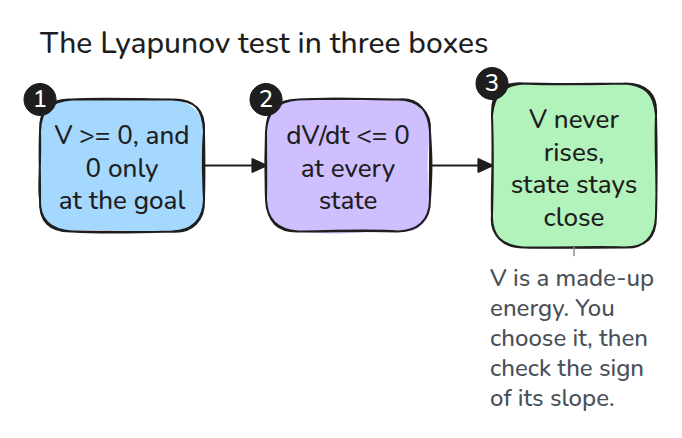
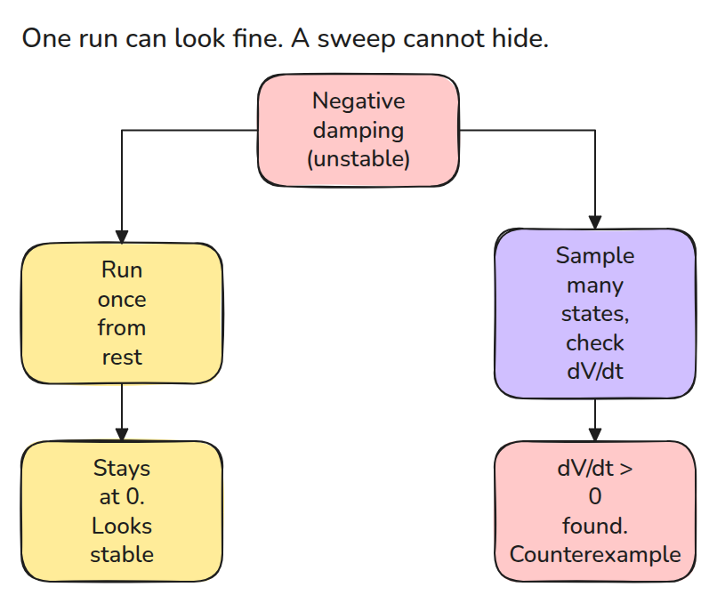
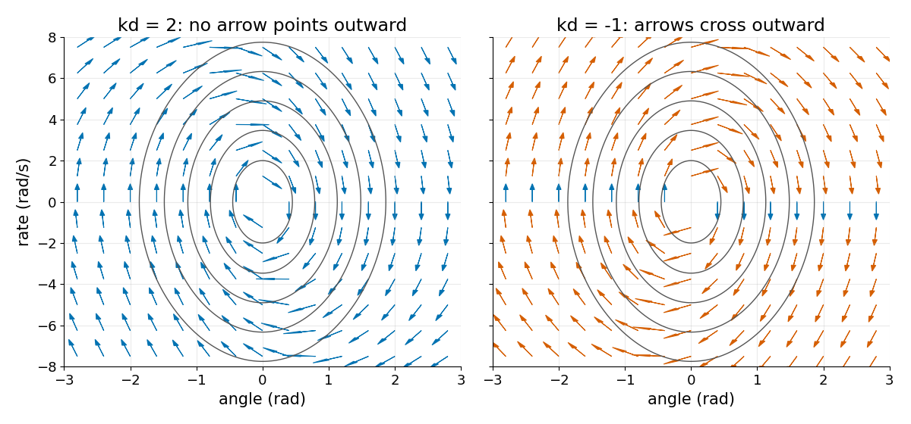
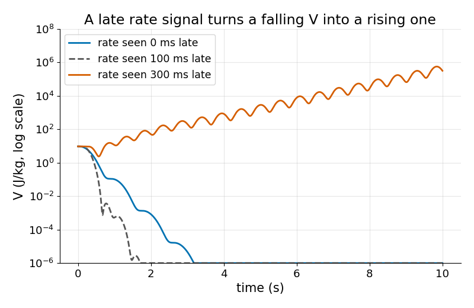

# Lyapunov 안정성을 검사로 확인하기

> 안정한 시스템에는 절대 오르지 않는 에너지 같은 수가 있고 그것을 컴퓨터로 시험할 수 있습니다.

**유형:** 만들기   **선수 지식:** 03/04 PID와 튜닝, 03/06 LQR   **시간:** 약 15분

## 쉽게 말하면

관절에 매달린 팔을 한쪽으로 살짝 밀었다고 해 보세요. 팔은 앞뒤로 흔들리고 브레이크가 에너지를 빼 가서 흔들릴 때마다 폭이 작아져요. 움직임, 높이, 스프링의 에너지를 모두 더하면 줄어들기만 해야 하는 수가 나와요.

Lyapunov function이 바로 이런 에너지 같은 수예요. 브레이크가 팔의 속도를 늦게 보면 흔들림과 같은 방향으로 밀어서 에너지를 오히려 더해요.

## 문제

지금 아는 안정성 시험은 "시뮬레이션했더니 가라앉았다"뿐입니다. 정지 상태에서 시작한 실행은 불안정한 시스템에서도 가만히 있고 한 출발점의 실행은 발산하는 state space의 구석을 놓칩니다. 모든 상태를 덮는 시험이 필요합니다.

## 개념



*V를 고르고 그 기울기의 부호를 확인합니다. 운동 방정식을 풀 필요는 없습니다.*

PD로 제어하는 진자(각도 `q`에는 스프링, 각속도 `w`에는 브레이크)에서는 `V = 1/2 w^2 + (g/l)(1 - cos q) + 1/2 kp q^2`을 잡습니다. 운동에너지, 중력 에너지, 스프링 에너지입니다. 운동을 따라 미분하면 `dV/dt = -(c + kd) w^2`이 됩니다. `c`는 관절 자체의 마찰입니다.

스프링과 중력은 운동과 에너지를 주고받을 뿐이라서 상쇄되고 damping 항만 남습니다. 그래서 `dV/dt <= 0`이 모든 곳에서 성립할 조건은 `c + kd >= 0`입니다.

예: 운동과 같은 방향으로 미는 브레이크 `kd = -1`과 `c = 0.1`이면 `dV/dt = 0.9 w^2`입니다. `w = 2` rad/s일 때 V는 초당 3.6씩 커집니다. 정지 상태는 평형점이라서 정지 상태에서 시작한 실행은 움직이지 않습니다.


*파란 팔 두 대는 `kd = -1`로 같습니다. 왼쪽 팔은 정지 상태에서 움직이지 않습니다. 0.1 rad 건드린 가운데 팔은 흔들릴 때마다 폭이 커집니다. 초록 팔(`kd = 2`)도 건드렸지만 가라앉습니다. 1.5배속입니다.*



*정지 상태에서 시작한 실행은 안정해 보입니다. 상태를 훑으면 양의 기울기가 바로 나옵니다.*



*화살표는 상태가 다음에 움직이는 방향이고 가로축이 각도 `q`, 세로축이 각속도 `w`입니다. 회색 곡선이 V의 level set입니다. 파란 화살표는 바깥을 향하지 않고 주황 화살표는 바깥을 향하며 그곳에서 V가 커집니다. `kd = -1`이면 거의 모든 화살표가 주황입니다.*



*gain은 같고 `kd = 5`지만 컨트롤러가 속도를 늦게 봅니다. 300 ms에서는 V가 줄지 않고 올라갑니다.*

## 만들기

```python
grad = np.array([(V(x + h*e, p) - V(x - h*e, p)) / (2*h) for e in np.eye(2)])
vdot = grad @ f(x, p)          # dV/dt along the motion
```

`check()`가 상태를 뽑아 가장 큰 `vdot`과 그 위치를 돌려줍니다. 테스트는 `V`가 양수인지, `vdot`이 `-(c + kd) w^2`과 같은지, 안정한 gain이 통과하고 음의 damping이 잡히는지, 늦은 속도가 V를 올리는지 확인합니다. 표본 검사는 반례를 찾을 뿐 증명은 아닙니다.

```bash
cd robotics-engineering-from-scratch
python3 -m pytest phases/03-dynamics-and-control/09-lyapunov-stability -q
python3 phases/03-dynamics-and-control/09-lyapunov-stability/code/figure.py
```

## 실제 도구로 보기

운용 범위 안에서 SciPy의 `minimize`로 `-vdot`을 최소화해 반례를 탐색합니다. 그 위치의 `vdot` 최대값을 보고하고 표본 검사와 비교하세요. 증명이 필요하면 SOS나 SMT 도구가 부호를 확인해야 합니다.

## 결과물

`outputs/skill-lyapunov-check.md`는 안정성 주장을 후보 V와 표본 검사로 바꿉니다.

## 연습 문제

1. `kp = 0`으로 두고 원점에서 먼 곳에서 V의 부호가 어떻게 되는지 설명하세요.
2. `kd = 5`가 처음으로 가라앉지 못하는 지연 값을 찾으세요.
3. 마찰 항 `c |w| w`를 더하고 `vdot`을 손으로 다시 구하세요.
