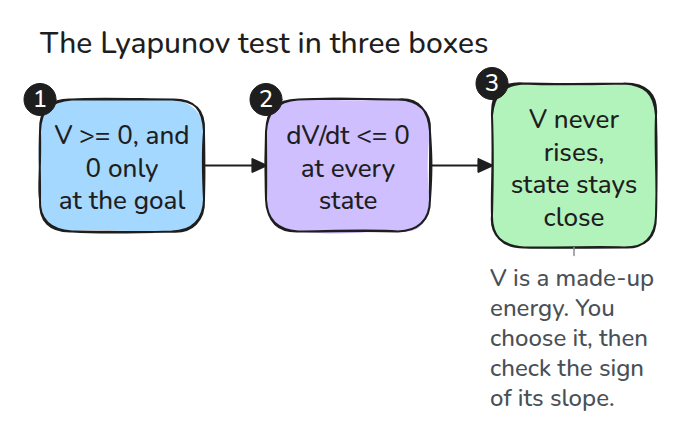
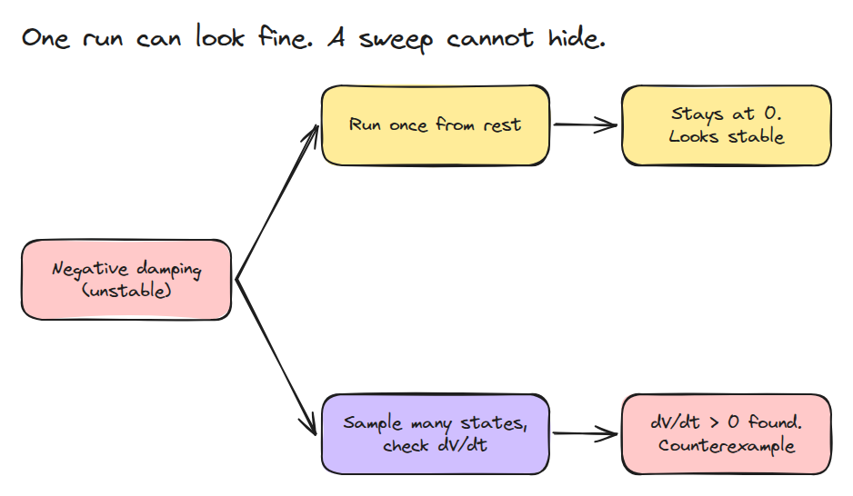
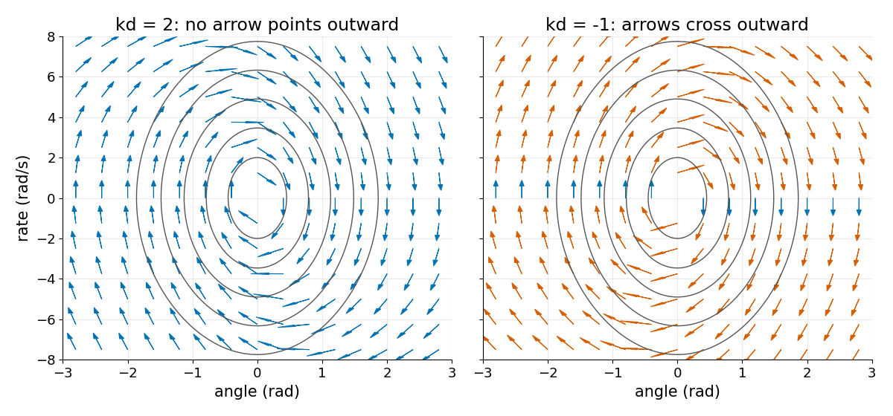
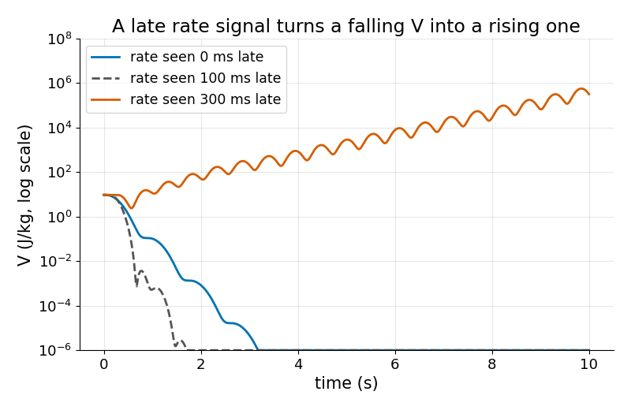

# Lyapunov 안정성을 검사로 확인하기

> 에너지 같은 수 하나로 컨트롤러가 어떤 출발 상태에서도 안정한지 확인하는 법을 알게 됩니다.

**유형:** 만들기   **선수 지식:** 03/04 PID와 튜닝, 03/06 LQR   **시간:** 약 15분

## 쉽게 말하면

관절에 매달린 팔을 한쪽으로 살짝 밀어 보세요. 팔은 흔들리고 브레이크가 에너지를 빼 가서 흔들릴 때마다 폭이 작아져요. 움직임과 높이와 스프링의 에너지를 모두 더한 수는 줄어들기만 해요.

Lyapunov function이 바로 이런 에너지 같은 수예요. 브레이크가 팔의 속도를 늦게 보면 흔들림과 같은 방향으로 밀어서 에너지를 오히려 더해요.

## 핵심 용어

- **Lyapunov function (`V`)**: 안정한 시스템의 움직임을 따라 절대 오르지 않는 에너지 같은 수입니다.
- **`vdot` (`dV/dt`)**: 시스템이 움직이면서 `V`가 얼마나 빨리 변하는지입니다.
- **Equilibrium**: 정지 상태의 팔처럼 아무것도 움직이지 않는 상태입니다.
- **Level set**: `V`의 값이 같은 모든 상태를 곡선으로 그린 것입니다.
- **Counterexample**: `vdot`이 양수인 상태 하나로 안정하다는 주장을 깨뜨립니다.
- **PD control**: 각도에는 스프링을, 각속도에는 브레이크를 거는 제어입니다.

## 문제

로봇의 컨트롤러를 조정하고 가라앉은 시뮬레이션 한 번으로 시험했습니다. 하지만 정지 상태에서 시작한 실행은 불안정한 시스템에서도 가만히 있고 한 출발점의 실행은 발산하는 구석을 놓칠 수 있습니다.

## 개념

사람 가까이에 있는 로봇은 어떤 출발 상태에서도 안정해야 하므로 운 좋은 실행 한 번으로는 부족합니다. 요령은 시스템이 움직이면서 줄어들기만 해야 하는 에너지 같은 수입니다. 그 기울기만 확인하고 운동을 풀 필요는 없습니다.



*수를 고르고 여러 상태에서 그 기울기를 확인합니다.*


*파란 브레이크는 움직임과 같은 방향으로 밀고 가운데 팔은 점점 크게 흔들립니다. 초록은 자리를 잡습니다.*



*정지 상태는 안정해 보이지만 상태를 훑으면 나쁜 기울기가 바로 나옵니다.*



*주황 화살표는 바깥을 향해서 에너지가 커집니다.*

속도 신호가 늦게 오면 좋은 브레이크도 망가집니다.



*컨트롤러가 속도를 늦게 보면 에너지가 올라갑니다.*

<details><summary>The math (optional)</summary>

PD 진자에서는 `V = 1/2 w^2 + (g/l)(1 - cos q) + 1/2 kp q^2`을 잡습니다. 그러면 `dV/dt = -(c + kd) w^2`(마찰 `c`)이고 `dV/dt <= 0`이 모든 곳에서 성립할 조건은 `c + kd >= 0`입니다.
`kd = -1`과 `c = 0.1`이면 `dV/dt = 0.9 w^2`이고 `w = 2` rad/s일 때 V는 초당 3.6씩 커집니다. 영상은 0.1 rad 건드리고 초록은 `kd = 2`입니다. 늦은 신호 그림에서는 `kd = 5`이고 지연은 300 ms입니다.

</details>

## 만들기

`check()`는 상태를 많이 시험해서 가장 큰 기울기와 그 위치를 알려 줍니다.

```python
grad = np.array([(V(x + h*e, p) - V(x - h*e, p)) / (2*h) for e in np.eye(2)])
vdot = grad @ f(x, p)          # dV/dt along the motion
```

테스트는 에너지가 양수인지, 기울기가 공식과 맞는지, 안정한 gain이 통과하는지, 음의 브레이크가 잡히는지, 늦은 속도가 에너지를 올리는지 확인합니다. 표본 검사는 반례를 찾을 뿐 증명은 아닙니다.

```bash
cd robotics-engineering-from-scratch
python3 -m pytest phases/03-dynamics-and-control/09-lyapunov-stability -q
python3 phases/03-dynamics-and-control/09-lyapunov-stability/code/figure.py
```

## 실제 도구로 보기

SciPy의 `minimize`로 기울기를 최소화해 반례를 탐색합니다. 증명이 필요하면 SOS나 SMT 도구가 필요합니다.

## 결과물

`outputs/skill-lyapunov-check.md`는 안정성 주장을 후보 V와 표본 검사로 바꿉니다.

## 연습 문제

1. 브레이크를 음수로 두고 검사가 실패하는 것을 보세요.
2. 컨트롤러가 속도를 늦게 보게 하고 처음 실패하는 지연을 찾으세요.
3. 스프링을 0으로 두고 에너지가 어떻게 되는지 보세요.
