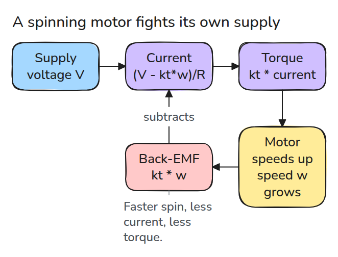
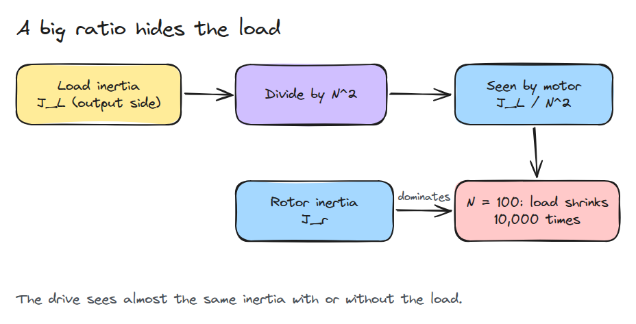
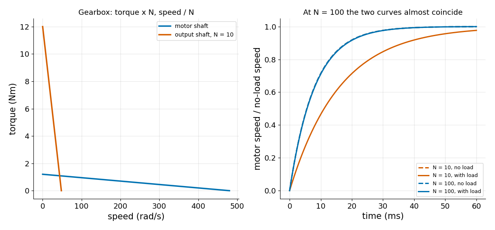

# Motor and Gearbox

> Learn why a gearbox makes a heavy load feel almost weightless to the motor.

**Type:** Build   **Prerequisites:** 03/02 Gravity Compensation   **Time:** ~15 minutes

## In Plain Words

A small motor spins a heavy flywheel through a gearbox. The flywheel turns far slower than the motor shaft, so the motor feels it as much lighter than it is.

A fast motor also pushes against itself with its own voltage, so its push fades as it speeds up.

## Key Terms

- **Torque**: a twisting push, the kind of force a motor puts on a shaft.
- **Back-EMF**: the voltage a spinning motor makes against its own supply, which cuts the current and the push.
- **Inertia**: how hard something is to spin up. A heavy flywheel has a lot.
- **Gear ratio (`N`)**: how many motor turns make one output turn. Torque grows `N` times and speed shrinks `N` times.
- **Stall torque**: the push a motor gives when held still, its strongest.
- **Drive**: the electronics that power and control the motor.

## The Problem

Your robot arm moves the same way before and after you hang a heavy tool on it. The gearbox hides the load from the drive.

## The Concept

This tells you how much motor a joint needs, and why one tuning keeps working when the load changes.



*Look at the red box: the faster the motor spins, the less it can push.*

A spinning motor makes its own voltage that works against the power supply. So the faster it spins, the weaker its push gets.



*The gearbox shrinks the load's weight as the motor feels it.*

A gearbox turns the motor many times for one turn of the load. It multiplies the push and makes the load feel much lighter. With a big ratio the motor feels almost only its own spinning part, so the load hardly matters.


*Left: no gearbox, the motor creeps. Right: it races.*



*Left: the gearbox moves the push-against-speed line without bending it. Right: with a big ratio, loaded and bare motors spin up alike.*

<details><summary>The math (optional)</summary>

`V` is supply voltage, `w` shaft speed, `R` winding resistance and `kt` the torque constant (torque per amp). Current is `(V - kt*w) / R` and torque is `kt * current`, so torque falls on a line from the stall torque (at `w = 0`) to zero at `V / kt`. A gear ratio `N` multiplies torque by `N` and divides speed by `N`, so the motor feels the load inertia `J_L` as `J_L / N^2`. With rotor inertia `J_r = 2e-5` and `J_L = 2e-3` (kg m^2), `N = 1` feels 101 times the rotor's own inertia and needs 0.81 s instead of 8 ms to reach 63% of final speed. `N = 100` feels 1.01 times and needs 8.08 ms.

</details>

## Build It

The load torque arrives divided by `N`.

```python
def motor_torque(w, kt, R, V):
    return kt * (V - kt * np.asarray(w, float)) / R

def load_at_motor(J_load, N):
    return J_load / N**2

def inertia_sensitivity(J_rotor, J_load, N):
    return (J_rotor + load_at_motor(J_load, N)) / J_rotor
```

`spin_up()` simulates the motor speeding up. A sensitivity of 1.0 means the drive cannot see the load.

```bash
cd robotics-engineering-from-scratch
python3 -m pytest phases/04-actuators-and-sensors/01-motor-and-gearbox -q
python3 phases/04-actuators-and-sensors/01-motor-and-gearbox/code/figure.py
```

## Use It

MuJoCo documents a DC motor actuator with these terms.

Sources: [MuJoCo DC motor model](https://mujoco.readthedocs.io/en/latest/_static/dcmotor.pdf), [Faulhaber DC motor calculations](https://www.faulhaber.com/en/know-how/tutorials/dc-motor-tutorial-motor-calculations-for-coreless-brush-dc-motors/); accessed 2026-11-09.

## Ship It

`outputs/skill-motor-gearbox-check.md` turns motor constants and a ratio into stall torque and load visibility.

## Exercises

1. Change the gear ratio and watch how the spin-up time changes.
2. Add friction and see what happens to the top speed.
3. Make the load ten times heavier.
