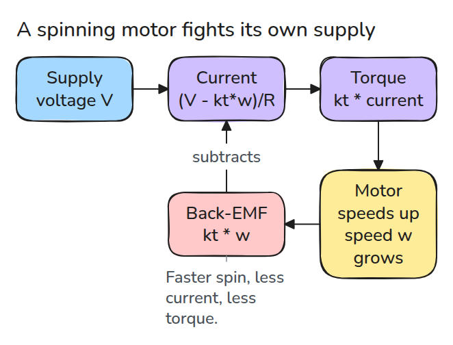
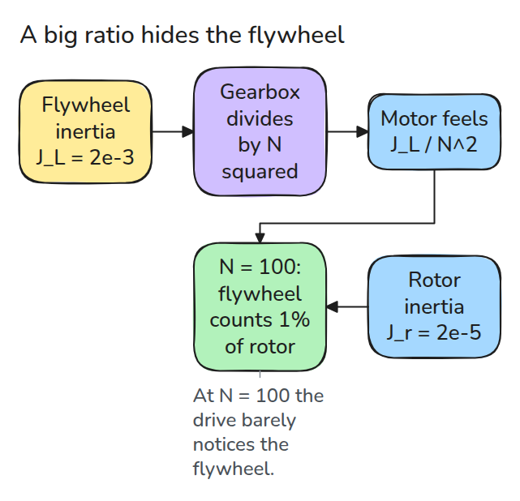
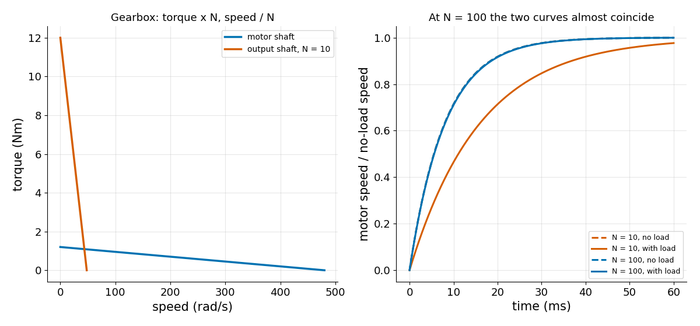

# Motor and Gearbox

> A motor is a torque source that weakens as it speeds up, and a gearbox makes the load almost invisible to it.

**Type:** Build   **Prerequisites:** 03/02 Gravity Compensation   **Time:** ~15 minutes

## In Plain Words

A small motor has to spin up a heavy flywheel through a gearbox. The gearbox makes the flywheel turn many times slower than the motor shaft. Spinning energy grows with the square of the speed, so a slow flywheel holds very little of it.

The motor therefore feels the flywheel as far lighter than it is. But the faster a motor spins, the more voltage it generates against its own supply, so less current flows and its push fades.

## The Problem

You add a 100:1 gearbox to a joint motor. You tune the drive, the electronics that power the motor, with the arm empty. Later the arm holds a heavy tool and the joint behaves exactly the same, because the drive cannot tell what hangs on it.

## The Concept

Follow the arrows from voltage to torque (a twisting push), then the red box feeding back into the current.



*More speed, more back-EMF (voltage generated against the supply), so less current and torque.*

Here `V` is the supply voltage, `w` the shaft speed, `R` the winding resistance and `kt` the torque constant (torque per amp). Current is `(V - kt*w) / R` and torque is `kt * current`. So torque falls on a straight line from the stall torque (the push at `w = 0`) to zero at the no-load speed `V / kt`.

Now the gearbox: see the flywheel's inertia shrink.



*Dividing the flywheel's inertia by N squared leaves the rotor in charge.*

A gearbox of ratio `N` multiplies torque by `N` and divides speed by `N`. Inertia `J_L` (how hard the flywheel is to spin up) at speed `w/N` stores `J_L*(w/N)^2/2` of spinning energy, which is what an inertia `J_L / N^2` at speed `w` stores. So the motor feels `J_L / N^2`.

Rotor (the motor's spinning part) inertia `J_r = 2e-5` and flywheel inertia `J_L = 2e-3` (kg m^2; 2e-5 means 0.00002). At `N = 1` it feels `2e-3 + 2e-5`, 101 times the rotor's inertia, and needs 0.81 s instead of 8 ms to reach 63% of its final speed. At `N = 100` it feels `2e-5 + 2e-7`, 1.01 times, and needs 8.08 ms.


*Left (N = 1, blue): the rotor creeps. Right (N = 100, green): it races while the flywheel turns 100 times slower.*



*Left: the gearbox moves the line without bending it. Right: at N = 100 loaded and bare curves coincide.*

## Build It

The load torque arrives divided by `N`.

```python
def motor_torque(w, kt, R, V):
    return kt * (V - kt * np.asarray(w, float)) / R

def load_at_motor(J_load, N):
    return J_load / N**2

def inertia_sensitivity(J_rotor, J_load, N):
    return (J_rotor + load_at_motor(J_load, N)) / J_rotor
```

`spin_up()` integrates `J * dw/dt = motor_torque(w) - tau_load / N`. A sensitivity of 1.0 means the drive cannot see the load.

```bash
cd robotics-engineering-from-scratch
python3 -m pytest phases/04-actuators-and-sensors/01-motor-and-gearbox -q
python3 phases/04-actuators-and-sensors/01-motor-and-gearbox/code/figure.py
```

## Use It

MuJoCo documents a DC motor actuator with these terms. Compare your `kt`, `R` and rotor inertia with a datasheet.

Sources: [MuJoCo DC motor model](https://mujoco.readthedocs.io/en/latest/_static/dcmotor.pdf), [Faulhaber DC motor calculations](https://www.faulhaber.com/en/know-how/tutorials/dc-motor-tutorial-motor-calculations-for-coreless-brush-dc-motors/), accessed 2026-11-09.

## Ship It

`outputs/skill-motor-gearbox-check.md` turns motor constants and a ratio into stall torque, no-load speed and load visibility.

## Exercises

1. Add viscous friction `b*w` and find the new terminal speed.
2. Find the ratio `N` at which the load adds only 5% to the motor-side inertia.
3. Add a gearbox efficiency below 1 and show it lowers output torque but not the speed.
