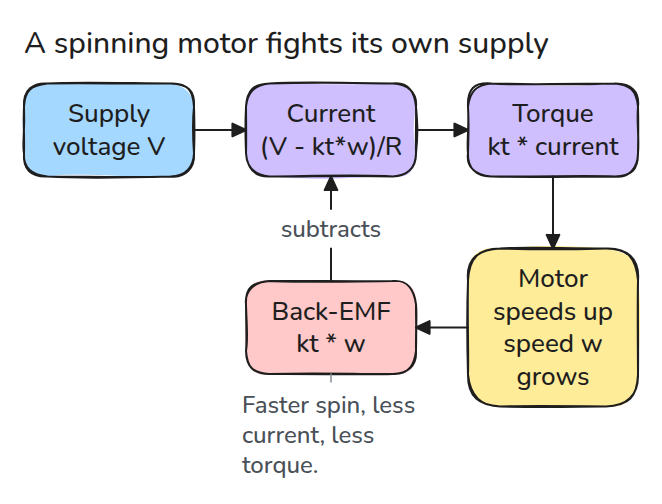
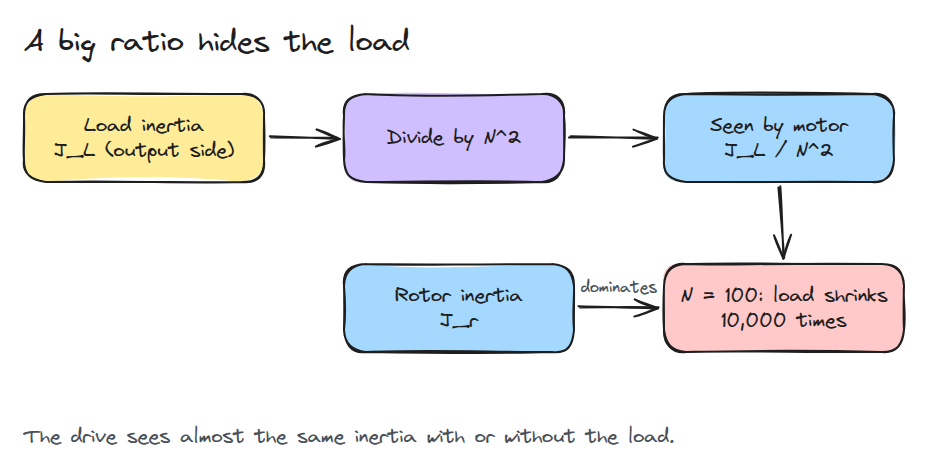
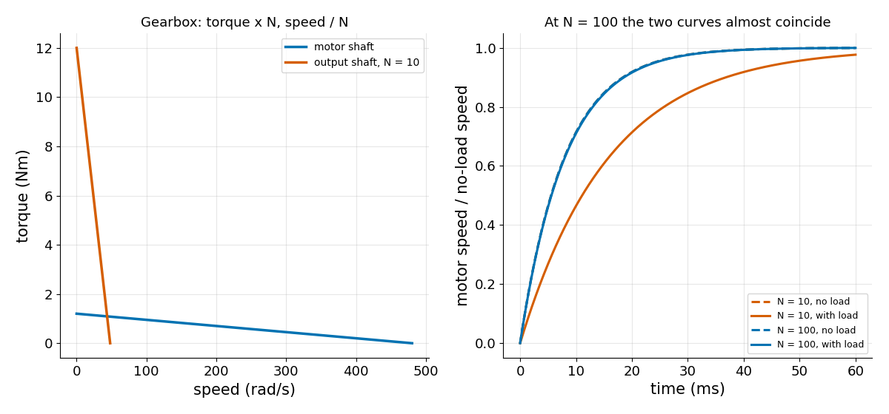

# 모터와 기어박스 (Motor and Gearbox)

> 모터는 빨리 돌수록 약해지는 토크 원천이고 기어박스는 부하를 모터에게 거의 보이지 않게 만듭니다.

**유형:** 만들기   **선수 지식:** 03/02 중력 보상   **시간:** 약 15분

## 쉽게 말하면

자전거를 낮은 gear에 놓으면 바퀴가 같은 만큼 도는 동안 페달은 더 돌아요. 부하를 움직이는 데 필요한 페달 torque는 줄지만 같은 페달 속도에서 바퀴는 더 느리게 돌아요.

motor gearbox도 속도와 torque를 이렇게 맞바꿔요. 모터에서 본 부하 inertia는 감속비의 제곱으로 나눈 만큼 작아져 rotor 자체의 inertia가 더 크게 작용할 수 있어요.
전압이 같을 때 모터 속도가 오르면 back-EMF 때문에 전류를 만드는 전압이 줄어 torque도 줄어요.

## 문제

관절에 모터를 고르고 100:1 기어박스를 달면 관절이 빠르고 강하게 움직입니다. 그런데 팔이 비어 있을 때 drive를 튜닝했더니, 무거운 공구를 들어도 똑같이 동작합니다. drive는 팔 끝에 무엇이 있는지 모릅니다. 원인은 두 줄짜리 식에 있습니다.

## 개념



*전압이 전류를 만들고 전류가 토크를 만듭니다. 속도에 비례하는 back-EMF가 전압의 일부를 되돌려 가져갑니다.*

전류는 `(V - kt*w) / R`이고 토크는 `kt * 전류`입니다. 그래서 토크는 `w = 0`일 때의 stall torque에서 시작해 무부하 속도 `V / kt`에서 0이 될 때까지 직선으로 줄어듭니다. SI 단위에서는 토크 상수와 back-EMF 상수가 같은 숫자입니다.



*부하 관성을 N의 제곱으로 나누면 rotor 관성이 지배적으로 남습니다.*

감속비 `N`인 기어박스는 토크를 `N`배 하고 속도를 `N`으로 나눕니다. 운동에너지는 속도의 제곱에 비례하므로 모터에서 본 부하 관성은 `J_L / N^2`입니다.



*왼쪽은 기어박스가 직선을 옮길 뿐 구부리지 않는다는 것을 보여 줍니다. 오른쪽은 N = 100에서 부하가 있을 때와 없을 때의 속도 응답이 거의 같다는 것을 보여 줍니다.*

## 만들기

부하 토크가 `N`으로 나뉘어 들어오는 모터 쪽 동역학입니다.

```python
def motor_torque(w, kt, R, V):
    return kt * (V - kt * np.asarray(w, float)) / R

def load_at_motor(J_load, N):
    return J_load / N**2

def inertia_sensitivity(J_rotor, J_load, N):
    return (J_rotor + load_at_motor(J_load, N)) / J_rotor
```

`spin_up()`은 `J * dw/dt = motor_torque(w) - tau_load / N`을 적분합니다. sensitivity가 1.0에 가까우면 drive가 부하를 보지 못한다는 뜻입니다.

```bash
cd robotics-engineering-from-scratch
python3 -m pytest phases/04-actuators-and-sensors/01-motor-and-gearbox -q
python3 phases/04-actuators-and-sensors/01-motor-and-gearbox/code/figure.py
```

## 실제 도구로 보기

시뮬레이터도 같은 모델을 씁니다. MuJoCo 문서에는 이 항들로 이루어진 DC motor actuator가 있고 모터 튜토리얼에는 토크 상수와 단자 저항이 정리되어 있습니다. 숫자를 믿기 전에 `kt`, `R`, rotor 관성을 실제 datasheet와 비교하세요.

출처 (2026년 11월 9일 접속):

- [MuJoCo DC motor model](https://mujoco.readthedocs.io/en/latest/_static/dcmotor.pdf)
- [Faulhaber DC motor calculations](https://www.faulhaber.com/en/know-how/tutorials/dc-motor-tutorial-motor-calculations-for-coreless-brush-dc-motors/)

## 결과물

`outputs/skill-motor-gearbox-check.md`는 모터 상수와 감속비를 받아 stall torque, 무부하 속도, 부하가 보이는 정도를 계산합니다.

## 연습 문제

1. 점성 마찰 `b*w`를 넣고 새 정상 속도를 구하세요.
2. 부하가 모터 쪽 관성에 5%만 더하게 되는 감속비 `N`을 구하세요.
3. 효율을 1보다 낮게 넣고 출력 토크는 줄지만 속도는 그대로임을 보이세요.
