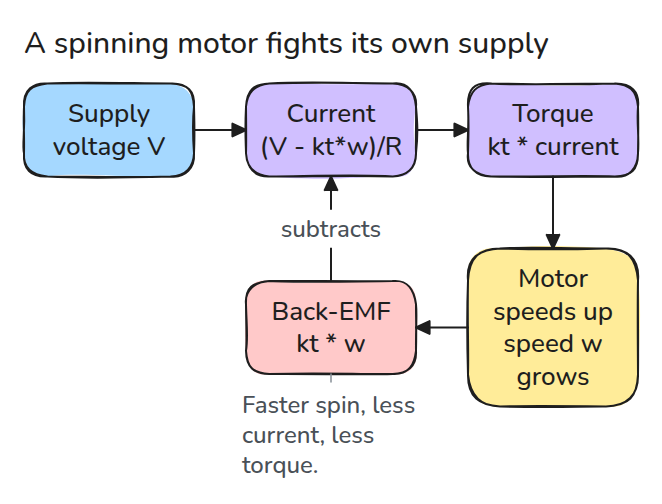
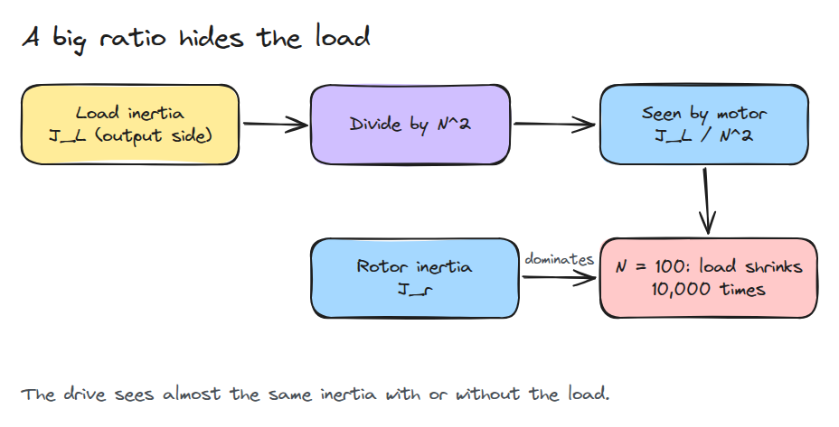
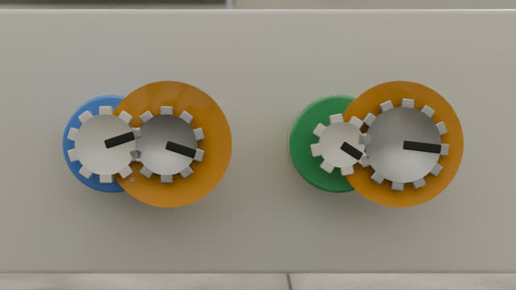
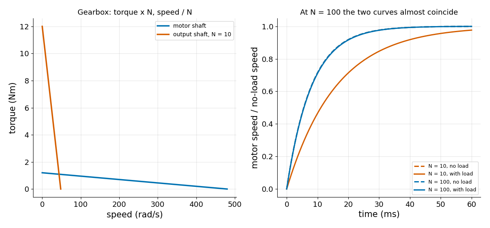

# 모터와 기어박스 (Motor and Gearbox)

> 기어박스가 무거운 부하를 모터에게 거의 가볍게 느껴지게 하는 이유를 배웁니다.

**유형:** 만들기   **선수 지식:** 없음   **시간:** 약 15분

## 쉽게 말하면

작은 모터가 기어박스를 거쳐 무거운 쇠바퀴를 돌린다고 해 보세요. 쇠바퀴는 모터 축보다 훨씬 느리게 돌아서 모터는 쇠바퀴를 실제보다 훨씬 가볍게 느껴요.

도는 모터는 전원과 맞서는 전압도 만들어서 빨리 돌수록 미는 힘이 약해져요.

## 핵심 용어

- **Torque**: 물체를 비트는 힘입니다. 모터가 축에 가하는 힘이 이것입니다.
- **Back-EMF**: 도는 모터가 자기 전원에 맞서 만드는 전압입니다. 미는 힘을 약하게 합니다.
- **Inertia**: 물체를 돌려 속도를 올리기가 얼마나 어려운지입니다. 무거운 쇠바퀴는 값이 큽니다.
- **Gear ratio (`N`)**: 출력이 한 바퀴 돌 때 모터가 도는 바퀴 수입니다. 토크는 그 수만큼 커지고 속도는 그 수만큼 줄어듭니다.
- **Drive**: 모터에 전기를 보내고 제어하는 전자회로입니다.

## 문제

로봇 팔은 무거운 공구를 달기 전과 후에 똑같이 움직입니다. 기어박스가 무거운 부하를 모터의 전자회로(drive)가 보지 못하게 가리기 때문입니다.

## 개념

이 개념을 알면 관절에 어느 정도의 모터가 필요한지와 부하가 바뀌어도 한 번 맞춘 튜닝이 왜 계속 통하는지 알 수 있습니다.



*빨간 상자를 보세요. 모터가 빨리 돌수록 밀 수 있는 힘이 줄어듭니다.*

모터가 빨리 돌수록 전원에 맞서는 전압을 더 만들어서 미는 힘이 약해집니다.



*기어박스는 모터가 느끼는 부하를 훨씬 가볍게 만듭니다.*

기어박스는 부하가 한 바퀴 도는 동안 모터를 여러 바퀴 돌립니다. 미는 힘을 키우고 부하를 더 가볍게 느끼게 합니다. 감속비가 크면 모터는 거의 자기 자신의 회전 부분만 느낍니다.

[](../assets/clip-example.mp4)

*왼쪽은 기어박스가 없어서 모터가 기어갑니다. 오른쪽은 기어박스가 있어서 달립니다.*



*왼쪽: 기어박스를 달면 힘과 속도의 직선이 옮겨지지만 곧게 남습니다. 오른쪽: 감속비가 크면 부하가 있을 때와 없을 때의 모터가 비슷하게 속도를 올립니다.*

<details><summary>The math (optional)</summary>

`V`는 전원 전압, `w`는 축 속도, `R`은 코일 저항, `kt`는 토크 상수(전류 1 A당 토크)입니다.
전류는 `(V - kt*w) / R`이고 토크는 `kt * 전류`이므로 토크는 멈춰 있을 때(`w = 0`)의 stall torque에서 시작해 `V / kt`에서 0이 될 때까지 직선으로 줄어듭니다.
감속비 `N`은 토크를 `N`배 하고 속도를 `N`으로 나누므로 모터는 부하 관성 `J_L`을 `J_L / N^2`으로 느낍니다.
rotor 관성 `J_r = 2e-5`와 `J_L = 2e-3`(kg m^2)이면 `N = 1`에서는 rotor 자신의 관성의 101배로 느낍니다. 최종 속도의 63%에 이르는 데 8 ms가 아니라 0.81초가 걸립니다. `N = 100`에서는 1.01배로 느끼고 8.08 ms가 걸립니다.

</details>

## 만들기

부하 토크는 `N`으로 나뉘어 들어옵니다.

```python
def motor_torque(w, kt, R, V):
    return kt * (V - kt * np.asarray(w, float)) / R

def load_at_motor(J_load, N):
    return J_load / N**2

def inertia_sensitivity(J_rotor, J_load, N):
    return (J_rotor + load_at_motor(J_load, N)) / J_rotor
```

`spin_up()`은 모터가 속도를 올리는 과정을 시뮬레이션합니다. sensitivity는 부하가 있을 때 모터가 부하가 없을 때보다 몇 배 무겁게 느끼는지입니다. 1.0이면 drive가 부하를 보지 못한다는 뜻입니다.

```bash
cd robotics-engineering-from-scratch
python3 -m pytest phases/04-actuators-and-sensors/01-motor-and-gearbox -q
python3 phases/04-actuators-and-sensors/01-motor-and-gearbox/code/figure.py
```

## 실제 도구로 보기

MuJoCo 문서에 이 항들을 쓰는 DC motor actuator가 설명되어 있습니다.

출처 (2026년 11월 9일 접속):

- [MuJoCo DC motor model](https://mujoco.readthedocs.io/en/latest/_static/dcmotor.pdf)
- [Faulhaber DC motor calculations](https://www.faulhaber.com/en/know-how/tutorials/dc-motor-tutorial-motor-calculations-for-coreless-brush-dc-motors/)

## 결과물

`outputs/skill-motor-gearbox-check.md`는 모터 상수와 감속비를 받아 stall torque와 부하가 보이는 정도를 계산합니다.

## 연습 문제

1. 감속비를 바꾸고 속도가 오르는 데 걸리는 시간이 어떻게 변하는지 보세요.
2. 속도를 줄이는 마찰을 넣고 최고 속도가 어떻게 되는지 보세요.
3. 부하(`J_load`)를 열 배 무겁게 해 보세요.
