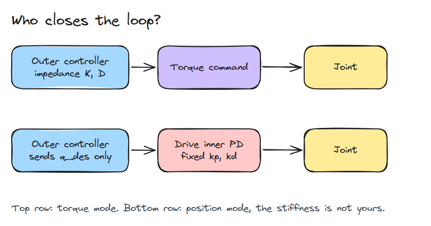
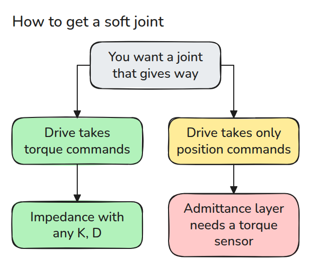
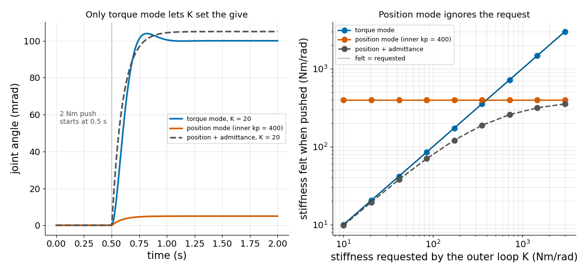

# Torque vs Position Modes

> A position mode is a torque mode with someone else's PD gains, and those gains set how stiff your joint feels.

**Type:** Build   **Prerequisites:** 04/01 Motor and Gearbox, 03/03 Impedance Control   **Time:** ~15 minutes

## In Plain Words

Ask a friend to hold a ruler at a mark while you push it sideways. If you specify only the mark, your friend
decides how hard to push back.

Position mode likewise lets the drive's inner loop choose torque from position error. An outer stiffness
request alone cannot change its gain. Torque mode lets your controller set that response; admittance instead
measures the push and moves the position target.

## The Problem

You write an impedance controller that should make a joint yield like a soft spring with `K = 20`. On the drive you have, the joint stays stiff and barely moves when you push it. The outer loop asked for softness, but the drive's own position loop was never told.

## The Concept



*In torque mode your loop writes the torque. In position mode the drive's inner PD does, with gains you cannot change.*

With a constant push `tau_ext` the joint settles where the spring force balances it. In torque mode that is `tau_ext / K`, so `K` is yours to choose. In position mode it is `tau_ext / kp_in`, whatever you send as `K`.



*Impedance needs a torque interface. A position-only drive needs a compliance layer outside, and that layer needs a measured torque.*



*Left: the same 2 Nm push gives three different joints. Right: the stiffness you feel follows your request only in torque mode, and the admittance layer is capped below the inner gain.*

## Build It

One joint `J*qdd = tau - b*qd + tau_ext`, three ways to produce `tau`.

```python
if mode == "torque":
    tau = K * (q_des - q) - D * qd
elif mode == "position":
    tau = kp_in * (q_des - q) - kd_in * qd
elif mode == "admittance":
    tau = kp_in * (q_des + ext / K - q) - kd_in * qd
```

A test shows `position` equals `torque` with `K = kp_in, D = kd_in`. The admittance deflection is `tau_ext * (1/K + 1/kp_in)`.

```bash
cd robotics-engineering-from-scratch
python3 -m pytest phases/04-actuators-and-sensors/02-torque-vs-position-modes -q
python3 phases/04-actuators-and-sensors/02-torque-vs-position-modes/code/figure.py
```

## Use It

ros2_control lets each joint declare command interfaces, usually position, velocity, acceleration or effort, and a controller fails if it requests an interface the hardware does not offer. Check which your drive exports before choosing impedance or admittance.

Sources: [ros2_control full tutorial](https://control.ros.org/master/doc/ros2_control_demos/example_7/doc/userdoc.html), accessed 2026-11-09.

## Ship It

`outputs/skill-drive-mode-check.md` decides whether a drive can host impedance control directly.

## Exercises

1. Raise `kp_in` to 4000 and measure how the admittance deflection changes.
2. Add a 3 ms delay to the measured push and watch the admittance loop.
3. Find the `K` at which the admittance layer feels half as stiff as requested.
