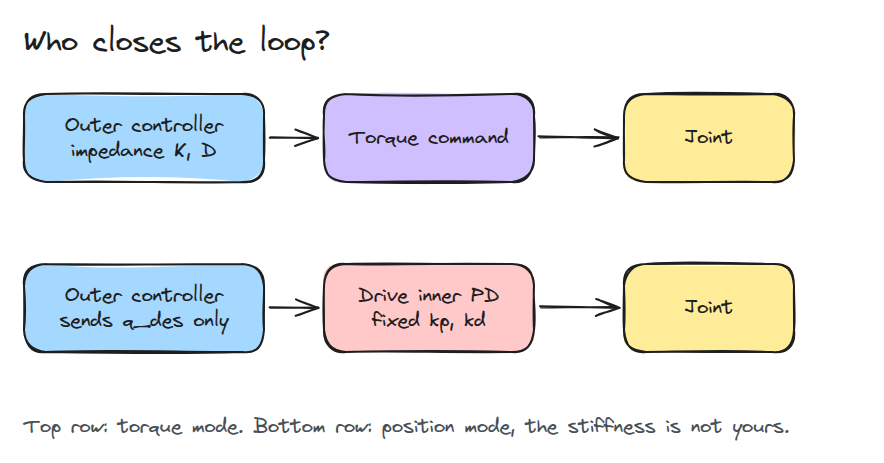
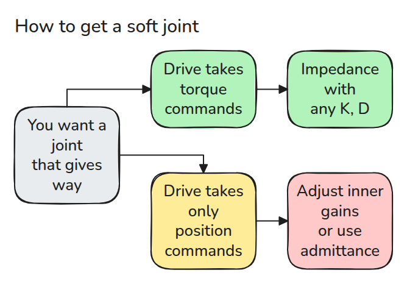
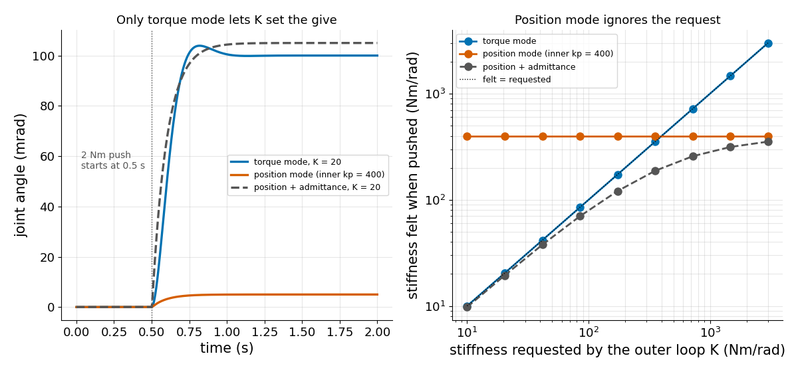

# Torque vs Position Modes

> Learn why a robot joint can stay stiff when you ask it to be soft, and what fixes that.

**Type:** Build   **Prerequisites:** 04/01 Motor and Gearbox, 03/03 Impedance Control   **Time:** ~15 minutes

## In Plain Words

Press up on the hand of a bench arm. Inside the joint, the drive pulls the hand back toward its target angle like a spring of fixed strength. Your program can ask for a softer spring, but in position mode the request never reaches it. In torque mode your program writes the pull itself.

## Key Terms

- **Torque mode**: your program tells the drive how hard to twist, and the drive obeys.
- **Position mode**: your program gives a target angle, and the drive's own controller picks the torque.
- **PD controller**: pulls back in proportion to the angle error (`kp`) and brakes in proportion to speed (`kd`).
- **Gain**: a multiplier such as `kp` that sets how strongly a controller reacts.
- **Stiffness (`K`)**: torque per radian (a unit of angle) of error. High means the joint resists a push.
- **Admittance layer**: code that measures a push and moves the target so the joint acts soft.

## The Problem

You push on a robot arm that should give way like a soft spring, but it stays stiff. Your program asked for `K = 20` Nm per radian, yet the drive never heard the request.

## The Concept

A robot that works beside people must give way when it is pushed.



*Torque mode: your program writes the torque. Position mode: the drive's inner PD does.*

The inner PD has fixed `kp_in` and `kd_in`. A constant push `tau_ext` moves the joint until the spring balances it: `tau_ext / K` in torque mode, but `tau_ext / kp_in` in position mode, whatever `K` you send.

With a 2 Nm push and `kp_in = 400`, torque mode with `K = 20` gives way 0.1 rad and position mode only 0.005 rad. An admittance layer lifts the target by `tau_ext / K = 0.1` rad. With the inner spring the total is `tau_ext * (1/K + 1/kp_in) = 0.105` rad, never stiffer than `kp_in`.


*Both in position mode, pushed up (red). Blue: the hand barely moves. Green: the layer lifts the amber target.*



*Impedance needs torque commands. Position-only drives need an outside layer.*



*Left: one push, three responses. Right: only torque mode follows the requested stiffness.*

## Build It

One joint `J*qdd = tau - b*qd + tau_ext` (`qdd` is acceleration), three ways to make `tau`.

```python
if mode == "torque":
    tau = K * (q_des - q) - D * qd
elif mode == "position":
    tau = kp_in * (q_des - q) - kd_in * qd
elif mode == "admittance":
    tau = kp_in * (q_des + ext / K - q) - kd_in * qd
```

A test shows `position` equals `torque` with `K = kp_in, D = kd_in`.

```bash
cd robotics-engineering-from-scratch
python3 -m pytest phases/04-actuators-and-sensors/02-torque-vs-position-modes -q
python3 phases/04-actuators-and-sensors/02-torque-vs-position-modes/code/figure.py
```

## Use It

ros2_control joints declare command interfaces such as position or effort. A controller fails if it asks for one the hardware lacks.

Sources: [ros2_control full tutorial](https://control.ros.org/master/doc/ros2_control_demos/example_7/doc/userdoc.html), accessed 2026-11-09.

## Ship It

`outputs/skill-drive-mode-check.md` decides whether a drive can host impedance control.

## Exercises

1. Raise `kp_in` to 4000 and see how the deflection changes.
2. Add a 3 ms delay to the measured push.
3. Find the `K` at which the layer feels half as stiff as requested.
