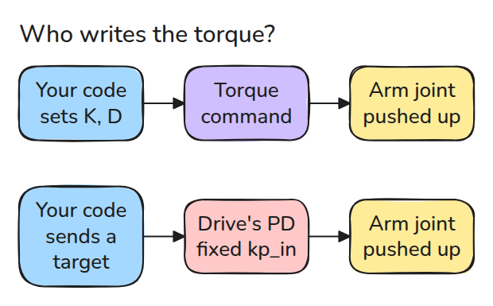
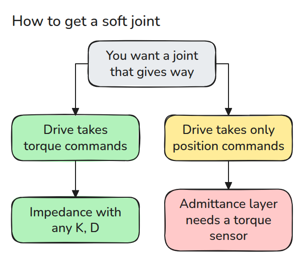
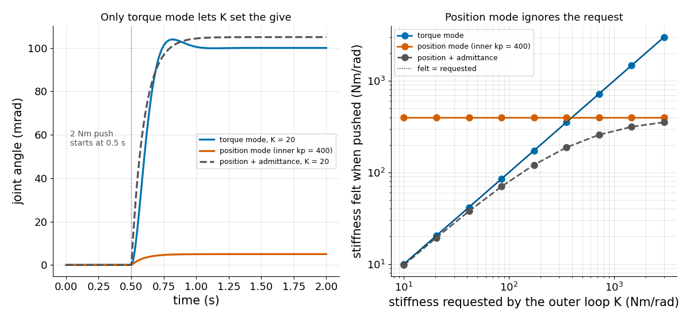

# 토크 모드와 position 모드 (Torque vs Position Modes)

> position 모드는 남의 PD gain을 쓰는 토크 모드이고 그 gain이 관절이 얼마나 뻣뻣하게 느껴지는지를 정합니다.

**유형:** 만들기   **선수 지식:** 04/01 모터와 기어박스, 03/03 임피던스 제어   **시간:** 약 15분

## 쉽게 말하면

bench 팔의 손을 위로 밀어 보세요. 관절 안에서는 drive가 손을 목표 각도 쪽으로 스프링처럼 끌어당기고
그 스프링의 세기는 drive 안에 고정되어 있어요.
프로그램이 더 부드러운 스프링을 요청해도 position 모드에서는 그 요청이 스프링에 닿지 않아서 팔이 거의 밀리지 않아요.

토크 모드에서는 프로그램이 끌어당기는 힘을 직접 써요. 그래서 오차 한 단위에 얼마나 끌어당길지도 프로그램이 정해요.

## 문제

관절이 스프링처럼 밀려나게 하는 impedance controller를 강성 `K = 20` Nm/rad로 짭니다. 그런데 가진 drive에서는 관절이 뻣뻣하게 버티고 밀어도 거의 움직이지 않습니다.
내 프로그램은 부드러움을 요청했지만 drive 자신의 position controller에는 그 요청이 전달되지 않았기 때문입니다.

## 개념

PD controller는 오차 1 rad당 `kp` Nm만큼 끌어당기고 속도에 비례해서 `kd`로 제동합니다.
그림의 각 줄에서 누가 PD를 돌리는지 보세요. 토크 모드에서는 내 프로그램이고 position 모드에서는 drive입니다.



*토크 모드에서는 내 프로그램이 토크를 씁니다. position 모드에서는 gain이 고정된 스프링인 drive 안쪽 PD가 씁니다.*

drive 안쪽 PD의 `kp_in`과 `kd_in`은 고정입니다.

일정한 외력 `tau_ext`가 있으면 관절은 스프링이 균형을 잡는 곳까지 움직입니다.
토크 모드에서는 `tau_ext / K`이므로 `K`를 내가 고릅니다. position 모드에서는 `K`로 무엇을 보내든 `tau_ext / kp_in`입니다.

외력 2 Nm와 `kp_in = 400`일 때 `K = 20`인 토크 모드는 `2 / 20 = 0.1` rad밀리고 position 모드는 `2 / 400 = 0.005` rad만 밀립니다. admittance 층은 관절이 강성 `K`인 스프링처럼 움직이길 바라므로 미는 힘을 측정해 목표를 `tau_ext / K = 0.1` rad 올립니다. 안쪽 스프링의 `0.005`를 더하면 합은 `tau_ext * (1/K + 1/kp_in) = 0.105` rad이고 `kp_in`보다 뻣뻣해지지는 않습니다.

초록 목표가 올라가는 것을 보세요.


*둘 다 position 모드입니다. 파랑은 층이 없어서 손이 거의 움직이지 않습니다. 초록은 층이 주황색 목표를 올리고 손이 따라갑니다.*

이제 관절을 부드럽게 하고 싶다는 상자에서 시작해 따라가 보세요.



*impedance에는 토크 명령이 필요합니다. position만 되는 drive는 토크를 측정하는 바깥 층이 필요합니다.*



*왼쪽은 같은 2 Nm 외력이 세 관절을 서로 다른 만큼 움직이는 모습입니다. 오른쪽은 요청한 강성과 느껴지는 강성을 견준 것이고 점선을 따르는 것은 토크 모드뿐입니다.*

## 만들기

관절 하나 `J*qdd = tau - b*qd + tau_ext`에 `tau`를 만드는 방법이 세 가지입니다.

```python
if mode == "torque":
    tau = K * (q_des - q) - D * qd
elif mode == "position":
    tau = kp_in * (q_des - q) - kd_in * qd
elif mode == "admittance":
    tau = kp_in * (q_des + ext / K - q) - kd_in * qd
```

테스트는 `position`이 `K = kp_in, D = kd_in`인 `torque`와 같다는 것을 보입니다.

```bash
cd robotics-engineering-from-scratch
python3 -m pytest phases/04-actuators-and-sensors/02-torque-vs-position-modes -q
python3 phases/04-actuators-and-sensors/02-torque-vs-position-modes/code/figure.py
```

## 실제 도구로 보기

ros2_control에서는 관절마다 command 인터페이스(drive가 받는 명령의 종류)를 선언합니다. position이나 effort가 그 예입니다.
controller가 hardware에 없는 인터페이스를 요청하면 실패합니다. impedance와 admittance 중 무엇을 쓸지 정하기 전에 drive가 무엇을 내보내는지 확인하세요.

출처 (2026년 11월 9일 접속):

- [ros2_control full tutorial](https://control.ros.org/master/doc/ros2_control_demos/example_7/doc/userdoc.html)

## 결과물

`outputs/skill-drive-mode-check.md`는 drive가 impedance 제어를 바로 올릴 수 있는지 판정합니다.

## 연습 문제

1. `kp_in`을 4000으로 올리고 admittance 처짐이 어떻게 변하는지 재세요.
2. 측정한 외력에 3 ms 지연을 넣고 admittance loop를 보세요.
3. admittance 층이 요청의 절반만큼만 뻣뻣하게 느껴지는 `K`를 찾으세요.
