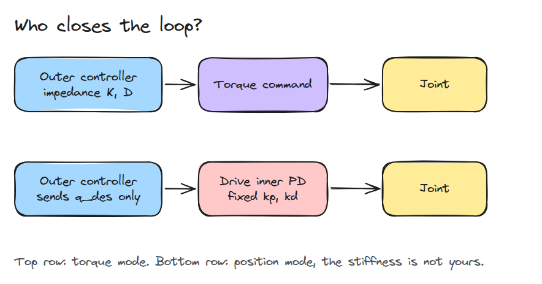
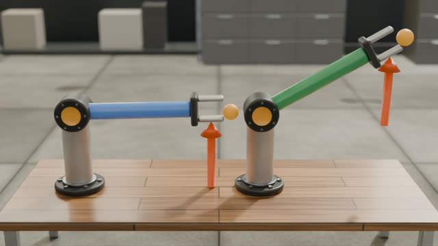
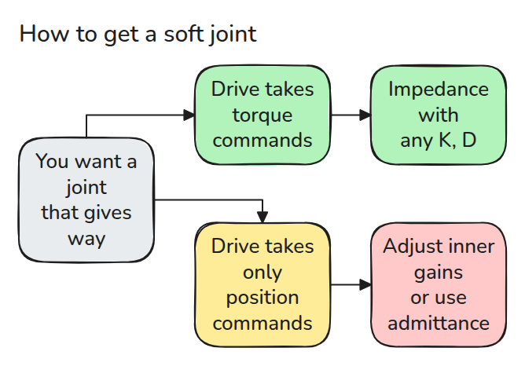
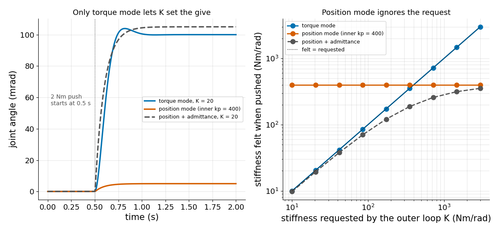

# 토크 모드와 position 모드 (Torque vs Position Modes)

> 관절에 부드럽게 움직이라고 해도 뻣뻣하게 버티는 이유와 그 해결책을 배웁니다.

**유형:** 만들기   **선수 지식:** 없음   **시간:** 약 15분

## 쉽게 말하면

로봇 팔의 손을 위로 밀어 보세요. 관절 안에서는 drive가 손을 목표 각도 쪽으로 세기가 정해진 스프링처럼 끌어당겨요. 프로그램이 더 부드러운 스프링을 요청해도 position 모드에서는 drive가 그 요청을 무시해요.

토크 모드에서는 프로그램이 끌어당기는 힘을 직접 써요.

## 핵심 용어

- **Torque mode**: 프로그램이 drive에 얼마나 세게 비틀지 알려 주면 drive가 그대로 따르는 방식입니다.
- **Position mode**: 프로그램은 목표 각도만 주고 토크는 drive 자신의 제어 코드(controller)가 정하는 방식입니다.
- **PD controller**: 목표 각도에서 얼마나 떨어졌는지에 비례해 끌어당기고 속도에 비례해 제동하는 controller입니다.
- **Gain**: controller가 얼마나 세게 반응할지 정하는 숫자입니다. 클수록 세게 당깁니다.
- **Stiffness (`K`)**: 오차 1 radian(각도 단위)당 토크입니다. 값이 크면 관절이 밀려도 잘 버팁니다.
- **Admittance layer**: 미는 힘을 재고 그만큼 목표를 옮겨서 관절이 부드럽게 움직이게 하는 코드입니다.

## 문제

부드러운 스프링처럼 밀려나야 하는 로봇 팔을 밀었는데 뻣뻣하게 버팁니다. drive는 그 요청을 전혀 듣지 못했습니다.

## 개념

사람 곁에서 일하는 로봇은 밀리면 비켜 줄 수 있어야 합니다.



*토크 모드에서는 내 프로그램이 토크를 씁니다. position 모드에서는 drive 안쪽 제어 코드가 씁니다.*

position 모드에서 drive는 자기 제어 코드를 돌립니다. 이 코드는 세기가 정해진 스프링과 같습니다. 밀면 관절은 그 스프링이 균형을 잡는 곳까지 움직입니다. 프로그램이 얼마나 부드럽게 해 달라고 했는지는 상관없습니다. 토크 모드에서는 스프링을 내가 고르므로 관절이 얼마나 밀릴지도 내가 정합니다.

admittance 층은 미는 힘을 재서 목표를 옮기므로 관절이 부드럽게 움직입니다.

[](../assets/clip-example.mp4)

*둘 다 position 모드이고 위로 밀립니다(빨강). 파랑은 거의 움직이지 않습니다. 초록은 admittance 층이 주황색 목표를 올립니다.*



*어떤 선택지가 관절을 부드럽게 만드는지 보세요.*



*왼쪽: 같은 외력에 대한 세 가지 응답입니다. 오른쪽: 요청한 강성을 따르는 것은 토크 모드뿐입니다.*

<details><summary>The math (optional)</summary>

drive 안쪽 controller의 `kp_in`과 `kd_in`은 고정입니다. 일정한 외력 `tau_ext`는 관절을 토크 모드에서는 `tau_ext / K`만큼, position 모드에서는 `K`로 무엇을 보내든 `tau_ext / kp_in`만큼 움직입니다.
외력이 2 Nm이고 `kp_in = 400`일 때 `K = 20`인 토크 모드는 0.1 rad 밀리고 position 모드는 0.005 rad만 밀립니다.
admittance 층은 목표를 `tau_ext / K = 0.1` rad 올립니다. 전체는 `tau_ext * (1/K + 1/kp_in) = 0.105` rad이므로 `kp_in`보다 뻣뻣해지는 일은 없습니다.

</details>

## 만들기

관절 하나에 토크를 만드는 방법이 세 가지입니다.

```python
if mode == "torque":
    tau = K * (q_des - q) - D * qd
elif mode == "position":
    tau = kp_in * (q_des - q) - kd_in * qd
elif mode == "admittance":
    tau = kp_in * (q_des + ext / K - q) - kd_in * qd
```

테스트는 drive에 고정된 스프링(`kp_in`, `kd_in`)이 같은 강성과 제동을 준 토크 모드와 같은 토크를 낸다는 것을 확인합니다.

```bash
cd robotics-engineering-from-scratch
python3 -m pytest phases/04-actuators-and-sensors/02-torque-vs-position-modes -q
python3 phases/04-actuators-and-sensors/02-torque-vs-position-modes/code/figure.py
```

## 실제 도구로 보기

ros2_control(ROS 2의 모터 제어 프레임워크)에서는 관절마다 position이나 effort(토크) 같은 명령 인터페이스를 선언합니다.

출처 (2026년 11월 9일 접속):

- [ros2_control full tutorial](https://control.ros.org/master/doc/ros2_control_demos/example_7/doc/userdoc.html)

## 결과물

`outputs/skill-drive-mode-check.md`는 drive가 impedance 제어를 얹을 수 있는지 판정합니다.

## 연습 문제

1. `kp_in`을 바꾸고 관절이 얼마나 밀리는지 보세요.
2. 측정한 외력(`ext`)에 작은 지연을 넣어 보세요.
3. `K`를 절반으로 해 보고 관절이 얼마나 뻣뻣하게 느껴지는지 보세요.
