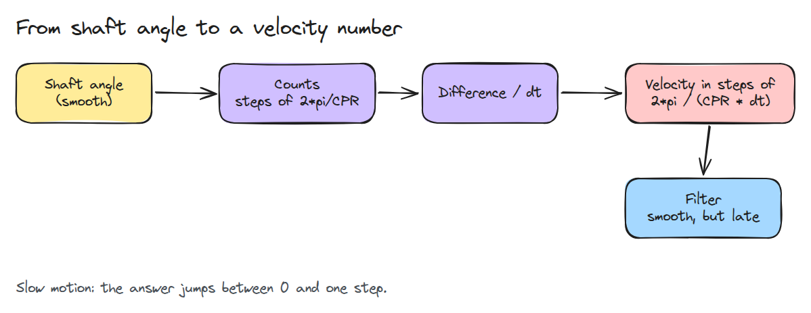
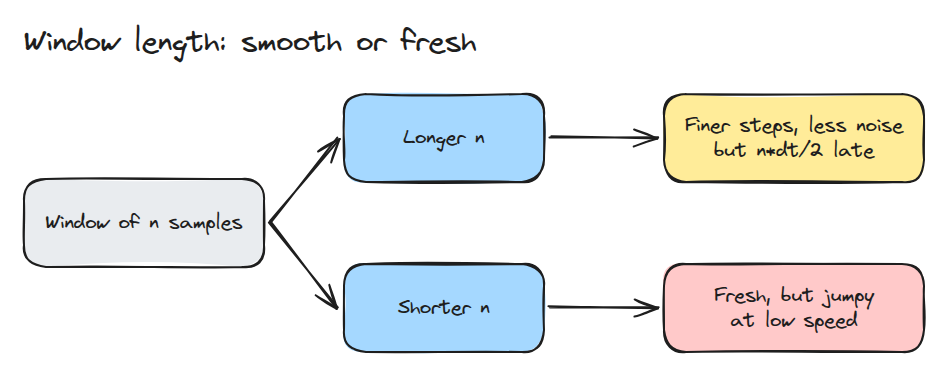
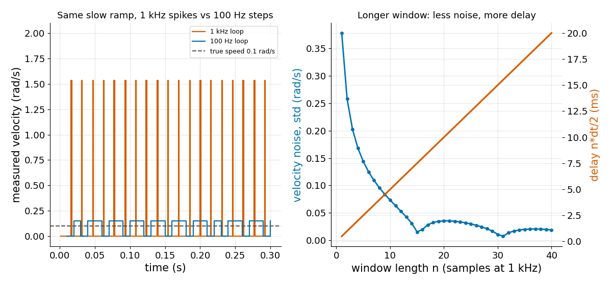

# Encoders and Quantisation

> Learn why a slow joint gives a jumpy speed reading, and why smoothing it makes it late.

**Type:** Build   **Prerequisites:** 04/01 Motor and Gearbox, 03/01 The Sampling Limit   **Time:** ~15 minutes

## In Plain Words

A slotted disc turns slowly past a fixed reader. The reader can only say one more slot edge went by, one count. Speed is counts divided by the time you counted for. Check often and you mostly see nothing, then one edge, so the speed jumps. Wait longer and it steadies, but each reading is older.

## Key Terms

- **Encoder**: a sensor that reports how far a shaft has turned, in whole steps.
- **Count**: one step an encoder reports, here one slot edge passing the reader.
- **CPR**: counts per revolution, the number of steps in one full turn.
- **Quantisation**: rounding a smooth value to whole steps, so small changes stay invisible.
- **Window**: the number of samples between the two counts you compare to get a speed.
- **Damping term**: `kd * velocity`, a brake that grows with speed.

## The Problem

A joint turns slowly and smoothly, yet its speed reading jumps between zero and a big value, and the damping term kicks it. A filter stops the kicks, but then the reading is late and the joint oscillates.

## The Concept

A joint's speed usually comes from encoder counts, so every slow robot meets this.

Counts are steps, and differencing (subtracting the previous count) turns each step into a spike.



*Smooth shaft, stepped counts, spiky velocity.*

One count is `2*pi / CPR` radians. Dividing by the sample time `dt` gives the smallest speed a one-sample difference can report, `2*pi / (CPR * dt)`: 1.53 rad/s for `CPR = 4096` and `dt = 1 ms`. A joint at 0.1 rad/s makes a count about every 15 ms, so 14 of 15 readings are zero and the rest read 1.53.



*Longer window: smaller steps, less noise, older estimate.*

A window of `n` samples divides the step by `n` and delays a changing signal by `n*dt/2`. In the lag test speed rises at 2 rad/s^2 with `n = 20` and `dt = 1 ms`. The estimate is 10 ms old, so it reads `2 * 0.01 = 0.02` rad/s too low.


*Blue (one sample) sits on the true speed, green (20 samples) trails by 10 ms.*



*Left: 1 kHz gives rare tall spikes, 100 Hz small steps. Right: longer windows cut noise but add delay.*

## Build It

```python
def min_velocity_step(cpr, dt):
    return TWO_PI / cpr / dt

def window_velocity(c, cpr, dt, n):
    return (c[n:] - c[:-n]) * TWO_PI / cpr / (n * dt)

def window_lag(n, dt):
    return n * dt / 2
```

Tests check whole-step output, no bias, the noise level and the lag `n*dt/2`.

```bash
cd robotics-engineering-from-scratch
python3 -m pytest phases/04-actuators-and-sensors/03-encoders-and-quantisation -q
python3 phases/04-actuators-and-sensors/03-encoders-and-quantisation/code/figure.py
```

## Use It

Drives count edges per window or time the gap between edges.

Sources: [maxon, encoder selection part three](https://www.maxongroup.com/en-us/knowledge-and-support/blog/encoder-selection-part-three-speed-control-25728), accessed 2026-11-09.

## Ship It

`outputs/skill-encoder-velocity-check.md` computes the velocity step and picks a window for a joint.

## Exercises

1. Time the gap between counts and compare its noise at 0.1 rad/s.
2. Find the speed above which a one-sample difference has under 10% error.
3. Show the dip near `n = 15` moves with the ramp speed.
