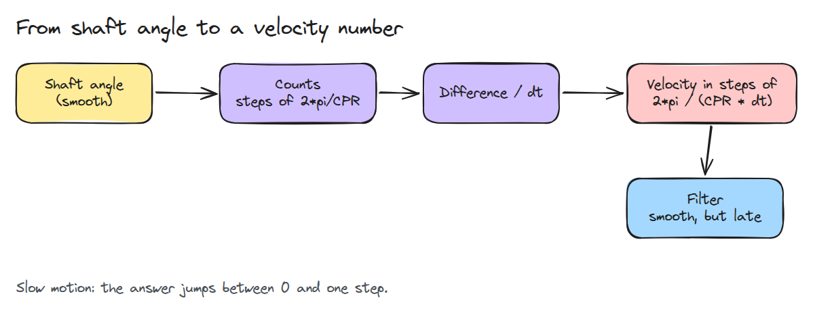
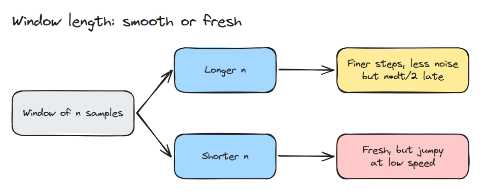
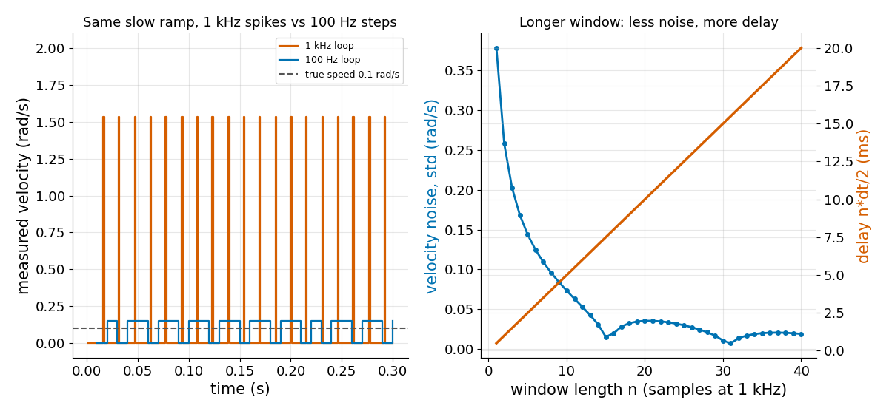

# Encoders and Quantisation

> An encoder reports whole counts, so a slow joint reads as a jumpy velocity, and every filter that calms it makes it late.

**Type:** Build   **Prerequisites:** 04/01 Motor and Gearbox, 03/01 The Sampling Limit   **Time:** ~15 minutes

## In Plain Words

Pour water slowly into a cup on a kitchen scale that shows only whole units. The true weight rises smoothly,
but the display waits and jumps. Divide each jump by a very short time and the estimated filling rate spikes,
even though your pouring stayed steady.

Encoder counts do the same to velocity estimates. Faster sampling makes a single count jump represent a larger
speed. Measuring across a longer window reduces the steps, but the result describes an earlier interval and
follows speed changes late.

## The Problem

You raise the loop rate to make a joint feel smoother, and at slow speed the velocity signal gets worse. It jumps between zero and a large value, and the damping term `kd * velocity` kicks the joint with every jump. You add a filter, the kicks stop, and the joint starts to oscillate because the velocity now arrives late.

## The Concept



*The shaft moves smoothly, the counts move in steps, and differencing the counts turns each step into a velocity spike.*

One count is `2*pi / CPR` radians. Dividing by the sample time gives the smallest non-zero velocity a one-sample difference can report, `2*pi / (CPR * dt)`. Below that speed the reading is zero or one step, and the average over time is still right.



*A longer window shrinks the step and the noise but makes the estimate older.*

A window of `n` samples divides the step by `n` and delays a changing signal by `n*dt/2`.



*Left: at 1 kHz the slow ramp reads as rare tall spikes, at 100 Hz as small steps. Right: noise falls with window length, with dips where the window spans a whole number of counts, while delay grows in a straight line.*

## Build It

```python
def min_velocity_step(cpr, dt):
    return TWO_PI / cpr / dt

def window_velocity(c, cpr, dt, n):
    return (c[n:] - c[:-n]) * TWO_PI / cpr / (n * dt)

def window_lag(n, dt):
    return n * dt / 2
```

Tests check that the output is a whole multiple of the step, that the slow ramp has no bias, that its noise matches the duty-cycle prediction `step * sqrt(d * (1 - d))`, and that the lag is `n*dt/2`.

```bash
cd robotics-engineering-from-scratch
python3 -m pytest phases/04-actuators-and-sensors/03-encoders-and-quantisation -q
python3 phases/04-actuators-and-sensors/03-encoders-and-quantisation/code/figure.py
```

## Use It

Drives and microcontrollers estimate speed by counting edges per window or by timing the gap between edges. The maxon page says counting is difficult at very low speed. Compare the fixed-window result here with a period-based estimate on the same ramp.

Sources: [maxon, encoder selection part three](https://www.maxongroup.com/en-us/knowledge-and-support/blog/encoder-selection-part-three-speed-control-25728), accessed 2026-11-09.

## Ship It

`outputs/skill-encoder-velocity-check.md` computes the velocity step and picks a window for a joint.

## Exercises

1. Add a period-based estimate that times the gap between counts and compare its noise at 0.1 rad/s.
2. Find the speed above which a one-sample difference has less than 10% error.
3. Show that the dip near `n = 15` moves when the ramp speed changes.
