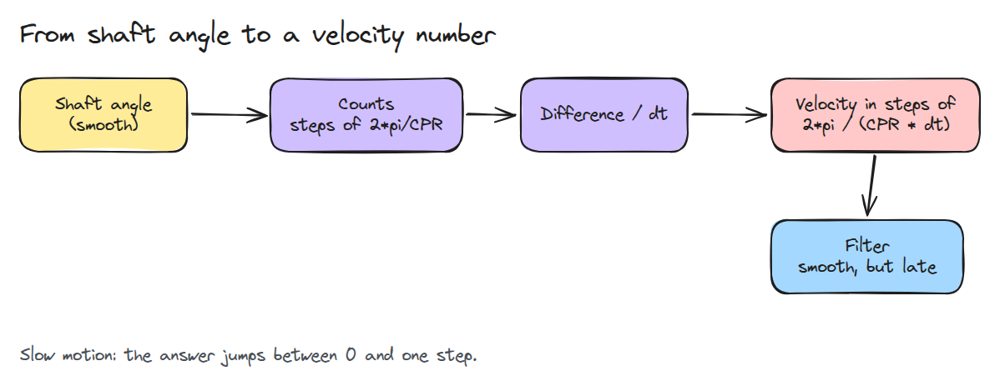
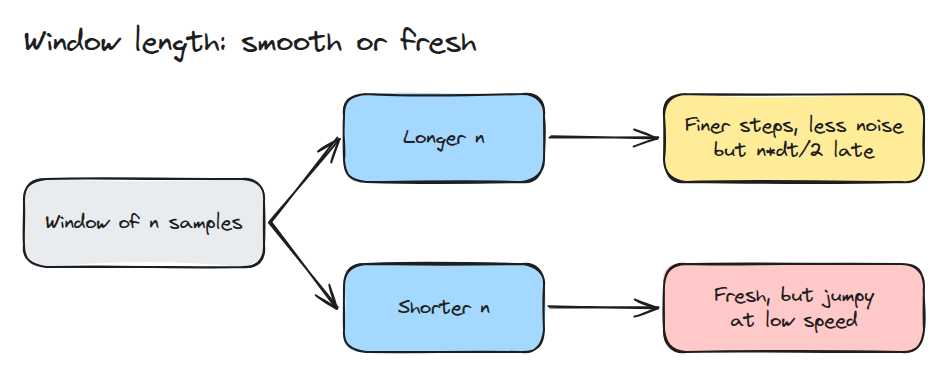
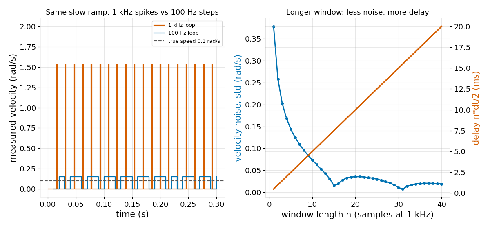

# Encoder와 양자화 (Encoders and Quantisation)

> encoder는 정수 카운트만 알려 주므로 느린 관절의 속도는 들쭉날쭉하고 그것을 진정시키는 필터는 모두 속도를 늦춥니다.

**유형:** 만들기   **선수 지식:** 04/01 모터와 기어박스, 03/01 샘플링 한계   **시간:** 약 15분

## 쉽게 말하면

정수 단위만 표시하는 주방 저울 위의 컵에 물을 천천히 부어 보세요. 실제 무게는 계속 늘지만 표시값은 멈춰 있다가 뛰어요. 그 변화를 아주 짧은 시간으로 나누면 붓는 속도가 일정해도 추정 속도는
크게 튀어요.

encoder count로 속도를 구할 때도 같아요. 더 짧은 간격으로 재면 count 하나의 변화가 더 큰 속도가 돼요. 더 긴 window에 걸쳐 재면 계단은 작아지지만 지난 구간을 보는 만큼
속도 변화를 늦게 따라가요.

## 문제

관절을 부드럽게 만들려고 loop 주기를 올렸더니 저속에서 속도 신호가 오히려 나빠집니다. 속도가 0과 큰 값 사이를 뜁니다. 댐핑 항 `kd * 속도`는 그 값이 뛸 때마다 관절을 걷어찹니다.
필터를 넣으면 걷어차는 일은 멈춥니다. 그 대신 속도가 늦게 도착해서 관절이 진동하기 시작합니다.

## 개념



*축은 부드럽게 움직이지만 카운트는 계단으로 움직입니다. 카운트를 차분하면 계단 하나하나가 속도 spike가 됩니다.*

카운트 하나는 `2*pi / CPR` rad입니다. 이것을 샘플 시간으로 나누면 한 샘플 차분이 보고할 수 있는 0이 아닌 가장 작은 속도 `2*pi / (CPR * dt)`가 됩니다. 이보다 느리면 값은 0이거나 한 단계이고 시간 평균은 여전히 맞습니다.



*창이 길수록 단계와 노이즈가 줄지만 추정값은 더 오래된 값이 됩니다.*

`n` 샘플 창은 단계를 `n`으로 나누고 변하는 신호를 `n*dt/2`만큼 늦춥니다.



*왼쪽은 1 kHz에서 저속 ramp가 드문 높은 spike로, 100 Hz에서 작은 계단으로 읽히는 모습입니다. 오른쪽은 창이 길수록 노이즈가 줄고 지연은 직선으로 늘어나는 모습입니다. 창이 카운트 정수 개에 걸칠 때는 노이즈가 푹 꺼집니다.*

## 만들기

```python
def min_velocity_step(cpr, dt):
    return TWO_PI / cpr / dt

def window_velocity(c, cpr, dt, n):
    return (c[n:] - c[:-n]) * TWO_PI / cpr / (n * dt)

def window_lag(n, dt):
    return n * dt / 2
```

테스트는 출력이 단계의 정수배인지, 저속 ramp에 bias가 없는지, 노이즈가 duty 비율 예측 `step * sqrt(d * (1 - d))`와 맞는지, 지연이 `n*dt/2`인지 확인합니다.

```bash
cd robotics-engineering-from-scratch
python3 -m pytest phases/04-actuators-and-sensors/03-encoders-and-quantisation -q
python3 phases/04-actuators-and-sensors/03-encoders-and-quantisation/code/figure.py
```

## 실제 도구로 보기

drive와 마이크로컨트롤러는 창 안의 edge를 세거나 edge 사이 간격을 재서 속도를 추정합니다. maxon 문서는 edge를 세는 방식이 아주 낮은 속도에서 어렵다고 설명합니다. 같은 ramp에서 여기의 고정 창 결과와 주기 기반 추정을 비교해 보세요.

출처 (2026년 11월 9일 접속):

- [maxon, encoder selection part three](https://www.maxongroup.com/en-us/knowledge-and-support/blog/encoder-selection-part-three-speed-control-25728)

## 결과물

`outputs/skill-encoder-velocity-check.md`는 속도 단계를 계산하고 관절에 맞는 창 길이를 고릅니다.

## 연습 문제

1. 카운트 사이 간격을 재는 주기 기반 추정을 더하고 0.1 rad/s에서 노이즈를 비교하세요.
2. 한 샘플 차분의 오차가 10% 아래로 내려가는 속도를 구하세요.
3. ramp 속도를 바꾸면 `n = 15` 근처의 꺼짐이 움직이는 것을 보이세요.
