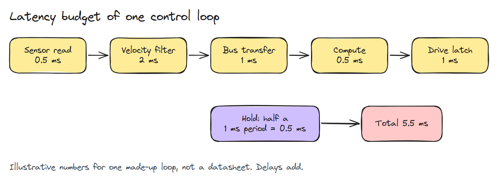
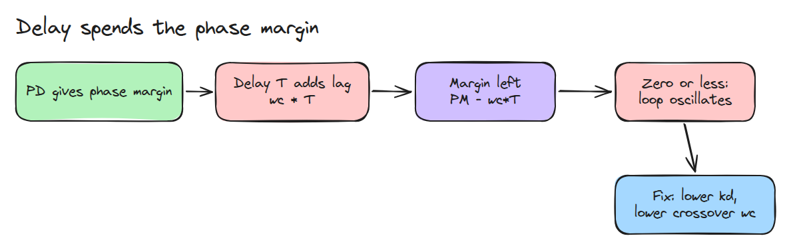
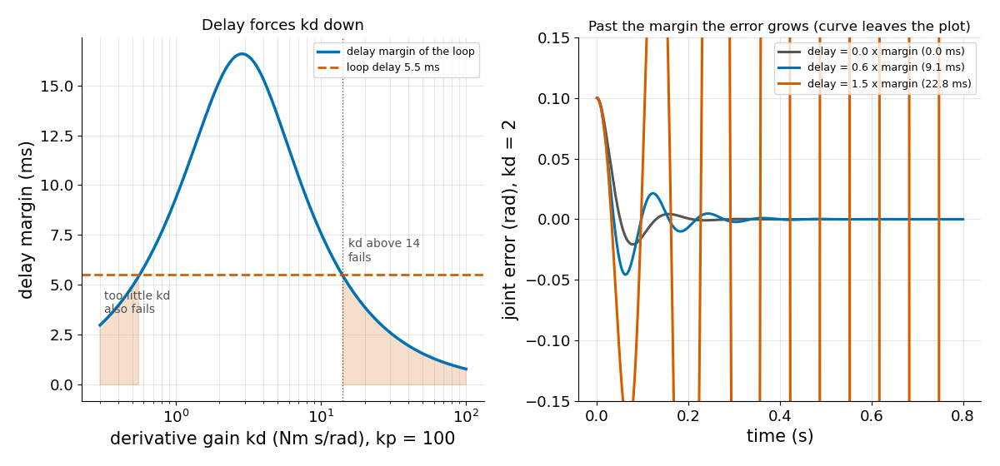

# Latency Budget

> Learn why a controller that is smooth on the bench can buzz on the real robot, and how much delay it can take.

**Type:** Build   **Prerequisites:** 04/03 Encoders and Quantisation, 03/01 The Sampling Limit   **Time:** ~15 minutes

## In Plain Words

A bench arm pulls its hand toward a target using an angle measured a few milliseconds ago. By then the hand has moved on, so the pull arrives late and overshoots. Every stage from sensor to motor adds delay.

## Key Terms

- **Latency**: the delay between measuring something and the motor acting on it.
- **PD loop**: a controller that pulls toward a target with `kp` and brakes with `kd`.
- **Damping gain (`kd`)**: the brake force per unit of speed.
- **Crossover (`wc`)**: the rate in rad/s (radians per second, an angular speed) where the loop stops amplifying a signal.
- **Phase margin**: how much lag, as an angle, the loop absorbs at crossover before it oscillates.
- **Delay margin**: the longest delay the loop survives, the phase margin divided by the crossover.

## The Problem

A joint is smooth on the bench. On the real controller, with the same settings, it buzzes. The only change is that commands now take a few milliseconds to reach the drive.

## The Concept

Every real robot loop has delays from sensor to motor, and they limit how strong a controller you can use.



*Each stage from sensor to motor adds a little delay.*

The small delays add up. A controller that corrects hard with old information overshoots, and the next late correction overshoots more. How much delay a loop can take is its delay margin.



*Delay eats into the loop's safety margin.*

More braking is not always safer. Past a point it makes the loop react faster, so the same delay ruins more of each swing. Too little braking fails too.


*Same delay. Green settles, blue swings wider until it hits the stop.*



*Left: with this delay, very strong and very weak braking both fail. Right: 0.6 times the margin settles, 1.5 times grows.*

<details><summary>The math (optional)</summary>

Delays add (ms): sensor 0.5, filter 2, bus 1, compute 0.5, drive 1, plus 0.5 for the half period a held command is old. Total 5.5 ms. For a PD loop on an inertia `J`, the crossover `wc` solves `J^2 wc^4 = kd^2 wc^2 + kp^2` and the phase margin is `PM = atan(kd*wc/kp)`. A delay `T` cuts the margin to `PM - wc*T`, so the delay margin is `PM / wc`. With `J = 0.05` and `kp = 100`: `kd = 2` gives `wc = 54.4`, `PM = 0.827` rad, margin 15.2 ms, so the delay is 0.36 of it and the arm settles. `kd = 30` gives `wc = 600`, margin 2.6 ms, delay 2.1 times it, and swings grow. 5.5 ms rules out `kd` above about 14.

</details>

## Build It

```python
def crossover(kp, kd, J):
    return np.sqrt((kd**2 + np.sqrt(kd**4 + 4 * J**2 * kp**2)) / (2 * J**2))

def phase_margin(kp, kd, J, delay=0.0):
    wc = crossover(kp, kd, J)
    return np.arctan(kd * wc / kp) - wc * delay

def delay_margin(kp, kd, J):
    return phase_margin(kp, kd, J) / crossover(kp, kd, J)
```

`simulate()` runs the delayed loop. Tests check that 0.6 times the delay margin is stable and 1.5 times is not.

```bash
cd robotics-engineering-from-scratch
python3 -m pytest phases/04-actuators-and-sensors/04-latency-budget -q
python3 phases/04-actuators-and-sensors/04-latency-budget/code/figure.py
```

## Use It

Delay margin is the phase margin you read off a Bode plot (loop response against frequency), divided by the crossover.

## Ship It

`outputs/skill-latency-budget-check.md` sums a loop's delays and returns the largest safe `kd`.

## Exercises

1. Change the total delay and watch the largest safe `kd` move.
2. Add a first-order filter and see the margin shrink.
3. Cut the filter delay and see what changes.
