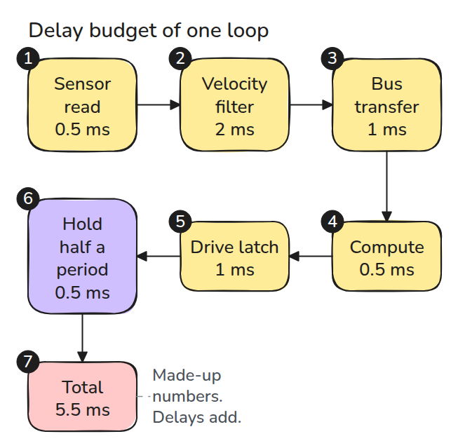
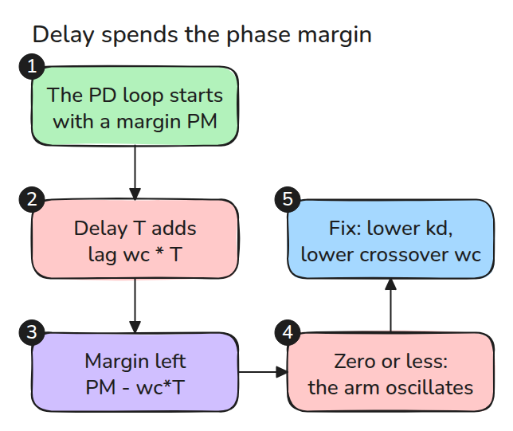
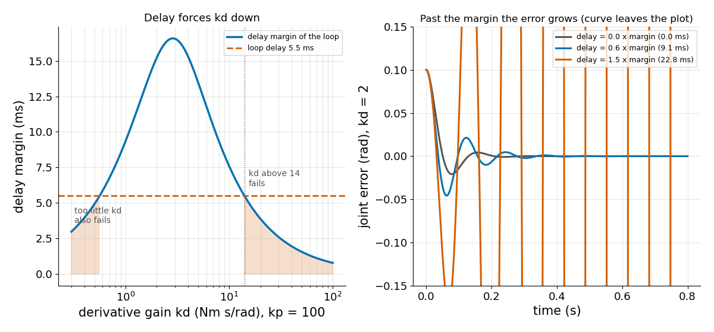

# Latency Budget

> Every stage of the loop adds delay, delay spends phase margin, and what is left decides how large kd may be.

**Type:** Build   **Prerequisites:** 04/03 Encoders and Quantisation, 03/01 The Sampling Limit   **Time:** ~15 minutes

## In Plain Words

A bench arm pulls its hand toward a target using the angle it measured a few milliseconds ago. By then the hand has moved on, so the pull arrives late. The hand is already back on target while the arm still pulls, so it overshoots, and the next late pull overshoots more.

Every stage from sensor to motor adds delay. A stronger damping gain `kd` (brake force per unit of speed) makes the arm correct faster, so a given delay eats more of each swing.

## The Problem

A joint is stable on the bench with `kd = 30` and buzzes on the real controller with the same gains. The command now takes a few milliseconds from sensor to drive.

## The Concept

Delays add: sensor 0.5 ms, filter 2 ms, bus 1 ms, compute 0.5 ms, drive 1 ms, plus 0.5 ms because a command held until the next 1 ms update is half a period old on average. Total 5.5 ms.



*Each stage adds delay.*

For a PD loop (pull `kp` Nm per radian, brake `kd` per unit of speed) on an inertia `J`, the gain crossover `wc` is the rate in rad/s where the loop stops amplifying. It solves `J^2 wc^4 = kd^2 wc^2 + kp^2`. The phase margin `PM = atan(kd*wc/kp)` is how much lag, as an angle, the loop can absorb at `wc` before it oscillates.

A delay `T` turns a wave of rate `wc` by an extra angle `wc*T`, so the margin falls to `PM - wc*T`. The delay margin `PM / wc` is the longest delay the loop survives.



*Delay eats the margin; the fix is a lower crossover.*

More `kd` is not always safer. It raises `wc` almost in proportion, but `PM` stops near a quarter turn, so past a point delay costs more angle than `kd` adds. Too little `kd` also fails: `PM` is small and a short delay uses it up.

Take `J = 0.05`, `kp = 100` and the 5.5 ms above. For `kd = 2`: `wc = 54.4`, `PM = 0.827` rad, so the margin is `0.827 / 54.4 = 15.2` ms, the delay is 0.36 of it so the arm settles. For `kd = 30`: `wc = 600` and the margin is 2.6 ms, so the delay is 2.1 times it and the swings grow. Watch the blue arm.


*Same delay. Green (kd = 2) settles, blue (kd = 30) swings wider until it hits the stop.*



*Left: 5.5 ms rules out kd above about 14 and very small kd. Right: 0.6 times the margin settles, 1.5 times grows.*

## Build It

```python
def crossover(kp, kd, J):
    return np.sqrt((kd**2 + np.sqrt(kd**4 + 4 * J**2 * kp**2)) / (2 * J**2))

def phase_margin(kp, kd, J, delay=0.0):
    wc = crossover(kp, kd, J)
    return np.arctan(kd * wc / kp) - wc * delay

def delay_margin(kp, kd, J):
    return phase_margin(kp, kd, J) / crossover(kp, kd, J)
```

`simulate()` runs the delayed loop. Tests check `wc` against a numeric gain of one, and stability at 0.6 and instability at 1.5 times `delay_margin()`.

```bash
cd robotics-engineering-from-scratch
python3 -m pytest phases/04-actuators-and-sensors/04-latency-budget -q
python3 phases/04-actuators-and-sensors/04-latency-budget/code/figure.py
```

## Use It

Delay margin is the Bode-plot phase margin divided by the crossover. Compare with `scipy.signal` on the same loop.

## Ship It

`outputs/skill-latency-budget-check.md` sums a loop's delays and returns the largest safe `kd`.

## Exercises

1. Add a first-order filter to the loop and recompute the margin numerically.
2. Find the delay margin as `kp` doubles at fixed `kd`.
3. Move the filter delay from 2 ms to 1 ms and report the new largest `kd`.
