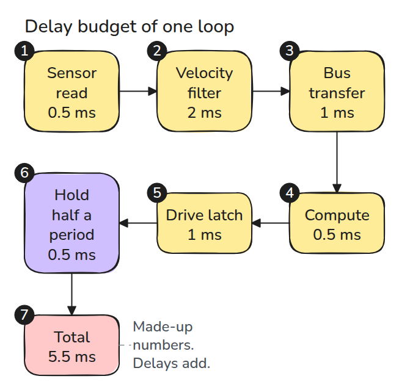
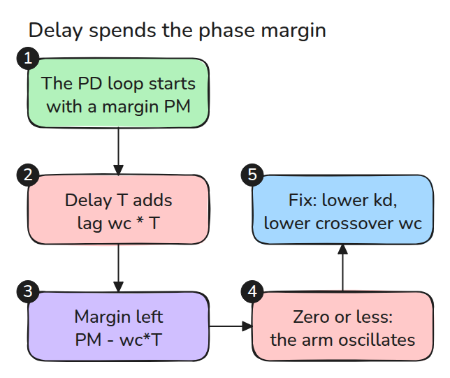
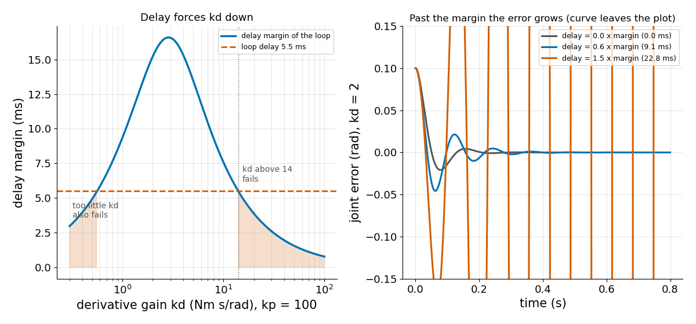

# 지연 예산 (Latency Budget)

> loop의 모든 단계가 지연을 더하고 그 지연은 phase margin을 소모합니다. 남은 margin이 kd를 얼마나 키울 수 있는지 정합니다.

**유형:** 만들기   **선수 지식:** 04/03 Encoder와 양자화, 03/01 샘플링 한계   **시간:** 약 15분

## 쉽게 말하면

bench 팔이 몇 ms 전에 잰 각도를 보고 손을 목표 쪽으로 끌어당겨요. 그 사이 손은 이미 움직였으니 끌어당기는 힘이 늦게 도착해요.
손이 벌써 목표로 돌아왔는데도 팔은 계속 끌어당겨서 목표를 지나치고 다음에 늦게 오는 힘은 더 크게 지나치게 해요.

센서에서 모터까지 모든 단계가 지연을 더해요. damping gain `kd`(팔이 속도에 맞서 얼마나 세게 제동하는지)를 키우면 팔이 더 빨리 보정해서 같은 지연이 한 번 흔들리는 시간을 더 많이 차지해요.

## 문제

관절이 bench에서는 `kd = 30`으로 안정적인데 같은 gain으로 실제 controller에 올리면 떨기 시작합니다. 명령이 센서에서 drive까지 가는 데 이제 몇 ms가 걸립니다.

## 개념

지연은 더해집니다. 센서 0.5 ms, 필터 2 ms, bus 1 ms, 계산 0.5 ms, drive 1 ms에 더해서 다음 1 ms 갱신까지 유지되는 명령은 평균 반 주기 묵은 값이므로 0.5 ms가 더 붙습니다. 합계는 5.5 ms입니다.



*단계마다 지연이 붙습니다.*

관성 `J`에 PD loop(오차 1 rad당 `kp` Nm로 끌어당기고 속도에 `kd`로 제동)를 건 경우 gain crossover `wc`는 loop가 신호를 키우기를 멈추는 rad/s 단위의 빠르기입니다.
`J^2 wc^4 = kd^2 wc^2 + kp^2`의 해입니다.

phase margin `PM = atan(kd*wc/kp)`는 loop가 진동하기 전까지 `wc`에서 견딜 수 있는 위상 지연(각도)의 양입니다.

지연 `T`는 빠르기 `wc`로 도는 파동을 `wc*T`만큼 더 돌려 놓으므로 margin은 `PM - wc*T`로 줄어듭니다.
delay margin `PM / wc`는 loop가 견디는 가장 긴 지연입니다.



*지연이 margin을 깎으므로 crossover를 낮춰야 합니다.*

`kd`를 키운다고 항상 안전하지는 않습니다. `kd`는 `wc`를 거의 비례해서 올리지만 `PM`은 4분의 1바퀴 근처에서 멈추므로 어느 지점부터는 지연이 `kd`가 더하는 것보다 더 많은 각도를 깎습니다.
`kd`가 너무 작아도 실패합니다. `PM`이 작아서 짧은 지연에도 다 소모되기 때문입니다.

`J = 0.05`, `kp = 100`, 위의 5.5 ms를 넣어 봅니다. `kd = 2`이면 `wc = 54.4`이고 `PM = 0.827` rad이므로 margin은 `0.827 / 54.4 = 15.2` ms이고 지연은 그것의 0.36배여서 팔이 가라앉습니다.
`kd = 30`이면 `wc = 600`이고 margin은 2.6 ms이므로 지연이 그것의 2.1배여서 흔들림이 커집니다. 파란 팔을 보세요.


*같은 지연입니다. 초록(kd = 2)은 가라앉고 파랑(kd = 30)은 stop에 부딪힐 때까지 더 크게 흔들립니다.*



*왼쪽은 5.5 ms가 약 14보다 큰 kd와 아주 작은 kd를 모두 막는 모습입니다. 오른쪽은 margin의 0.6배에서는 가라앉고 1.5배에서는 커지는 모습입니다.*

## 만들기

```python
def crossover(kp, kd, J):
    return np.sqrt((kd**2 + np.sqrt(kd**4 + 4 * J**2 * kp**2)) / (2 * J**2))

def phase_margin(kp, kd, J, delay=0.0):
    wc = crossover(kp, kd, J)
    return np.arctan(kd * wc / kp) - wc * delay

def delay_margin(kp, kd, J):
    return phase_margin(kp, kd, J) / crossover(kp, kd, J)
```

`simulate()`는 지연이 있는 loop를 돌립니다. 테스트는 crossover를 수치로 구한 gain 1과 대조하고 `delay_margin()`의 0.6배에서 안정이고 1.5배에서 불안정함을 확인합니다.

```bash
cd robotics-engineering-from-scratch
python3 -m pytest phases/04-actuators-and-sensors/04-latency-budget -q
python3 phases/04-actuators-and-sensors/04-latency-budget/code/figure.py
```

## 실제 도구로 보기

delay margin은 Bode plot의 phase margin을 crossover 주파수로 나눈 값입니다. 같은 loop를 `scipy.signal` 같은 주파수 응답 도구로 그려서 결과를 비교해 보세요.

## 결과물

`outputs/skill-latency-budget-check.md`는 loop의 지연을 합산하고 안전한 가장 큰 `kd`를 돌려줍니다.

## 연습 문제

1. loop에 1차 필터를 넣고 margin을 수치로 다시 계산하세요.
2. `kd`를 고정하고 `kp`를 두 배로 할 때 delay margin을 구하세요.
3. 필터 지연을 2 ms에서 1 ms로 옮기고 새 최대 `kd`를 보고하세요.
