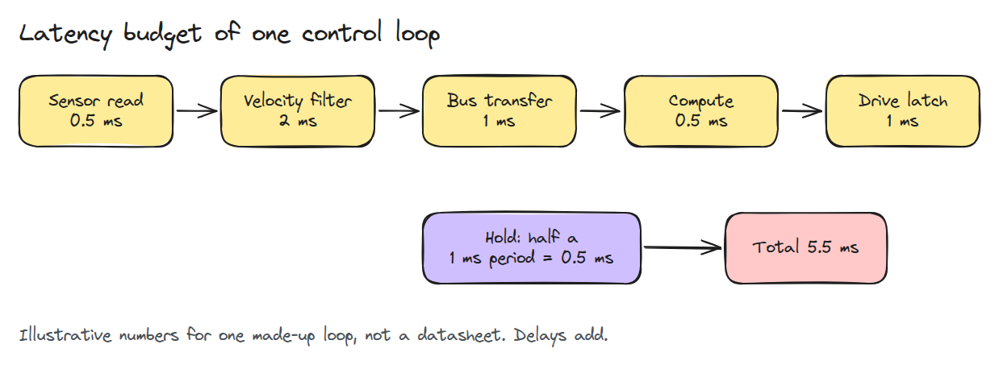
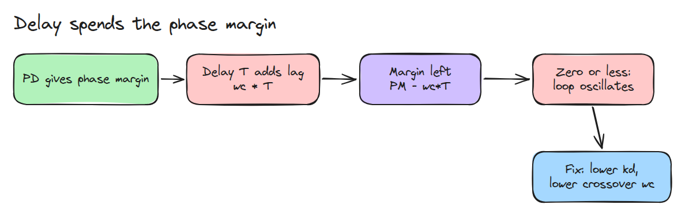

# 지연 예산 (Latency Budget)

> 벤치에서는 매끄럽던 controller가 실제 로봇에서 떨리는 이유와 얼마나 지연을 견디는지 배웁니다.

**유형:** 만들기   **선수 지식:** 04/03 Encoder와 양자화, 03/01 샘플링 한계   **시간:** 약 15분

## 쉽게 말하면

bench 팔이 몇 ms 전에 잰 각도를 보고 손을 목표 쪽으로 끌어당겨요. 그 사이 손은 이미 움직였으니 끌어당기는 힘이 늦게 도착하고 목표를 지나쳐요. 센서에서 모터까지 모든 단계가 지연을 더해요.

## 핵심 용어

- **Latency**: 무언가를 잰 뒤 모터가 그것에 반응하기까지 걸리는 지연입니다.
- **PD loop**: `kp`로 목표 쪽으로 끌어당기고 `kd`로 제동하는 controller입니다.
- **Damping gain (`kd`)**: 속도 한 단위당 제동하는 힘입니다.
- **Crossover (`wc`)**: loop가 신호를 키우기를 멈추는 rad/s(초당 라디안, 각속도) 단위의 빠르기입니다.
- **Phase margin**: loop가 진동하기 전까지 crossover에서 견딜 수 있는 지연의 양을 각도로 나타낸 값입니다.
- **Delay margin**: loop가 견디는 가장 긴 지연입니다. phase margin을 crossover로 나눈 값입니다.

## 문제

관절이 bench에서는 `kd = 30`으로 매끄러운데 같은 gain으로 실제 controller에 올리면 떨기 시작합니다. 명령이 drive에 닿는 데 이제 몇 ms가 걸리기 때문입니다.

## 개념

실제 로봇의 loop에는 센서에서 모터까지 지연이 있고 그 지연이 쓸 수 있는 controller의 세기를 제한합니다.

지연은 더해집니다(ms). 센서 0.5, 필터 2, bus 1, 계산 0.5, drive 1에 더해서 붙들려 있던 명령이 반 주기 묵었으므로 0.5가 더 붙습니다. 합계는 5.5 ms입니다.



*단계마다 지연이 붙습니다.*

관성 `J`에 건 PD loop에서 crossover `wc`는 `J^2 wc^4 = kd^2 wc^2 + kp^2`의 해이고 phase margin은 `PM = atan(kd*wc/kp)`입니다.
지연 `T`는 파동을 `wc*T`만큼 더 돌려 놓으므로 margin은 `PM - wc*T`로 줄어듭니다. delay margin은 `PM / wc`입니다.



*지연이 margin을 깎습니다.*

`kd`를 키운다고 항상 안전하지는 않습니다. `kd`는 `wc`를 거의 비례해서 올리지만 `PM`은 4분의 1바퀴 근처에서 멈춥니다.

`J = 0.05`, `kp = 100`, 5.5 ms를 넣어 봅니다. `kd = 2`이면 `wc = 54.4`이고 `PM = 0.827` rad이며 margin은 15.2 ms이고 지연은 그것의 0.36배여서 팔이 가라앉습니다.
`kd = 30`이면 `wc = 600`이고 margin은 2.6 ms이며 지연이 그것의 2.1배여서 흔들림이 커집니다.


*초록(kd = 2)은 가라앉고 파랑(kd = 30)은 stop에 부딪힐 때까지 더 크게 흔들립니다.*


*왼쪽은 5.5 ms가 약 14보다 큰 kd와 아주 작은 kd를 막는 모습입니다. 오른쪽은 margin의 0.6배에서는 가라앉고 1.5배에서는 커지는 모습입니다.*

## 만들기

```python
def crossover(kp, kd, J):
    return np.sqrt((kd**2 + np.sqrt(kd**4 + 4 * J**2 * kp**2)) / (2 * J**2))

def phase_margin(kp, kd, J, delay=0.0):
    wc = crossover(kp, kd, J)
    return np.arctan(kd * wc / kp) - wc * delay

def delay_margin(kp, kd, J):
    return phase_margin(kp, kd, J) / crossover(kp, kd, J)
```

`simulate()`는 지연이 있는 loop를 돌립니다. 테스트는 `wc`를 수치로 확인하고 delay margin의 0.6배는 안정이고 1.5배는 불안정함을 확인합니다.

```bash
cd robotics-engineering-from-scratch
python3 -m pytest phases/04-actuators-and-sensors/04-latency-budget -q
python3 phases/04-actuators-and-sensors/04-latency-budget/code/figure.py
```

## 실제 도구로 보기

delay margin은 Bode plot(주파수에 따른 loop 응답)의 phase margin을 crossover로 나눈 값입니다.

## 결과물

`outputs/skill-latency-budget-check.md`는 loop의 지연을 합산하고 안전한 가장 큰 `kd`를 돌려줍니다.

## 연습 문제

1. 1차 필터를 넣고 margin을 수치로 다시 계산하세요.
2. `kp`를 두 배로 할 때 delay margin을 구하세요.
3. 필터 지연을 1 ms로 줄이고 새 최대 `kd`를 보고하세요.
