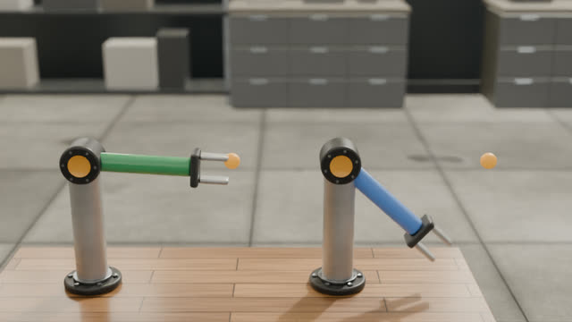
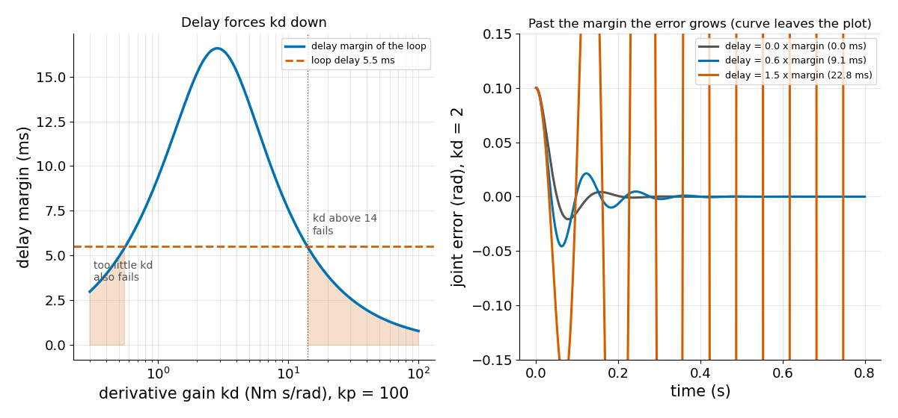

# 지연 예산 (Latency Budget)

> bench에서는 매끄럽던 controller가 실제 로봇에서 떨리는 이유와 지연을 얼마나 견딜 수 있는지를 배웁니다.

**유형:** 만들기   **선수 지식:** 없음   **시간:** 약 15분

## 쉽게 말하면

로봇 팔이 몇 ms 전에 잰 각도를 보고 손을 목표 쪽으로 끌어당겨요. 그 사이 손은 이미 움직였으니 끌어당기는 힘이 늦게 도착하고 목표를 지나쳐요. 센서에서 모터까지 모든 단계가 지연을 더해요.

## 핵심 용어

- **Latency**: 무언가를 잰 뒤 모터가 그것에 반응하기까지 걸리는 지연입니다.
- **PD loop**: 목표 쪽으로 끌어당기고 속도에 비례해 제동하는 제어 코드(controller)입니다.
- **Damping gain (`kd`)**: 속도 한 단위당 제동하는 힘입니다.
- **Delay margin**: loop가 흔들리기 시작하기 전까지 견딜 수 있는 가장 긴 지연입니다.

## 문제

관절이 bench에서는 매끄럽습니다. 같은 설정으로 실제 로봇에 올리면 떨기 시작합니다. 달라진 것은 명령이 drive에 닿는 데 이제 몇 ms가 걸린다는 것뿐입니다.

## 개념

실제 로봇의 loop에는 센서에서 모터까지 지연이 있고 그 지연이 제어 코드가 얼마나 세게 보정할 수 있는지를 제한합니다.


*센서에서 모터까지 단계마다 지연이 조금씩 붙습니다.*

작은 지연이 쌓입니다. 낡은 정보로 세게 보정하는 제어 코드는 목표를 지나치고 그다음의 늦은 보정은 더 크게 지나칩니다. loop가 견딜 수 있는 지연의 크기가 delay margin입니다.


*loop는 정해진 margin을 갖고 시작하고 지연이 그 일부를 씁니다. 다 쓰면 팔이 흔들립니다.*

제동을 키운다고 항상 안전하지는 않습니다. 어느 지점부터는 loop가 더 빨리 반응하고 같은 지연이 한 번 흔들리는 동안의 더 많은 부분을 망칩니다. 제동이 너무 작아도 실패합니다.

[](../assets/clip-example.mp4)

*같은 지연입니다. 초록은 가라앉고 파랑은 stop에 부딪힐 때까지 더 크게 흔들립니다.*



*왼쪽: 이 지연에서는 아주 센 제동과 아주 약한 제동이 모두 실패합니다. 오른쪽: delay margin의 0.6배 지연에서는 가라앉고 1.5배에서는 커집니다.*

<details><summary>The math (optional)</summary>

지연은 더해집니다(ms). 센서 0.5, 필터 2, bus 1, 계산 0.5, drive 1에 더해 유지되는 명령이 반 주기만큼 묵으므로 0.5가 더 붙고 합계는 5.5 ms입니다.
관성 `J`에 건 PD loop에서 crossover `wc`(rad/s 단위이고 이보다 빠른 신호는 loop가 더 이상 키우지 않는 속도)는 `J^2 wc^4 = kd^2 wc^2 + kp^2`의 해입니다.
phase margin `PM = atan(kd*wc/kp)`는 loop가 견딜 수 있는 늦음을 각도로 나타낸 값입니다.
지연 `T`는 phase margin을 `PM - wc*T`로 줄이므로 delay margin은 `PM / wc`입니다.
`J = 0.05`, `kp = 100`일 때 `kd = 2`이면 `wc = 54.4`, `PM = 0.827` rad, margin 15.2 ms이고 지연은 그것의 0.36배여서 팔이 가라앉습니다.
`kd = 30`이면 `wc = 600`, margin 2.6 ms이고 지연은 2.1배여서 흔들림이 커집니다. 5.5 ms는 약 14보다 큰 `kd`를 막습니다.

</details>

## 만들기

```python
def crossover(kp, kd, J):
    return np.sqrt((kd**2 + np.sqrt(kd**4 + 4 * J**2 * kp**2)) / (2 * J**2))

def phase_margin(kp, kd, J, delay=0.0):
    wc = crossover(kp, kd, J)
    return np.arctan(kd * wc / kp) - wc * delay

def delay_margin(kp, kd, J):
    return phase_margin(kp, kd, J) / crossover(kp, kd, J)
```

`simulate()`는 지연이 있는 loop를 돌립니다. 테스트는 delay margin의 0.6배 지연에서는 가라앉고 1.5배에서는 가라앉지 않는지 확인합니다.

```bash
cd robotics-engineering-from-scratch
python3 -m pytest phases/04-actuators-and-sensors/04-latency-budget -q
python3 phases/04-actuators-and-sensors/04-latency-budget/code/figure.py
```

## 실제 도구로 보기

같은 loop를 제어 설계 도구에 넣고 그 도구가 보고하는 delay margin을 내 값과 비교해 보세요.

## 결과물

`outputs/skill-latency-budget-check.md`는 loop의 지연을 합산하고 안전한 가장 큰 `kd`를 돌려줍니다.

## 연습 문제

1. 전체 지연을 바꾸고 안전한 가장 큰 `kd`가 어떻게 움직이는지 보세요.
2. 1차 필터를 넣고 margin이 줄어드는 것을 보세요.
3. 필터 지연을 줄이고 무엇이 달라지는지 보세요.
