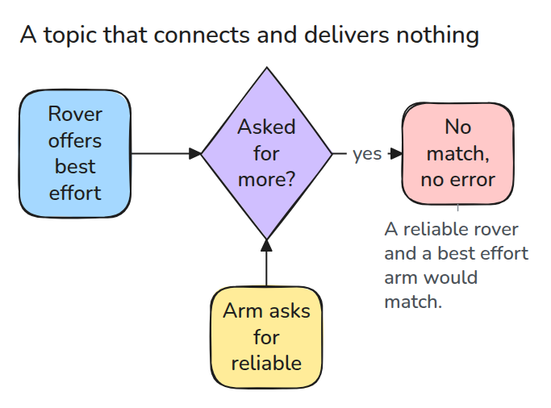
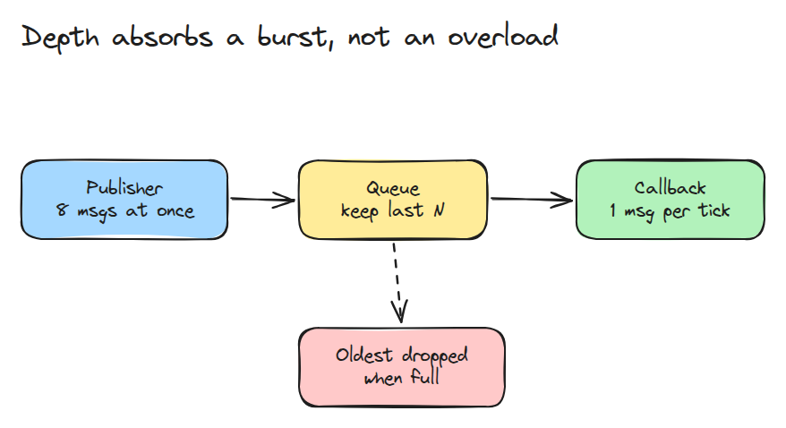
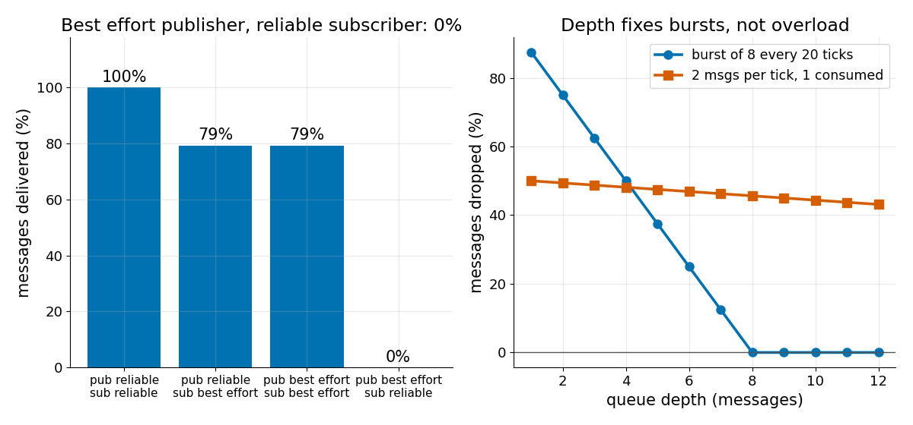

# Publish-Subscribe and QoS Mismatch

> A subscriber may not ask for more than the publisher offers, and when it does, nothing is delivered and nothing complains.

**Type:** Build   **Prerequisites:** 00/04 ROS 2 in One Page   **Time:** ~15 minutes

## In Plain Words

A class needs notes delivered. A volunteer promises to try, but the teacher accepts only a service that
guarantees delivery. They never agree to start. That differs from agreeing to a casual delivery and
occasionally losing a note.

With QoS matching, a reliable subscriber cannot match a best effort publisher, so nothing arrives. A publisher
offering reliability can satisfy a subscriber asking for less. After a match, a slow callback can still
overflow its queue; compatibility does not prevent that loss.

## The Problem

A camera driver publishes images and a viewer subscribes, yet the viewer stays blank. Both ends exist, no node crashed, and no error scrolled by. The two sides asked for different delivery guarantees, so the middleware never connected them.

## The Concept



*A best effort publisher cannot satisfy a reliable subscriber, so the pair never matches.*

Each side declares a QoS profile: reliability, durability and a history depth. A pair connects only if the subscriber requests no more than the publisher offers, for every policy. Reliable publisher with best effort subscriber is fine. The reverse is not.



*A keep-last queue holds N messages and drops the oldest when a new one arrives.*

Even a matched pair loses messages when the callback is slower than the publisher (lesson 00/04 built this bus). Here depth is tested against bursts and overload.



*Left: only the mismatched pair delivers 0%. Right: a burst of 8 needs depth 8, while a sustained overload drops about half at any depth.*

## Build It

```python
def compatible(pub, sub):
    if pub.reliability == "best_effort" and sub.reliability == "reliable":
        return False, "reliability: ..."
    if pub.durability == "volatile" and sub.durability == "transient_local":
        return False, "durability: ..."
    return True, "ok"
```

`Queue.push()` appends and pops the oldest past `depth`, counting drops. `run()` publishes `arrivals[t]` messages per tick, loses some on a best effort link, and lets the callback take one per tick.

```bash
cd robotics-engineering-from-scratch
python3 -m pytest phases/05-robot-software/01-publish-subscribe-and-qos-mismatch -q
```

## Use It

Compare `compatible()` with the tables in the ROS 2 QoS documentation, and with the incompatible-QoS events that publishers and subscriptions can report. The documented defaults are keep last, depth 10, reliable and volatile.

Sources: ROS 2 Jazzy, "Quality of Service settings" (https://docs.ros.org/en/jazzy/Concepts/Intermediate/About-Quality-of-Service-Settings.html), read 2026-11-09 from its source file in the `jazzy` branch of ros2/ros2_documentation.

## Ship It

`outputs/skill-qos-mismatch-check.md` walks a silent topic through profile, compatibility and queue checks.

## Exercises

1. Add a deadline policy and a rule that rejects a subscriber deadline shorter than the publisher's.
2. Give `Queue` a keep-all mode and show the memory it needs under sustained overload.
3. Make a transient-local publisher replay its last `depth` messages to a late subscriber.
