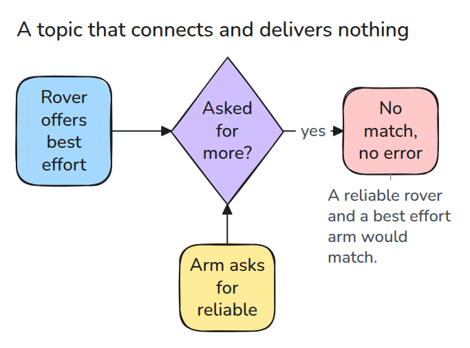
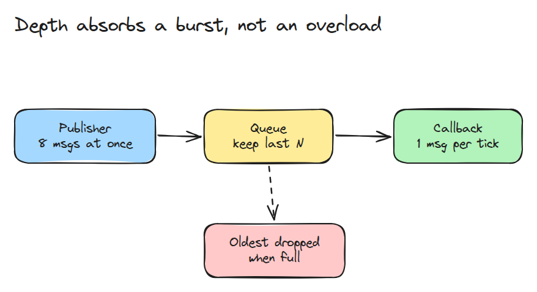
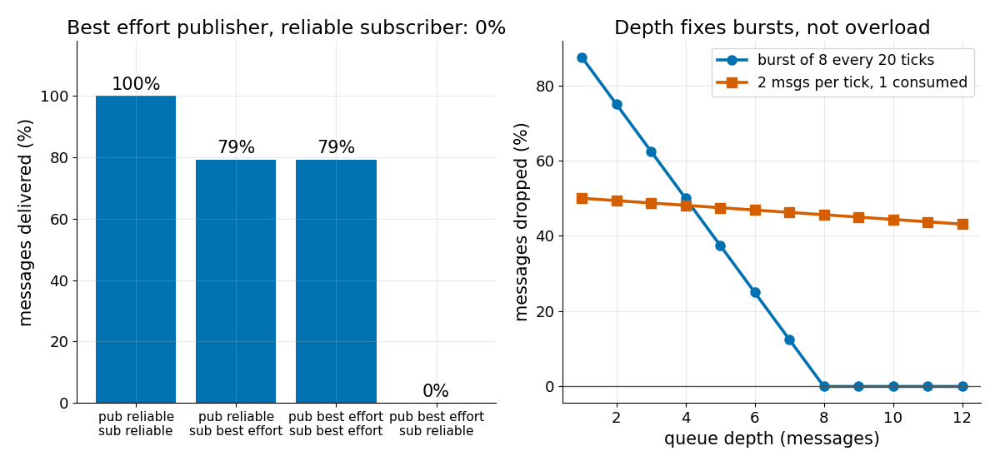

# Publish-Subscribe and QoS Mismatch

> Learn why two ROS programs can both run fine and still never exchange a message.

**Type:** Build   **Prerequisites:** 00/10 ROS 2 in One Page   **Time:** ~15 minutes

## In Plain Words

A rover tells a robot arm where it is by sending messages. Before they connect, each side states a delivery promise, called QoS (quality of service). The rover promises only to try, but the arm insists on guaranteed delivery. They never connect, nobody complains, and the arm stays still.

## Key Terms

- **Node**: a running program in ROS 2, the robot software framework.
- **Topic**: a named channel that nodes send messages to and listen on.
- **Publisher / Subscriber**: the sender and the listener on a topic.
- **QoS**: quality of service, the delivery promises each side states before connecting.
- **Callback**: the function that handles each arriving message.
- **Queue depth**: how many unread messages may wait before the oldest is dropped.

## The Problem

A rover sends its position and an arm listens, yet the arm never moves and nothing crashes. They asked for different delivery guarantees, so ROS never connected them.

## The Concept

A robot is many programs passing messages, and this silent mismatch looks just like a dead sensor.



*The rover offers best effort, the arm asks for reliable: no match.*

Each side declares a delivery promise. Best effort sends once and moves on, while reliable resends a lost message. A pair connects only if the listener asks for no more than the sender offers. A reliable sender with a best effort listener is fine. The reverse is not.



*A keep-last queue holds the newest few and drops the oldest.*

A slow listener loses messages unless the queue is deep enough.


*Same burst. Blue has one slot: most messages fall. Green has enough slots: the arm steps through all.*



*Left: the mismatched pair delivers nothing. Right: a burst needs a queue as deep as the burst, while constant overload drops messages at any depth.*

<details><summary>The math (optional)</summary>

Another QoS setting is durability: volatile gives a late listener nothing, transient local gives it the old messages. Say the rover sends 8 messages at once and the arm handles one per tick (a simulation step). With depth 1, `run()` delivers 1 and drops 7. With depth 8 it delivers all 8. In the figure the mismatched pair delivers 0%, and a constant overload drops half the messages at any depth.

</details>

## Build It

```python
def compatible(pub, sub):
    if pub.reliability == "best_effort" and sub.reliability == "reliable":
        return False, "reliability: ..."
    if pub.durability == "volatile" and sub.durability == "transient_local":
        return False, "durability: ..."
    return True, "ok"
```

`Queue.push()` pops the oldest past `depth`, counting drops.

```bash
cd robotics-engineering-from-scratch
python3 -m pytest phases/05-robot-software/01-publish-subscribe-and-qos-mismatch -q
```

## Use It

Compare `compatible()` with the ROS 2 QoS tables.

Sources: ROS 2 Jazzy, "Quality of Service settings" (https://docs.ros.org/en/jazzy/Concepts/Intermediate/About-Quality-of-Service-Settings.html), read 2026-11-09.

## Ship It

`outputs/skill-qos-mismatch-check.md` walks a silent topic through profile, compatibility and queue checks.

## Exercises

1. Change the sender or listener setting and see when they connect.
2. Make the queue deeper and watch the drops change.
3. Let a late listener receive the old messages.
