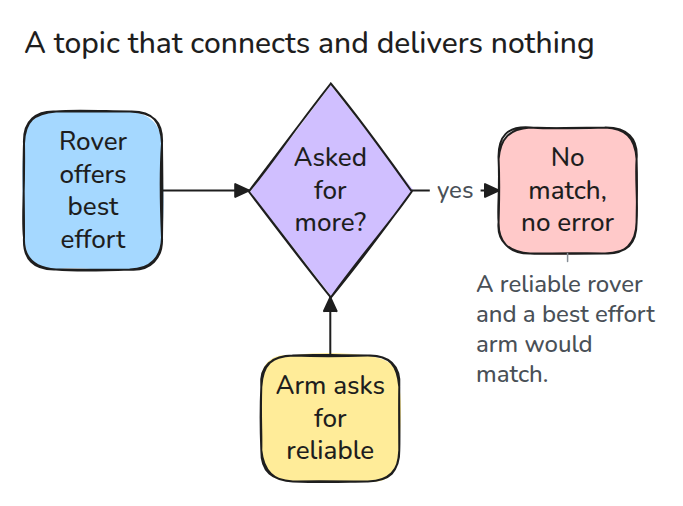
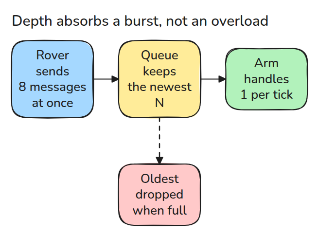
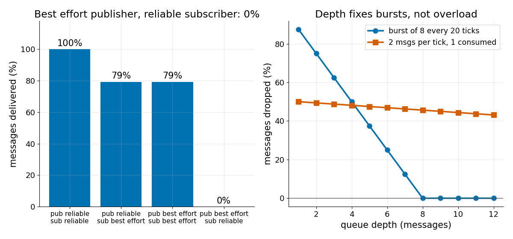

# Publish-Subscribe와 QoS 불일치

> subscriber는 publisher가 제공하는 것보다 더 많이 요구할 수 없습니다. 요구하면 아무것도 전달되지 않고 아무 경고도 없습니다.

**유형:** 만들기   **선수 지식:** 00/04 한 페이지로 보는 ROS 2   **시간:** 약 15분

## 쉽게 말하면

로버가 짧은 메시지로 자기 위치를 알려 주면 로봇 팔은 받은 메시지만 보고 로버를 따라가요. 연결하기 전에 양쪽은 각자 전달 약속을 밝혀요. 이 약속을 ROS에서는 QoS(quality of service)라고 불러요.
로버는 보내 보겠다고만 약속하고 팔은 반드시 전달되는 방식만 받겠다고 해요.

팔이 로버가 약속한 것보다 더 많이 요구해서 둘은 연결되지 않아요. 로버는 계속 보내는데 아무도 불평하지 않고 아무것도 도착하지 않아서 팔은 가만히 있어요. 로버가 반드시 전달하겠다고 약속했다면 그보다 적게 요구하는 팔과는 연결돼요.

## 문제

실행 중인 프로그램인 로버 node가 자기 위치를 topic이라는 이름 붙은 통로에 publish합니다. 팔 node는 그 topic을 subscribe해서 듣고 있는데 팔이 전혀 움직이지 않습니다. 두 node 모두 실행 중이고 죽은 것도 없습니다.
두 쪽이 서로 다른 전달 보장을 요구해서 메시지를 실어 나르는 소프트웨어가 둘을 연결하지 않은 것입니다.

## 개념



*화살표를 따라가 보세요. 로버는 best effort를 제공하고 팔은 reliable을 요구합니다. 팔이 제공된 것보다 더 많이 요구하므로 둘은 연결되지 않습니다.*

양쪽은 각자 QoS profile을 선언합니다. reliability에서 best effort는 한 번 보내고 넘어가고 reliable은 잃어버린 메시지를 다시 보냅니다.
durability에서 volatile은 늦게 온 subscriber에게 아무것도 주지 않고 transient local은 옛 메시지를 줍니다. history depth는 읽지 않은 메시지가 몇 개까지 기다릴 수 있는지를 정합니다.
subscriber가 모든 항목에서 publisher가 제공하는 것 이하만 요구해야 쌍이 연결되므로 reliable과 transient local이 더 큰 요구입니다.
reliable publisher와 best effort subscriber는 괜찮고 반대는 안 됩니다.



*keep-last 큐는 최신 메시지 N개를 담고 새 메시지가 오면 가장 오래된 것을 버립니다.*

연결된 쌍도 메시지를 처리하는 함수인 callback이 publisher보다 느리면 메시지를 잃습니다.

예를 들어 로버가 위치 메시지 8개를 한꺼번에 보내고 팔이 tick마다 하나씩 처리한다고 해 보겠습니다. tick은 시뮬레이션의 한 단계입니다. depth가 1이면 `run()`은 1개를 전달하고 7개를 버려서 팔은 마지막 위치만 봅니다.
depth가 8이면 8개가 모두 전달됩니다.


*한꺼번에 몰려온 메시지 8개를 선반 두 개가 받습니다. 파란 선반은 칸이 하나라서 메시지 일곱 개가 떨어지고 팔은 한 번만 움직입니다. 초록 선반은 칸이 여덟 개라서 팔이 모두 차례로 따라갑니다.*



*왼쪽은 불일치 쌍만 0%를 전달하는 모습입니다. 오른쪽은 8개짜리 burst에 depth 8이 필요한 모습입니다. callback이 tick당 1개를 처리하는데 tick당 2개가 계속 오는 과부하는 어떤 depth에서도 절반을 버립니다.*

## 만들기

```python
def compatible(pub, sub):
    if pub.reliability == "best_effort" and sub.reliability == "reliable":
        return False, "reliability: ..."
    if pub.durability == "volatile" and sub.durability == "transient_local":
        return False, "durability: ..."
    return True, "ok"
```

`Queue.push()`는 메시지를 넣고 `depth`를 넘으면 가장 오래된 것을 빼며 유실을 셉니다.
`run()`은 tick마다 `arrivals[t]`개를 publish하고 best effort 링크에서 일부를 잃으며 callback이 tick당 하나씩 가져가게 합니다.

```bash
cd robotics-engineering-from-scratch
python3 -m pytest phases/05-robot-software/01-publish-subscribe-and-qos-mismatch -q
```

## 실제 도구로 보기

`compatible()`을 ROS 2 QoS 문서의 표와 비교해 보세요. publisher와 subscription이 보고할 수 있는 incompatible-QoS 이벤트도 같이 보세요.


출처: ROS 2 Jazzy, "Quality of Service settings".
https://docs.ros.org/en/jazzy/Concepts/Intermediate/About-Quality-of-Service-Settings.html

2026년 11월 9일에 ros2/ros2_documentation의 `jazzy` branch 소스 파일에서 읽었습니다.

## 결과물

`outputs/skill-qos-mismatch-check.md`는 조용한 topic을 profile, 호환성, 큐 순서로 점검합니다.

## 연습 문제

1. deadline policy를 추가하고 publisher보다 짧은 subscriber deadline을 거부하는 규칙을 넣으세요.
2. `Queue`에 keep-all 모드를 넣고 지속적인 과부하에서 필요한 메모리를 보이세요.
3. transient-local publisher가 늦게 온 subscriber에게 마지막 `depth`개를 다시 보내게 하세요.
