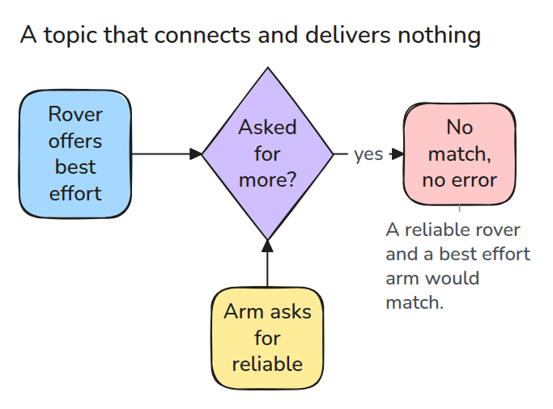
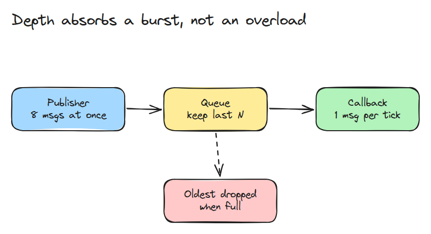
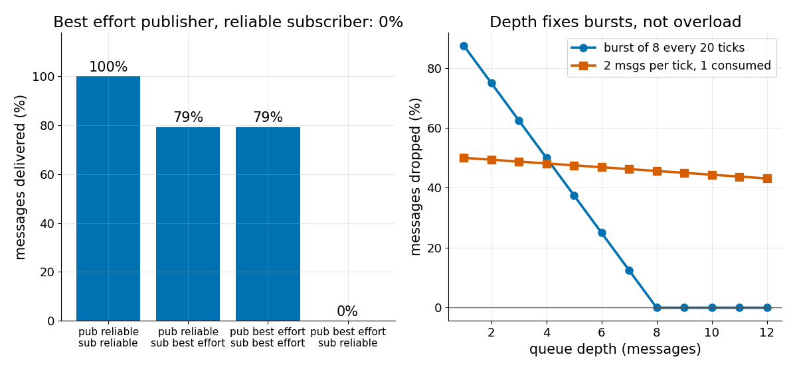

# Publish-Subscribe와 QoS 불일치

> 두 ROS 프로그램이 둘 다 잘 돌아가는데도 메시지를 전혀 주고받지 못하는 이유를 배웁니다.

**유형:** 만들기   **선수 지식:** 00/10 한 페이지로 보는 ROS 2   **시간:** 약 15분

## 쉽게 말하면

로버가 메시지로 자기 위치를 로봇 팔에 알려 줘요. 연결하기 전에 양쪽은 각자 전달 약속을 밝혀요. 이 약속을 QoS(quality of service)라고 불러요.

로버는 보내 보겠다고만 약속하는데 팔은 반드시 전달되는 방식만 받겠다고 해요. 그러면 둘은 연결되지 않고 아무도 불평하지 않으며 팔은 가만히 있어요.

## 핵심 용어

- **Node**: 로봇 소프트웨어 틀인 ROS 2에서 실행 중인 프로그램입니다.
- **Topic**: node들이 메시지를 보내고 받는 이름 붙은 통로입니다.
- **Publisher / Subscriber**: topic에서 보내는 쪽과 듣는 쪽입니다.
- **QoS**: quality of service로 연결하기 전에 양쪽이 밝히는 전달 약속입니다.
- **Callback**: 메시지가 도착할 때마다 그것을 처리하는 함수입니다.
- **Queue depth**: 읽지 않은 메시지가 몇 개까지 기다릴 수 있는지입니다. 넘으면 가장 오래된 것을 버립니다.

## 문제

로버가 자기 위치를 보내고 팔이 듣고 있는데 팔이 전혀 움직이지 않고 죽은 것도 없습니다. 둘이 서로 다른 전달 보장을 요구해서 ROS가 둘을 연결하지 않았기 때문입니다.

## 개념

로봇은 메시지를 주고받는 여러 프로그램이고 이 조용한 불일치는 죽은 센서와 똑같아 보입니다.



*로버는 best effort를 제공하고 팔은 reliable을 요구하므로 맞지 않습니다.*

양쪽은 각자 전달 약속을 밝힙니다. best effort는 한 번 보내고 넘어가고 reliable은 잃어버린 메시지를 다시 보냅니다. 듣는 쪽이 보내는 쪽의 제공보다 더 많이 요구하지 않을 때만 연결됩니다.
reliable 보내는 쪽에 best effort 듣는 쪽은 괜찮고 반대는 안 됩니다.



*keep-last queue는 최신 몇 개를 담고 가장 오래된 것을 버립니다.*

느린 듣는 쪽은 queue가 충분히 깊지 않으면 메시지를 잃습니다.


*같은 묶음입니다. 파랑은 칸이 하나여서 대부분의 메시지가 떨어집니다. 초록은 칸이 충분해서 팔이 모두 따라갑니다.*



*왼쪽은 불일치한 쌍이 아무것도 전달하지 못하는 모습입니다. 오른쪽은 묶음만큼 깊은 queue가 필요하고 계속되는 과부하는 depth와 상관없이 메시지를 버리는 모습입니다.*

<details><summary>The math (optional)</summary>

다른 QoS 설정으로 durability가 있습니다. volatile은 늦게 온 듣는 쪽에게 아무것도 주지 않고 transient local은 지난 메시지를 줍니다. 로버가 메시지 8개를 한꺼번에 보내고 팔이 tick(시뮬레이션 한 스텝)마다 하나씩 처리한다고 합시다.
depth 1이면 `run()`은 1개를 전달하고 7개를 버립니다. depth 8이면 8개를 모두 전달합니다. 그림에서 불일치한 쌍은 0%를 전달하고 계속되는 과부하는 depth와 상관없이 메시지의 절반을 버립니다.

</details>

## 만들기

```python
def compatible(pub, sub):
    if pub.reliability == "best_effort" and sub.reliability == "reliable":
        return False, "reliability: ..."
    if pub.durability == "volatile" and sub.durability == "transient_local":
        return False, "durability: ..."
    return True, "ok"
```

`Queue.push()`는 `depth`를 넘으면 가장 오래된 것을 빼며 버린 수를 셉니다.

```bash
cd robotics-engineering-from-scratch
python3 -m pytest phases/05-robot-software/01-publish-subscribe-and-qos-mismatch -q
```

## 실제 도구로 보기

`compatible()`을 ROS 2 QoS 문서의 표와 비교해 보세요.

출처: ROS 2 Jazzy, "Quality of Service settings" (https://docs.ros.org/en/jazzy/Concepts/Intermediate/About-Quality-of-Service-Settings.html), 2026년 11월 9일 확인.

## 결과물

`outputs/skill-qos-mismatch-check.md`는 조용한 topic을 profile, 호환성, queue 점검 순서로 따라가며 확인합니다.

## 연습 문제

1. 보내는 쪽이나 듣는 쪽의 설정을 바꾸고 언제 연결되는지 보세요.
2. queue를 더 깊게 하고 버리는 수가 어떻게 변하는지 보세요.
3. 늦게 온 듣는 쪽이 지난 메시지를 받게 해 보세요.
