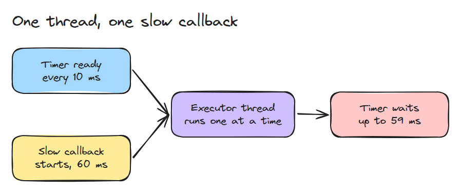
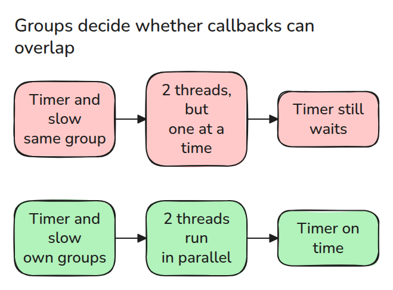
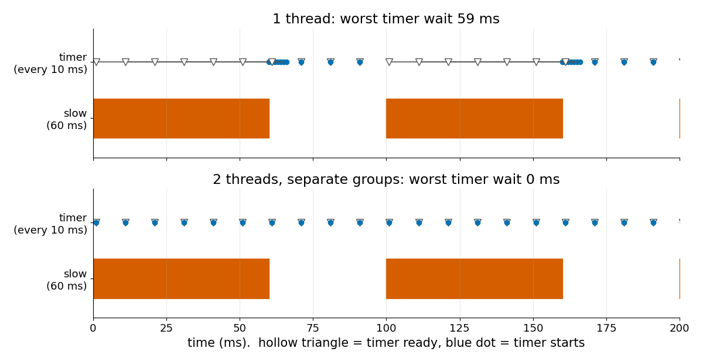

# Executors and Callbacks

> Learn why one slow task can freeze a robot's other tasks even when the processor is idle.

**Type:** Build   **Prerequisites:** none   **Time:** ~15 minutes

## In Plain Words

A toy car drives only while a timer keeps ticking (its heartbeat). If a tick is late, a watchdog stops the car. The car's program has one thread, a worker that does one job at a time, so a long image job makes the heartbeat wait.

## Key Terms

- **Callback**: a function ROS 2 runs when a message arrives or a timer fires.
- **Thread**: one worker inside a program, doing one job at a time.
- **Executor**: the part of ROS 2 that decides which ready callback runs next, and on which thread.
- **Callback group**: a set of callbacks with one shared rule about running together, such as never at the same time.
- **Starvation**: a callback waits too long because another one holds the thread.
- **Watchdog**: a guard that stops the robot when a heartbeat is late.

## The Problem

A toy car stops suddenly. Its heartbeat stutters while another callback does a long stretch of image work, so the watchdog stops it though the processor is mostly idle.

## The Concept

A robot runs many callbacks at once, and one slow callback can starve the safety-critical ones.



*The timer waits for the whole slow callback.*

An executor decides which ready callback runs next and on which thread. A group set to "never together" (mutually exclusive) never runs two of its callbacks at once, which protects data they share. Callbacks in different groups may run in parallel.



*A second thread helps only if the groups let the two callbacks run together.*

Use a second thread and groups that allow the two callbacks to run together.

[](../assets/clip-example.mp4)

*Each roof lamp is a thread. Blue shares one group, so its second lamp stays dark and the car stops. Green never stops.*



*With one thread the timer starts very late. With two threads and separate groups it never starts late.*

<details><summary>The math (optional)</summary>

The timer sends a heartbeat 100 times a second and the subscription callback does 60 ms of image work. The slow callback starts at 0 ms and holds its thread for 60 ms. The timer is ready at 1 ms, so with one thread, or two threads and one group, it waits 59 ms. In separate groups it starts at once. The model is first come, first served, but ROS 2 takes ready work in turns, so read its "Scheduling semantics" before comparing numbers.

</details>

## Build It

```python
busy = {g for _, g in running}
job = next((j for j in pending if j[3] not in busy), None)
```

`simulate()` moves time forward 1 ms at a time. Each free thread takes the oldest waiting callback whose group is not busy.

```bash
cd robotics-engineering-from-scratch
python3 -m pytest phases/05-robot-software/02-executors-and-callbacks -q
python3 phases/05-robot-software/02-executors-and-callbacks/code/main.py
```

## Use It

Callbacks without a group share one default group, so give the slow callback its own before adding threads.

Sources: ROS 2 Jazzy, "Executors" (https://docs.ros.org/en/jazzy/Concepts/Intermediate/About-Executors.html), read 2026-11-09.

## Ship It

`outputs/skill-executor-starvation-check.md` finds the callback that starves the others and names the fix.

## Exercises

1. Put both callbacks in one group, then in two groups, and watch the timer.
2. Drop missed timer ticks instead of queueing them.
3. Split the slow callback into six 10 ms chunks and watch the timer.
